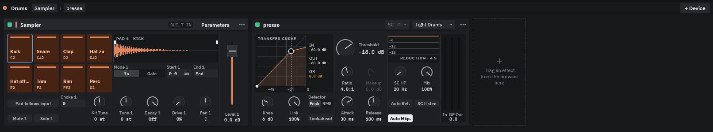
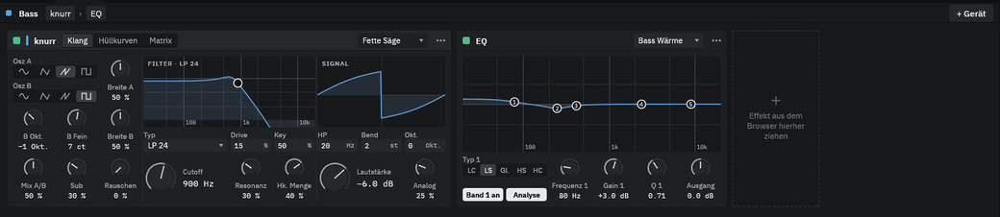
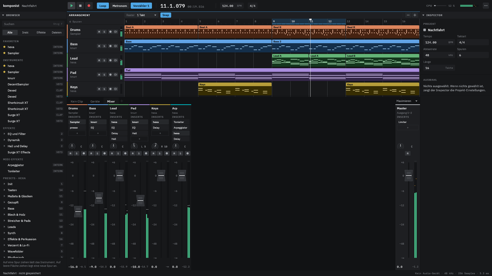

<p align="center">
  <picture>
    <source media="(prefers-color-scheme: dark)" srcset="assets/logo/06-spurmarke/logo.svg">
    <source media="(prefers-color-scheme: light)" srcset="assets/logo/06-spurmarke/logo-on-light.svg">
    
  </picture>
</p>

<p align="center"><b>A MIDI DAW for Linux, macOS and Windows. Fast, small, and made for writing music.</b></p>

<p align="center">
  <a href="https://github.com/klang-studio/komponist/actions/workflows/ci.yml"></a>
  <a href="LICENSE"></a>
  
  
  
</p>


komponist is a MIDI DAW written in Rust with [egui](https://github.com/emilk/egui). You arrange clips, edit notes and
steps, shape sounds with built-in instruments and effects, host CLAP and VST3 plugins, and mix it all on the same
screen. Everything above is the demo project that ships with the app (`komponist --demo`). The interface is available in
English and German; it follows your desktop language, and Settings › Appearance (or `--lang de|en`) switches it.

## Features

### Arrangement, piano roll, step sequencer

Arrange MIDI, step and linked audio clips on tracks, with a snapping grid, loop range, split, duplicate, and a full undo history.
Open a clip in the dock below to edit it. Audio tracks stream WAV, AIFF, FLAC, MP3 and OGG files with sample-rate conversion, Re-Pitch, clip gain and linear fades. Import linked files with Ctrl+I; Ctrl+Shift+T opens the audio-track dialog.


The piano roll has pointer, pencil and eraser tools, a velocity lane, quantize and transpose. Draw, drag, done:


The step sequencer is made for drums and Sampler kits. Toggle steps while the pattern plays:


### Built-in instruments

No plugins needed to make a sound.

**Hexa** is a six-operator FM synth with envelopes, LFOs and a large preset library. Here with an EQ and a Delay behind
it:


**Volt** is a subtractive synth with two oscillators, a filter and a sub oscillator. Here on the bass, with an EQ and a Presse keyed by the drums:


The **Sampler** is a pad sampler with layers, envelopes, filters and slicing. The demo kit is synthesized, so it needs
no sample files. Next to it, the Presse compressor:



### Built-in effects

**EQ**, **Delay**, **Reverb**, **Presse** (compressor with sidechain) and **Limiter**, plus the MIDI effects
**Arpeggiator** and **Scale**. The EQ shows the live spectrum of the signal it processes:


Add a device from the search menu in the dock, or drag it from the browser onto a track:


### Sidechains

Key Presse from another track's signal: choose the source in the **SC** chip of the device. Here, Presse on the bass is
keyed by the drums:



### CLAP and VST3 plugins

komponist hosts **CLAP** and **VST3** plugins. Every plugin runs in a bridge process of its own, so a crashing plugin
does not take your project down with it. Plugin windows open as native windows: X11 on Linux, a window of the plugin's
bridge on macOS and Windows.

### Mixer, routing, recording

- Record MIDI from any connected MIDI input (or the computer keyboard) into a take.
- Route tracks into **groups** (Ctrl+G) and **effect buses** with pre/post-fader sends; sidechain Presse, or a CLAP or
  VST3 plugin with a sidechain input, from any track or bus.
- Every edit is undoable, including parameter changes.
- The transport bar shows the master output as an oscilloscope or a spectrum; a click switches between them.

The mixer shows every track with its inserts, sends, pan, mute/solo, faders and level meters. The group (named Rhythm in the demo) and the effect bus (named Reverb) have strips of their own on the right, next to the master channel:



## Status

komponist is **early software (v0.2)**. The MIDI workflow works end to end: arrange, edit, play, record, mix, save,
export. Expect rough edges and file-format changes.

What works: MIDI and step clips, piano roll, step sequencer, Hexa / Volt / Sampler, the built-in effects, sidechains
(also into CLAP and VST3 plugins with a sidechain input), CLAP and VST3 hosting, mixer with groups, buses and sends, recording, undo and redo, project files, export.

What is coming: **audio tracks**, automation.

## Install

Every [release](https://github.com/klang-studio/komponist/releases) has a Linux x86_64 archive (built on Ubuntu 24.04):
unpack it, run `./komponist --demo`, and `scripts/install-desktop.sh` adds the menu entry and icon. On macOS 14.4 or newer
(Apple Silicon) take the `macos-arm64.zip`, move `komponist.app` to `/Applications` and allow it once in System Settings →
Privacy & Security (the app is ad-hoc signed for now, see [docs/INSTALL.md](docs/INSTALL.md#macos)). On Windows 11
(x86_64; since v0.3.0-alpha2) take the `windows-x86_64.zip`, unpack it and run `komponist.exe`; the first start needs
"More info → Run anyway" in SmartScreen (the exe is not code-signed yet, see
[docs/INSTALL.md](docs/INSTALL.md#windows)). Or build from source,
see [docs/INSTALL.md](docs/INSTALL.md) for the details (executable, icon, desktop entry, working on klang-dsp together
with komponist).

```bash
git clone https://github.com/klang-studio/komponist
cd komponist
cargo build --release -p komponist-app --bin komponist
target/release/komponist --demo
```

You need the Rust toolchain from [`rust-toolchain.toml`](rust-toolchain.toml) (`rustup` picks it up) and the system
development packages behind the audio and window crates. On Debian or Ubuntu these are typically:

```bash
sudo apt install build-essential pkg-config clang libasound2-dev libjack-jackd2-dev libpipewire-0.3-dev \
    libdbus-1-dev libfontconfig1-dev libxkbcommon-dev libx11-dev libwayland-dev
```

At runtime you also need a Vulkan driver (wgpu renders with Vulkan) and an X11 or XWayland session. Package names
differ on other distributions. `komponist --help` lists the options (`--demo`, `--null-audio`, `--lang de|en`, `--scale`).

## Contributing

Issues and pull requests are welcome. Before you send a change, run `scripts/check.sh`: `cargo fmt --check`, `clippy -D
warnings` and the tests. Translations are the easiest way in: add or complete `crates/komponist-i18n/locales/<lang>/*.ftl`
as described in [docs/I18N.md](docs/I18N.md). Performance notes are in [docs/PERFORMANCE.md](docs/PERFORMANCE.md).

### Regenerating the screenshots

The pictures in this README come from the demo project and are produced by a script, so they follow the UI:

```bash
scripts/readme-media.sh            # everything into docs/media/
scripts/readme-media.sh hero mixer # only these scenarios
```

It runs komponist in English (`--lang en`) under a private Xvfb with `--null-audio` (no audio or MIDI hardware, no
sound) and drives the UI through its accessibility tree. It needs `xvfb-run`, `ffmpeg`, ImageMagick, Python 3 and `egui-mcp`.

## Architecture

A Rust workspace: model and undo, a realtime engine, built-in devices, plugin hosting and bridges, and the egui app.
[docs/ARCHITECTURE.md](docs/ARCHITECTURE.md) describes the design and the decisions behind it.

## License

komponist is licensed under the **GNU General Public License, version 3 or (at your option) any later version**, see
[LICENSE](LICENSE).

- `crates/hexa-core` (Hexa's FM engine) is a copy of the `hexa-core` crate of pisynth, and `crates/sampler-core`
  (the Sampler engine) is a copy of the `dsp` crate of klopfer. Both authors license the copies under
  GPL-3.0-or-later; the crates' READMEs record the provenance. The projects continue separately.
- The DSP library [klang-dsp](https://github.com/klang-studio/klang-dsp) is a git dependency.
- The UI uses **IBM Plex Sans** and **IBM Plex Mono** (© IBM Corp.), unmodified, under the
  [SIL Open Font License 1.1](assets/fonts/OFL.txt). See [assets/fonts/README.md](assets/fonts/README.md).
