<p align="center">
  <picture>
    <source media="(prefers-color-scheme: dark)" srcset="assets/logo/06-spurmarke/logo.svg">
    <source media="(prefers-color-scheme: light)" srcset="assets/logo/06-spurmarke/logo-on-light.svg">
    
  </picture>
</p>

<p align="center"><b>An audio and MIDI DAW for Linux, macOS and Windows. Fast, small, and made for writing music.</b></p>

<p align="center">
  <a href="https://github.com/klang-studio/komponist/actions/workflows/ci.yml"></a>
  <a href="LICENSE"></a>
  
  
  
</p>

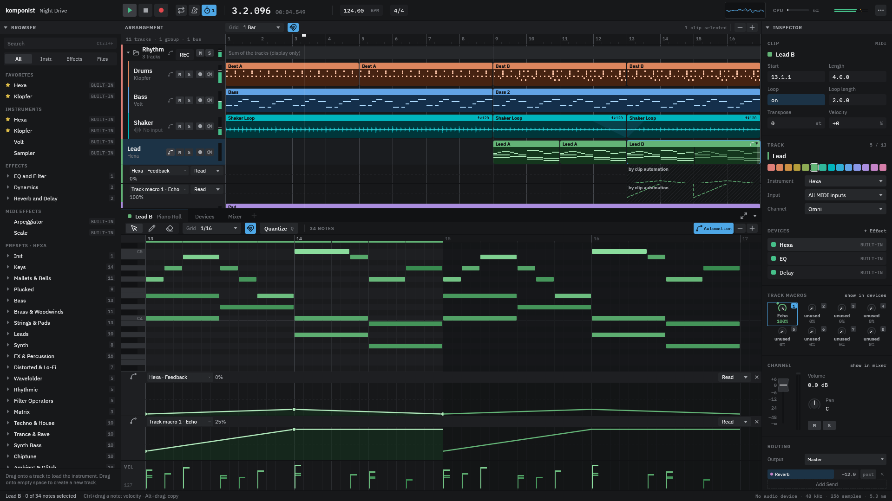

komponist is an audio and MIDI DAW written in Rust with [egui](https://github.com/emilk/egui). You arrange audio and MIDI
clips, edit waveforms, notes and steps, record inputs and buses, shape sounds with built-in instruments and effects,
host CLAP and VST3 plugins, automate parameters, and mix on the same screen. Open the Night Drive demo shown here
with `komponist --demo`. The interface follows your desktop language. Switch between English and German in
Settings › Appearance or with `--lang de|en`.

## Features

### Arrangement, piano roll, step sequencer

Arrange MIDI, step and linked audio clips on tracks, with a snapping grid, split, duplicate, and a full undo history.
Open a clip in the dock below to edit it. The demo includes a mono Shaker loop and a stereo Sweep alongside the instruments.


The piano roll has pointer, pencil and eraser tools, a velocity lane, quantize and transpose. Draw, drag, done:


The step sequencer is made for drums and Klopfer kits. Toggle steps while the pattern plays:

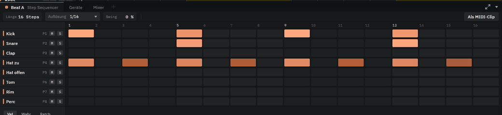

### Automation and track macros

Use **Show Automation** and **Add Automation Lane** in the track menu to edit mixer or device parameters over time.
The master has automation lanes too, and individual clips can carry their own envelopes in the clip editor.
Double-click a lane to add a point. **Read** plays back the curve, **Touch** writes while you hold the control,
and **Latch** keeps writing after you release it until playback stops.

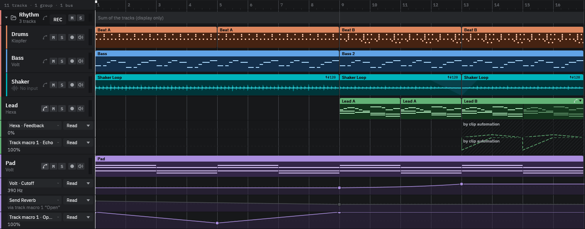

Each track can have up to eight **Track Macros**. Choose **Map** and move the parameters you want a macro to control,
then set each mapping's range in the inspector. Automate the macro from a lane or a clip envelope. In the demo,
the Pad track's **Open** macro controls its send to the Reverb bus.

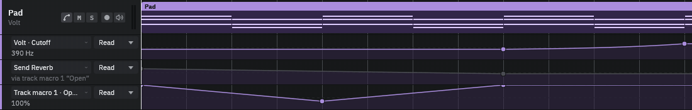

### Audio tracks and clip editing

Import **WAV, AIFF, FLAC, MP3 and OGG** files with **Ctrl+I**, or drag an audio file from the browser into the
arrangement. **Ctrl+Shift+T** opens the audio-track dialog. Files stay linked to their sources; **Collect and Save**
copies supported audio sources into the project folder for moving or sharing a session.

The waveform editor shows mono and stereo sources. Trim clips, change their source start, adjust clip gain and linear
fades, and choose **Warp** to follow the project tempo while preserving pitch. **Fixed** is the default.
**Re-Pitch** follows tempo with a pitch change. Enter the original BPM or set a known bar count for the
**entire source file**. The duration factor and linked song/source rulers show the playback mapping. Edits leave
the source intact. Missing files can be relinked with **Replace File…**.

Use **File actions › Detect Tempo** to estimate the active source’s original tempo. The menu shows the estimate
and its confidence and lets you apply it at the suggested, half or double rate.

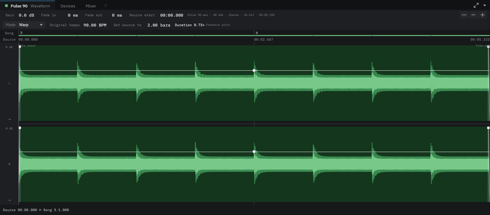

### Audio recording and takes

Choose a hardware input or a bus, arm an audio track and press **R** to record. Inputs can be mono or stereo, with
**Off**, **Auto (When Armed)** and **On** monitoring. Settings › Audio selects the input device and recording format:
**24-bit WAV** or **32-bit Float WAV**.

The audio track inspector shows the input meter. Use **Input gain** to adjust hardware input levels. On Linux with JACK, use
Settings › Audio to assign capture ports and the left and right master outputs.

The arrangement and waveform dock show the recording as it grows. **Record Bus** creates an audio track fed by a
group or effect bus. Here, the demo's Rhythm group feeds the recording track.

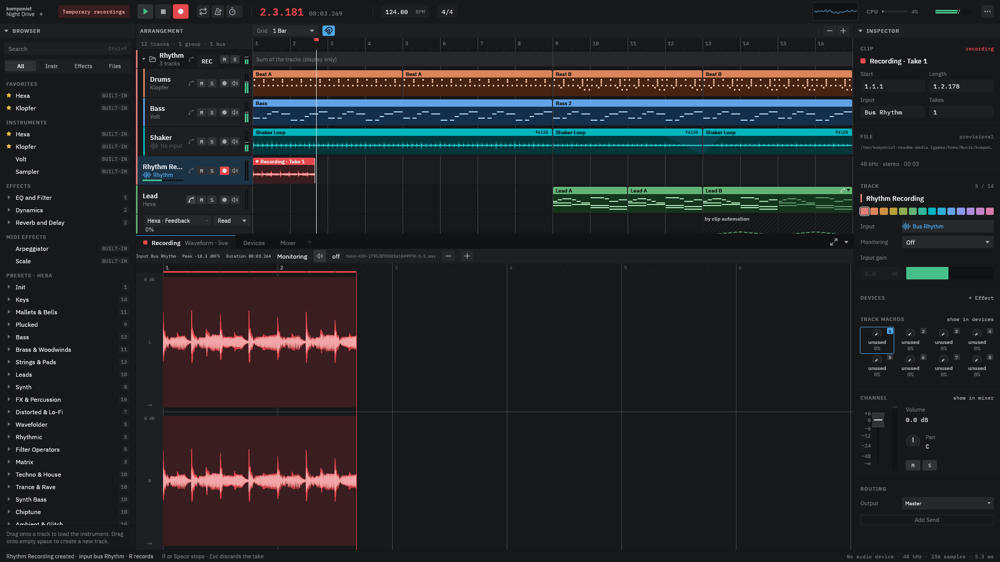

Loop passes become takes in the same clip. Choose, rename or remove takes in the inspector. Recordings made before
the project is saved stay in a temporary folder and move into the project when you save.

### Built-in instruments

No plugins needed to make a sound.

**Hexa** is a six-operator FM synth with envelopes, LFOs and a large preset library. Here with an EQ and a Delay behind
it:


**Volt** is a subtractive synth with two oscillators, a filter and a sub oscillator. Here on the bass, with an EQ and a Presse keyed by the drums:


**Klopfer** is the built-in drum sampler. The demo kit is synthesized, so it needs
no sample files. Next to it, the Presse compressor:


The **Sampler** plays pitched phrases and MIDI-triggered slices. In the demo, **Glass Pluck** plays a
pitched melody from one sample with tempo sync enabled. Set the playback range, fades and root note in the **Sample**
view, or use reverse playback, envelopes and modulation to shape the sound.

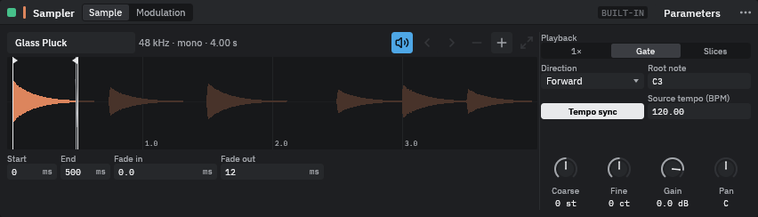

**Glass Slices** uses the same audio file with a different MIDI note for each slice. Add markers in the waveform
and play the slices from MIDI notes.

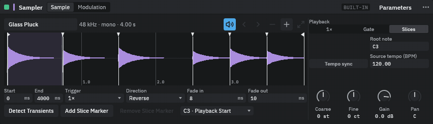

### Built-in effects

**EQ**, **Delay**, **Reverb**, **Presse** (compressor with sidechain) and **Limiter**, plus the MIDI effects
**Arpeggiator** and **Scale**. The EQ shows the live spectrum of the signal it processes:

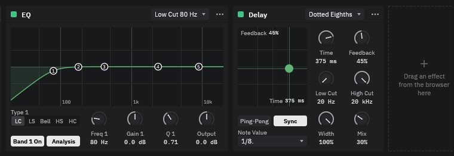

Add a device from the search menu in the dock, or drag it from the browser onto a track:


### Sidechains

Key Presse from another track's signal: choose the source in the **SC** chip of the device. Here, Presse on the bass is
keyed by the drums:


### CLAP and VST3 plugins

komponist hosts **CLAP** and **VST3** plugins. Every plugin runs in a bridge process of its own, so a crashing plugin
does not take your project down with it. Plugin windows open as native windows: X11 on Linux, a window of the plugin's
bridge on macOS and Windows.

### Mixer, routing and MIDI recording

- Record MIDI from any connected MIDI input (or the computer keyboard) into a take.
- Route tracks into **groups** (Ctrl+G) and **effect buses** with pre/post-fader sends; sidechain Presse, or a CLAP or
  VST3 plugin with a sidechain input, from any track or bus.
- Every edit is undoable, including parameter changes.
- The transport bar shows the master output as an oscilloscope or a spectrum; a click switches between them.

The mixer shows every track with its inserts, sends, pan, mute/solo, faders and level meters. The group (named Rhythm in the demo) and the effect bus (named Reverb) have strips of their own on the right, next to the master channel:

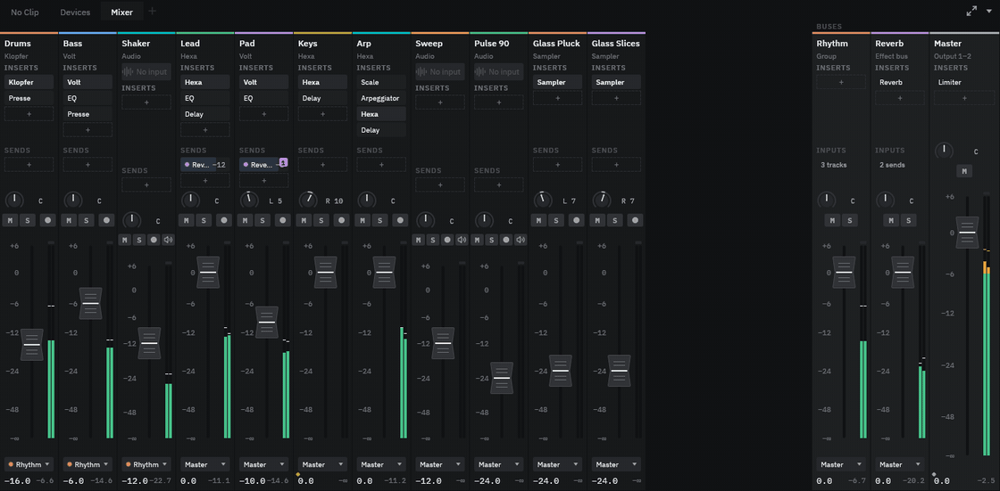

### Render tracks and export WAV

Choose **Flatten to Audio** in a MIDI track's context menu to render the track and its device chain to an audio
clip. **Undo** restores the MIDI clips and devices.

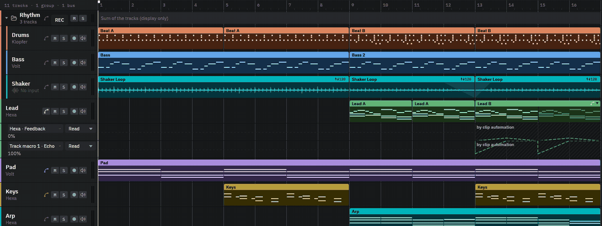

Choose **Export WAV…** from the application menu to export the mix. Choose the whole song, the active loop or the current selection,
then set the sample rate and bit depth (16-bit, 24-bit or 32-bit float). Add a tail for reverb and delay.

## Status

komponist is **early software**. The Night Drive demo includes automation, track macros and both Sampler workflows
shown above.

## Install

Download the archive for your platform from the [releases page](https://github.com/klang-studio/komponist/releases).
The Linux x86_64 archive is built on Ubuntu 24.04. Unpack it and run `./komponist --demo`. Use
`scripts/install-desktop.sh` to add the menu entry and icon. On macOS 14.4 or newer (Apple Silicon), unpack
`macos-arm64.zip`, move `komponist.app` to `/Applications` and allow it once in System Settings →
Privacy & Security. The app is ad-hoc signed. See [docs/INSTALL.md](docs/INSTALL.md#macos). On Windows 11 (x86_64),
unpack `windows-x86_64.zip` and run `komponist.exe`. The executable is unsigned. On first launch, choose
"More info → Run anyway" in SmartScreen. See [docs/INSTALL.md](docs/INSTALL.md#windows). To build from source,
see [docs/INSTALL.md](docs/INSTALL.md) for the details (executable, icon, desktop entry, working on klang-dsp together
with komponist).

```bash
git clone https://github.com/klang-studio/komponist
cd komponist
cargo build --release -p komponist-app --bin komponist
target/release/komponist --demo
```

You need the Rust toolchain from [`rust-toolchain.toml`](rust-toolchain.toml) (`rustup` picks it up) and the system
development packages behind the audio and window crates. On Debian or Ubuntu these are typically:

```bash
sudo apt install build-essential pkg-config clang libasound2-dev libjack-jackd2-dev libpipewire-0.3-dev \
    libdbus-1-dev libfontconfig1-dev libxkbcommon-dev libx11-dev libwayland-dev
```

At runtime you also need a Vulkan driver (wgpu renders with Vulkan) and an X11 or XWayland session. Package names
differ on other distributions. `komponist --help` lists the options (`--demo`, `--null-audio`, `--lang de|en`, `--scale`).

## Contributing

Issues and pull requests are welcome. Build the test plugins once with `scripts/build-test-plugins.sh`, then run
`scripts/check.sh` before you send a change. The gate requires all fixture bundles (`KOMPONIST_REQUIRE_FIXTURES=1`): `cargo fmt --check`, `clippy -D
warnings` and the tests. Translations are the easiest way in: add or complete `crates/komponist-i18n/locales/<lang>/*.ftl`
as described in [docs/I18N.md](docs/I18N.md). Performance notes are in [docs/PERFORMANCE.md](docs/PERFORMANCE.md).

### Regenerating the screenshots

The pictures in this README come from the demo project and are produced by a script, so they follow the UI:

```bash
scripts/readme-media.sh            # everything into docs/media/
scripts/readme-media.sh hero mixer # only these scenarios
scripts/readme-media.sh audio_editor audio_recording # waveform editor and live recording
scripts/readme-media.sh automation sampler flatten_to_audio # screenshots and GIFs
```

It runs komponist in English (`--lang en`) under a private Xvfb with `--null-audio` (no audio or MIDI hardware, no
sound) and drives the UI through its accessibility tree. The recording scenario captures the Rhythm bus with the
loop and count-in switched off. It needs `xvfb-run`, `ffmpeg`, ImageMagick, Python 3 and `egui-mcp`.
If Vulkan cannot present through your local Xvfb, use `WGPU_BACKEND=gl scripts/readme-media.sh`.

## Architecture

A Rust workspace: model and undo, a realtime engine, built-in devices, plugin hosting and bridges, and the egui app.
[docs/ARCHITECTURE.md](docs/ARCHITECTURE.md) describes the design and the decisions behind it.

## License

komponist is licensed under the **GNU General Public License, version 3 or (at your option) any later version**, see
[LICENSE](LICENSE).

- `crates/builtin-devices/hexa/core` (Hexa's FM engine) is a copy of the `hexa-core` crate of pisynth, and `crates/builtin-devices/sampler/core`
  (the Sampler engine) is a copy of the `dsp` crate of klopfer. Both authors license the copies under
  GPL-3.0-or-later; the crates' READMEs record the provenance. The projects continue separately.
- The DSP library [klang-dsp](https://github.com/klang-studio/klang-dsp) is a git dependency.
- The UI uses **IBM Plex Sans** and **IBM Plex Mono** (© IBM Corp.), unmodified, under the
  [SIL Open Font License 1.1](assets/fonts/OFL.txt). See [assets/fonts/README.md](assets/fonts/README.md).
