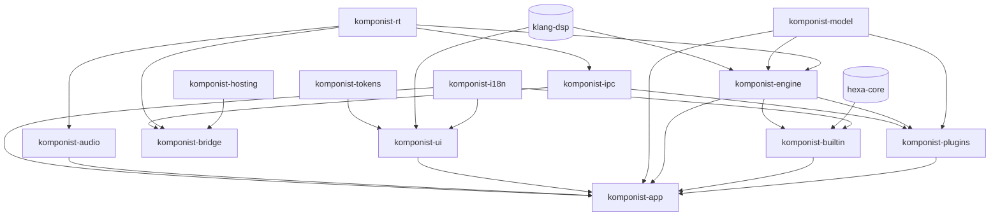

# komponist – Software Architecture v0.1

Status: **proposal, waiting for approval** (stack decision, gate G0 in `PLAN.md`).
Date: 2026-11-13. Inputs: `../klang-studio-handoff/` (design v0.1 "Graphit"),
`../daw-design-briefing.md`, klang-dsp, pisynth (origin of Hexa), klopfer (origin of the Sampler engine).

This document fixes the structure that the work packages in `PLAN.md` build on.
Anything marked **Decision** needs the owner's approval before code is written.

**Naming:** the DAW is called **komponist**. *klang-studio* is the umbrella name for all projects in
the workspace (the parent folder of this repo: komponist, pisynth, klopfer, klang-dsp). The design
handoff still says "klang-studio" where it means the DAW. In the UI, read it as "komponist" (§13.6).

---

## 1. Requirements that shape the architecture

From `HANDOFF.md` §3 and the screens:

| # | Requirement | Consequence |
|---|---|---|
| R1 | Linux first; PipeWire, JACK and ALSA; buffer size changes without restarting the engine (S07) | Audio I/O layer separate from the engine. The engine survives a stream rebuild. |
| R2 | Host CLAP and VST3 plugins, including their GUIs in a native window with a komponist frame (S05) | Native windows with X11 window IDs. Plugin GUI embedding through a parent window. |
| R3 | A plugin crash must not stop the track (S05 "abgestürzt → Neu laden") | **Plugins run out of process.** In-process hosting cannot survive a segfault. |
| R4 | The realtime audio thread is separate from the UI | No locks, allocation or blocking syscalls on the audio thread. Lock-free queues. |
| R5 | Pixel-exact custom UI, 1×/2× scaling, 1 px lines, 60 fps with thousands of notes | GPU-drawn custom widgets, our own hit testing for canvases, culling and level of detail. |
| R6 | Built-in instruments Hexa (6-op FM) and klopfer (drum sampler) | Hexa (the built-in FM synth, derived from the pisynth hardware synth) runs in process as `hexa-core`. klopfer is already a CLAP plugin. |
| R7 | Tokens are never hard-coded; `tokens.json` is the single source of truth | Code generation from `tokens.json` at build time. |
| R8 | Keyboard first; every frequent action has a shortcut | Central action and keymap layer, independent of widgets. |
| R9 | Later: audio tracks, automation, buses/sends, CC lanes | Extension points in the model, the engine events and the program, without building them now. |

---

## 2. Stack options

### 2.1 Option A – egui on wgpu, cpal, own plugin bridges (**recommended**)

| Layer | Choice | Why |
|---|---|---|
| UI | **egui + eframe 0.37** (wgpu renderer, features `inspection` and `accesskit`). X11 is forced through `NativeOptions::event_loop_builder` (`with_x11()`), so it runs under XWayland on Wayland desktops. | The briefing assumes egui, and klopfer already uses egui 0.36 (known patterns). An immediate-mode `Painter` suits timeline and piano roll. eframe brings for free: event loop, extra native windows as viewports (plugin frames), AccessKit, screenshots, clipboard/IME, file drops and live inspection for agents (`EGUI_INSPECTION=1`, §11.1). Native handles stay reachable (`Frame::winit_window()`, `HasWindowHandle`). Our own integration on `egui-winit` + `egui-wgpu` is only the fallback if spike WP-15 shows that eframe cannot give us the X11 ID of a plugin frame viewport. `egui_kittest` provides headless snapshot and interaction tests. |
| Audio I/O | **cpal 0.18** with the `pipewire`, `jack` and ALSA hosts. MIDI in through **midir 0.11** (ALSA seq, optionally JACK). | One API for all three drivers in S07. pisynth and klopfer already use cpal 0.18. A buffer change rebuilds only the stream. |
| Hosting core (inside the bridge) | **Own layer** on **clack-host 0.2** (CLAP) + **vst3 0.3** (VST3), behind the `HostedPlugin` trait. Decided after spike WP-15 (§2.4). | The spike embedded Klopfer, Surge XT, Dexed, Shortcircuit XT and DecentSampler through both crates from a bridge process. truce-rack failed on Linux. |
| Isolation | **One bridge process per plugin instance** (`komponist-bridge`). Audio via shared memory and futex, control via a Unix socket. | Meets R3. No Rust library provides this on Linux (§2.4). Gives parallelism across cores for free. klopfer's egui/baseview dependency stack never meets ours. |
| Test plugins | **nice-plug** 0.4 (crates.io; the klang-studio fork only if a fix is needed) | One source exports CLAP **and** VST3, so both hosting paths get the same fixtures without the C++ SDK. Known from klopfer. |
| RT plumbing | `rtrb` (SPSC), `rustix` (futex, memfd, pidfd), `assert_no_alloc` in tests and debug builds | Proven, small. |
| Serialization | `serde` + `serde_json` (project, settings), `postcard` (IPC control messages) | Readable project files, compact IPC. |
| WAV | `hound` | Already used in pisynth and klopfer. |

### 2.2 Option B – own wgpu renderer instead of egui

A rect and line batcher with a glyph atlas (cosmic-text/swash), plus our own immediate-mode layer.
**Pro:** full control over pixels and OpenType features (`tnum`). **Contra:** text input, IME, focus,
scrolling, menus and tests all become our own work. Roughly 2–3× the UI effort before the first screen.
Only worth it if egui fails gate G2 (gallery review).

### 2.3 Option C – iced (or Slint)

Retained or declarative, wgpu-based. **Contra:** the dense canvases (timeline, piano roll, step grid)
end up as custom canvas widgets anyway. Multi-window plus foreign X11 child windows is less direct than
with egui on winit, and there is no existing know-how in the projects. No advantage over A.

*Rejected:* a web UI (Tauri/WebKitGTK). WebKitGTK canvas performance on Linux is weak for 60 fps
note editing, and the briefing asks for a Rust GPU UI. GTK4 is rejected because the design wants no
system widgets and pixel-exact rendering.

### 2.4 Plugin hosting libraries evaluated (2026-11-13)

| Candidate | What it is | Verdict for komponist |
|---|---|---|
| **nice-plug** 0.4 (codeberg RustAudio, successor of NIH-plug) | Framework for **writing** plugins: exports CLAP, VST3 and standalone. klopfer is built with it. It has no code that loads foreign plugins. Its README still calls it experimental. | **Cannot host.** Used for the test plugins (WP-27). Its wrappers are good reading for what plugins expect from a host. Option for later: pisynth as a nice-plug plugin, so it works in other DAWs too. |
| **truce-rack** 1.1.5 (2026-06-19, MIT/Apache) | In-process host library for CLAP and VST3 (plus AU/LV2). Pure Rust on clap-sys and vst3. `Plugin` trait with sample-accurate `EventList`, `PluginEditor` with an `X11(u64)` parent handle, versioned state envelope, scanners. | **Out (spike WP-15, spike notes `WP-15.md` (internal notes) §2):** CLAP loads 0 of 5 plugins (NULL `clap_host`), VST3 instruments stay silent, state restore fails for 4 of 5, 8–12 allocations per `process`, no IRunLoop, IPlugFrame, IComponentHandler, latency or render mode, unmaintained since June. Useful only as reference code. |
| **plughost** 0.2.5 (2026-11-13, 6 weeks old) | Host library with crash isolation: one helper process per chain, shared memory, one buffer of pipelining (the callback never waits). | **Out: no Linux support** ("Linux … not supported"). Its design confirms our approach. Its pipelining costs one buffer of latency per hop. komponist waits synchronously with a deadline instead, to keep monitoring latency low. |
| **Carla** 2.5.10 (C++, GPL) | Mature host with bridges. VST3 through JUCE. CLAP only in the unreleased main branch. | **Out:** C++ and GPL in the core, CLAP not released, little control over the realtime handshake. |
| **nexus** (GitHub poucet/nexus) | App and hosting engine on clack + vst3, not a published library. | **Reference code** for WP-26/32 if we write the core ourselves. |
| **clack-host** 0.2 + **vst3** 0.3 | Low-level, safe (CLAP) and raw COM (VST3) bindings. | **Baseline and fallback.** Always works, most effort. |

Conclusion: crash isolation, IPC, GUI frames and the format layer are our own. The format layer uses
clack-host and vst3 directly (D3, decided after spike WP-15).

### 2.5 Decisions to approve (G0)

| ID | Decision | Recommendation |
|---|---|---|
| D1 | UI toolkit | egui + eframe 0.37 (wgpu, `inspection`), X11 via `event_loop_builder`; fallback own egui-winit + egui-wgpu integration if spike WP-15 requires it |
| D2 | Audio/MIDI I/O | cpal 0.18 (pipewire/jack/alsa) + midir |
| D3 | Plugin format layer | **decided after WP-15:** own layer behind `HostedPlugin` on clack-host 0.2 (CLAP) + vst3 0.3 (VST3); CLAP first. Test plugins with nice-plug |
| D4 | Plugin isolation | out of process, one bridge per instance |
| D5 | klopfer integration | load the bundled `Klopfer.clap` through the normal bridge, shown as "INTERN". **Superseded by WP-87:** komponist has its own Sampler (internal device, `sampler-core` engine); klopfer is an ordinary scanned CLAP plugin |
| D6 | Hexa integration | in process via `hexa-core` (`alloc` + `serde` features), as a built-in `Processor` |
| D7 | Project format | one JSON file `*.komponist` with schema version; plugin states as base64 |
| D8 | Undo | immutable snapshots with `Arc` structural sharing (copy on write) |
| D9 | Musical time | `i64` ticks at 960 PPQ; display `Takt.Schlag.Tick` with 240 ticks/beat (= PPQ/4) |

---

## 3. System overview

```
┌────────────────────────── komponist (main process) ───────────────────────────┐
│                                                                                  │
│  Main/UI thread (eframe + egui)                Audio thread (cpal callback, RT)  │
│  ┌──────────────────────────┐   commands      ┌───────────────────────────────┐  │
│  │ App: Document (model +   │ ──rtrb──────▶   │ Engine                        │  │
│  │ undo), UiState, Keymap,  │                 │  transport · sequencer ·      │  │
│  │ panels, dialogs, plugin  │ ◀──rtrb──────── │  mixer · metronome · record   │  │
│  │ frame windows            │   events +      │  processors: Hexa (in-proc)│  │
│  │ EngineSync (compile)     │   garbage       │  ExternalProcessor ──┐        │  │
│  └────────────┬─────────────┘ ◀── atomics ─── │  telemetry (meters…) │        │  │
│               │                 (telemetry)   └──────────────────────┼────────┘  │
│  Worker threads: scan, load/save, export render, plugin manager      │ shm +     │
│  MIDI thread (midir) ──rtrb (timestamped)──▶ engine                  │ futex     │
└───────────────┬──────────────────────────────────────────────────────┼───────────┘
                │ Unix socket (control, postcard)                      │
        ┌───────▼──────────────────────────────────────────────────────▼────────┐
        │ komponist-bridge (one process per plugin instance)                 │
        │  RT thread: wait(futex) → plugin.process() → signal                   │
        │  main thread: poll loop (control socket, plugin fds, timers), GUI     │
        │  GUI: plugin window as X11 child of the app's frame window            │
        └───────────────────────────────────────────────────────────────────────┘
```

Threads and their rules:

| Thread | Owns | May | Must not |
|---|---|---|---|
| Main/UI | `App`, `Document`, windows | allocate, do IO, block briefly | touch engine internals except through queues and atomics |
| Audio (RT) | `Box<Engine>` | futex wait/wake on bridges (with deadline), atomics, rtrb | allocate, free, lock, log, do file or socket IO |
| MIDI | midir connection | push timestamped events into rtrb | block on the engine |
| Workers | jobs | anything non-RT | hold `Document` locks (there are none, they get snapshots) |
| Bridge RT | plugin `process` | call the plugin | anything beyond the plugin's own RT contract |
| Bridge main | plugin instance (main-thread side), GUI | poll fds and timers, socket IO | block the RT thread |

---

## 4. Workspace and crates

New repository `komponist/` (this folder), Cargo workspace, edition 2024, resolver 3 (as in pisynth).
klang-dsp is a git dependency pinned to a commit (`docs/INSTALL.md` for the local override). `crates/hexa-core` is
vendored from pisynth's `synth-core`, `crates/sampler-core` from klopfer's `dsp` crate (klopfer commit `190581c`, 2026-11-15); both are developed independently since. A plain clone builds without any sibling folder.

```
komponist/
  Cargo.toml                 workspace
  CLAUDE.md                  rules for agents (from PLAN.md §1)
  design/tokens.json         copy of the handoff tokens (single source of truth)
  assets/fonts/              IBM Plex Sans / Mono (OFL)
  assets/icons/              Lucide subset (ISC), SVG
  crates/
    komponist-tokens/           build.rs: tokens.json → Rust consts; oklch → sRGB; fonts
    komponist-i18n/             build.rs: locales/*/*.ftl → typed text catalog (`Lang`, one method per message); leaf crate
    komponist-model/            project document, time, edits, undo, serde, formatting
    komponist-engine/           RT engine, Processor trait, program compiler, offline render, export
    komponist-audio/            cpal backends, midir inputs, stream lifecycle, CPU/xrun stats
    hexa-core/                  vendored 6-op FM engine of Hexa (from pisynth)
    sampler-core/               vendored sampler engine of the Sampler (from klopfer's dsp crate)
    komponist-builtin/          Hexa adapter (Processor), internal devices; builds device, parameter and page names per `Lang` from the catalog
    komponist-ipc/              shared memory, futex signalling, SPSC rings, control protocol
    komponist-audiofile/        audio files: seekable chunked decoding (hound, symphonia), sample-rate conversion (rubato), waveform peak cache, the file pool; leaf crate, no studio dependency
    komponist-stretch/          worker-only Signalsmith Default chunks, priming/reset and latency (#14 WP-B/D)
    komponist-rt/               realtime thread set-up: SCHED_FIFO, time-constraint policy, audio workgroups, os_sync waits (macOS); depends on libc only
    komponist-hosting/          CLAP (clack-host) and VST3 (vst3) hosting, scanning
    komponist-bridge/           lib `run()` (instance mode, scan mode) + bin `komponist-bridge`; `komponist --bridge` calls it
    komponist-plugins/          app side: catalog, scan cache, bridge lifecycle, ExternalProcessor
    komponist-ui/               design system on egui: theme, widgets, paint fns, bin `komponist-gallery`
    komponist-app/              bin `komponist`: shell, views, dialogs, actions, keymap
  test-plugins/              own Cargo workspace: nice-plug test plugins (CLAP + VST3 each): synth, fx, crash, slow
  scripts/                   check.sh, build-klopfer.sh
```



Rules: `komponist-model` has no dependency on any other studio crate (it writes no language of its own: default names and value words are passed in, see `docs/I18N.md` §8). `komponist-engine` knows no UI,
no IPC and no plugin format. Only `komponist-bridge` links plugin formats. Only `komponist-app` knows egui
*and* the engine.

### 4.1 Platform cfgs

komponist runs on Linux and macOS (a Windows port is planned, see the work packages W1–W9 in the internal notes).
A `cfg` says what the code is about, never "everything but the other OS": a negative OS condition
(`not(target_os = …)`) is only used for a fallback that is meaningful on every other OS (for example "no audio
workgroup", `komponist-rt`, `komponist-audio`). Two semantic cfgs, set by a small `build.rs` in each crate that needs
them (`komponist-app`, `komponist-bridge`, `komponist-hosting`; `cargo::rustc-check-cfg` declares both, so
`unexpected_cfgs` stays clean on every target):

| cfg | Set on | Meaning |
|---|---|---|
| `x11_embed` | Linux | The app owns the plugin frame window and the plugin attaches to an X11 child of it (`GuiTarget::X11Child`, `GuiParent::X11`, CLAP `x11`, VST3 `kPlatformTypeX11EmbedWindowID`); X11 key grabs (WP-50). |
| `bridge_frame` | macOS, Windows | The bridge owns the plugin frame window (`GuiTarget::OwnFrame`, `komponist-bridge/src/frame`; #52, port W6): header model and actions, `RaiseFrame`, activation hand-over. |

Plain `target_os = "linux"` / `"macos"` stays where the code is about one OS's API: futex, memfd, pidfd, eventfd,
`prctl`, `SCHED_FIFO`, `/proc` (Linux); AppKit, CoreFoundation, mach, kqueue, `os_sync`, `shm_open` (macOS). The
frame code of the bridge and the activation hand-over of the app are `bridge_frame` code with the OS calls in one
module per OS: `frame/mod.rs` and `frame/keys.rs` are the shared frame logic, `frame/appkit.rs` (macOS) and
`frame/win32.rs` (Windows, W6) the OS halves; in the app `activation.rs` has a `macos` and a `win32` module.

Every per-OS backend module (`komponist-ipc` `shm`, `signal`, `control`, `process`; `komponist-engine` `sys`;
`komponist-hosting` `library`, `host_loop::wake`, `vst3::module`, the GUI platform types; `komponist-bridge`'s main
loop and process hardening; the app's activation) ends with a `compile_error!` for any other OS that names the missing
backend and the work package that adds it. `komponist-rt` and `komponist-audio` keep their fallbacks and compile on
every OS. Since W5 the hosting, bridge and plugin-manager modules have their Windows backends; there the
`compile_error!` only names an OS none of the three supports.

Unix-only items are `cfg(unix)` where they are about fds: `HostLoop::register_fd` / `modify_fd` / `unregister_fd`,
`HostedPlugin::on_fd`, CLAP posix-fd-support and VST3 `IRunLoop` (Windows plugins drive their own work through window
messages and `SetTimer`, so there is no fd registry to offer).

---

## 5. Data model (`komponist-model`)

The prototype's semantics are kept, its short names are not (`HANDOFF.md` §8).

### 5.1 Time

- `Tick(i64)`, **960 PPQ**. One 4/4 bar = 3840 ticks. A 1/16 step = 240 ticks.
- Display `Takt.Schlag.Tick` uses 240 ticks per beat: `display_tick = tick_in_beat / 4`.
  Example: `10.2.120`. Before position 0 the display reads "Vorzähler".
- `Tempo { bpm: f64 }` and `Meter { num: u8, den: u8 }`, constant per project in v0.1.
  A `TempoMap` with one segment hides this, so tempo changes can come later.
- Sample position ↔ tick conversion lives in `time.rs` (f64 math, rounding rules documented and tested).

### 5.2 Document

```rust
pub struct Project {
    pub name: String,
    pub tempo: Tempo, pub meter: Meter,
    pub loop_range: TickRange, pub loop_on: bool,
    pub metronome: bool, pub count_in_bars: u8,           // "Vorzähler 1"
    pub tracks: Vec<Arc<Track>>,
    pub master: Arc<Channel>,                              // master strip + inserts
    pub next_id: u64,
}
pub struct Track {
    pub id: TrackId, pub name: String, pub hue: Hue,       // Hue = one of the 14 token hues
    pub kind: TrackKind,                                   // Midi | Bus (wave 9) | Audio (wave 10, §6.9)
    pub channel: Channel,                                  // volume_db, pan (-1..1), mute, solo, devices
    pub arm: bool, pub monitor: bool,                      // R, I
    pub input: MidiInputSel, pub midi_channel: MidiChannelSel, // "Alle MIDI-Eingänge", "Omni"
    pub audio: AudioIo,                                    // audio input + monitoring, audio tracks only (§6.9)
    pub height: u16,                                       // 32..=160, part of the project
    pub clips: Vec<Arc<Clip>>,                             // empty on a bus
    pub output: TrackOutput,                               // Master | Bus(id)       (routing, §6.8)
    pub sends: Vec<TrackSend>,                             // to buses, pre/post     (§6.8)
    pub folder: bool, pub folded: bool,                    // bus shown as a group   (§6.8.1)
}
pub struct Channel { pub volume_db: f32, pub pan: f32, pub mute: bool, pub solo: bool,
                     pub devices: Vec<Arc<Device>> }       // MIDI track: [MidiEffect…] Instrument? [Effect…]
pub struct Device {
    pub id: DeviceId, pub role: DeviceRole,                // MidiEffect | Instrument | Effect
    pub plugin: PluginRef,                                 // format Builtin|Clap|Vst3, id, name, vendor, version
    pub bypass: bool,
    pub state: Option<Arc<[u8]>>,                          // opaque plugin state, kept when the plugin is missing
    pub sidechain: Option<Sidechain>,                      // source track/bus + tap (§6.8)
}
pub struct Clip {
    pub id: ClipId, pub name: String,
    pub start: Tick, pub length: Tick,                     // on the timeline
    pub loop_length: Option<Tick>,                         // "loopen": repetitions of the content
    pub mute: bool,
    pub content: ClipContent,                              // Midi(MidiClip) | Step(StepClip) | Audio(AudioClip) (§6.9)
}
pub struct MidiClip { pub takes: Vec<Take>, pub active_take: usize }  // loop recording → takes
pub struct Take { pub name: String, pub notes: Arc<Vec<Note>> }       // sorted by start
pub struct Note { pub id: NoteId, pub start: Tick, pub length: Tick, pub pitch: u8, pub velocity: u8 }
pub struct StepClip {
    pub rows: Vec<StepRow>,                                // name + MIDI note; default 8 rows
    pub steps: Vec<[Step; 32]>,                            // per row
    pub length_steps: u8,                                  // 1..=32 ("Länge 16 Steps")
    pub resolution: StepResolution,                        // 1/8, 1/16, 1/32, triplets
    pub swing: f32,                                        // 0..=0.75
}
pub struct Step { pub on: bool, pub velocity: u8, pub probability: u8 /*0..=100*/, pub ratchet: u8 /*1..=4*/ }
```

**Chain order (WP-88).** A MIDI track's chain is `[MIDI effects…] → instrument → [audio effects…]`, in one
`devices` list, in signal order. `DeviceRole::MidiEffect` (serialised `"midieffect"`) devices come first,
the instrument (at most one) right behind them, audio effects last; the master holds audio effects only.
`Channel::midi_effect_count()`, `Channel::instrument()` and `Channel::first_effect_index()` read that
order; the edits keep it (`insert_device` puts a device into its part whatever the index, `move_device`
reorders only inside the part, `replace_instrument` replaces in place or inserts behind the MIDI
effects). Nothing was added to the file format: a project saved before WP-88 has no MIDI effects and
loads and saves unchanged (`FORMAT_VERSION` stays 1). A project **with** MIDI effects is rejected by a
build from before WP-88 (unknown role), which is the intended direction of compatibility.

Runtime status of a device (ok / lädt / abgestürzt / fehlt) is **not** part of the document. It lives
in `komponist-plugins` and is shown by the UI. The document only keeps what must survive a save.

IDs are `u64` from `Project::next_id`, so they stay stable across undo and redo (sends have ids too, `SendId`).
Allocation is checked and fallible; an exhausted counter rejects the edit without changing the document. Project
loading rejects maximal object IDs and an exhausted `next_id` instead of wrapping the counter.

**Routing (wave 9).** Buses, outputs, sends and sidechains, their invariants, edits and file format: §6.8. A project
without buses has every track's output on the master and no sends, which is the pre-wave-9 behaviour.

### 5.3 Edits and undo (D8)

- The document is a tree of `Arc`s. An edit clones the path to the changed node (`Arc::make_mut`) and
  produces a new root `Arc<Project>`.
- `Document { current, undo: Vec<Arc<Project>>, redo, gesture }`. Undo swaps roots. A drag is one
  *gesture*: `begin_gesture` takes the snapshot, intermediate updates replace `current` without
  pushing, `end_gesture` pushes once.
- Every edit is a function `fn(&Project, args) -> Result<Project, EditError>` in `edits/`. Pure,
  unit-tested, also used by the acceptance tests. Routing edits (`edits/routes.rs`, §6.8.3) reject a cycle;
  deleting a track or bus repairs every routing reference to it in the same undo step.
- Change detection for the engine: `Arc::ptr_eq` per track, clip and device (see 6.3).
- Selection, focus, zoom and open panels are UI state (`komponist-app`) and are not undone.
- **Device parameters and plugin states are tracked** (owner decision 2026-11-15). A knob, fader,
  XY or graph-handle drag is one gesture, a wheel burst is one gesture, a click, key step, text
  entry, reset or dropdown choice is one step; a sample load, replace or clear is one step. The
  value goes into the device state (`edits::set_device_state`) and, for Hexa and the internal
  devices, to the running processor as `SetParam` on the engine's fast path: the app does **not**
  run `EngineSync::sync_device_states` for it, so a drag neither clicks nor recompiles per frame.
  Undo, redo, a cancelled gesture, presets and pastes do follow the document that way: the values
  that differ go to the running processor as `SetParam`s, for Hexa its card parameters
  (`komponist_builtin::device::param_changes`, #19), so a held note sounds on through undo and
  redo; only a Hexa change no card parameter reaches (filters, effects, modulation, as between most
  presets) or one larger than the engine's per-slot parameter queue gives Hexa a fresh processor.
  A bridged plugin's own edits and card parameters arrive as state snapshots; they are tracked
  too, **coalesced** per device (snapshots within 1 s amend one step, `Document::amend`), named „<Parameter> ändern“ or „<Plugin>: Zustand ändern“, and a snapshot
  equal to the stored state is skipped. Only transport settings, sample paths rewritten on save
  and the echo of an undo (a plugin answering `SetState` with other bytes) stay outside the
  history (`Document::apply_untracked`). Details: `komponist-app/src/param_undo.rs`.

### 5.4 Formatting (pure, tested)

`fmt_pos` (`10.2.120`, "Vorzähler"), `fmt_time` (`00:17.902`), `fmt_db` (`−∞`, `+1.5`, `−3.2`,
U+2212 minus), `fmt_pan` (`C`, `L 12`, `R 50`), `note_name` (`C4` = 60). Rules from `ks-engine.js`.

### 5.5 Persistence (D7)

- `*.komponist`: JSON `{ "format": "komponist", "version": 3, "project": … }`. Plugin states are base64.
  A missing plugin keeps its state unchanged (S06).
- Migrations: `version` → `migrate_vN_to_vN+1` functions, with a test per version. Version 2 (WP-101) adds the
  routing (§6.8.3); `migrate_v1_to_v2` routes every track of an older file to the master. Version 3 (#9, wave 10) adds audio tracks and clips (§6.9); it is
  all optional data, so `migrate_v2_to_v3` changes nothing, and the bump only keeps older builds from opening it.
- Settings: `~/.config/komponist/settings.json` (driver, device, rate, buffer, MIDI inputs, plugin
  folders, last export settings, UI scale). Recent projects: `~/.config/komponist/recent.json`. (macOS:
  `~/Library/Application Support/komponist/`; Windows: `%APPDATA%\komponist\`, see §9.3.)
  Plugin scan cache: `~/.cache/komponist/plugins.json`.
  On macOS the settings and recent list live in `~/Library/Application Support/komponist/` and the
  scan cache in `~/Library/Caches/komponist/plugins.json` (`XDG_*_HOME` is not honoured there).

---

## 6. Engine (`komponist-engine`)

### 6.1 Realtime rules (enforced)

- `Engine::process` runs inside `assert_no_alloc` in debug builds and tests (this also catches frees).
- No `Arc` drop can be the last one on the RT thread. Everything the engine retires (old programs,
  removed processors) goes back through a **garbage queue** and is dropped on the UI thread.
- FTZ/DAZ is set on the audio thread (helper in `komponist-audio`). Worker threads (§6.4) copy the
  dispatching thread's floating-point mode before every batch.
- Fixed capacities: max block `MAX_BLOCK = 2048` frames, max events per block, max tracks per program
  (configurable, preallocated when the program is built off-thread).

### 6.2 Processor trait

```rust
pub trait Processor: Send {
    /// Non-RT. Called before the processor goes into the engine and again after a rate change.
    fn activate(&mut self, sample_rate: f32, max_block: usize) -> Result<(), ProcessorError>;
    /// RT. `events` are sorted by `offset` (< frames). Stereo in/out; instruments ignore input.
    fn process(&mut self, ctx: &ProcessContext, events: &[Event], io: &mut StereoIo) -> ProcessStatus;
    /// RT, optional (WP-102). `process` with the device's sidechain input (§6.8.2), aligned with
    /// `io.input`; called instead of `process` for a device whose sidechain is set. Default:
    /// ignore the sidechain, call `process`.
    fn process_sidechain(&mut self, ctx: &ProcessContext, events: &[Event], io: &mut StereoIo,
                         sidechain: [&[f32]; 2]) -> ProcessStatus { self.process(ctx, events, io) }
    /// RT, optional (WP-65). Start the next `process` early (bridges); default: no-op, `false`.
    fn begin(&mut self, ctx: &ProcessContext, events: &[Event], input: [&[f32]; 2]) -> bool { false }
    fn latency(&self) -> u32;
    /// RT. Silence all voices (stop, loop jump, bypass on).
    fn reset(&mut self);
    /// RT-safe, cheap (WP-88). `Some` for a MIDI effect: the engine runs its event stage (6.4.2)
    /// in front of the instrument and never calls `process`. Default: `None`.
    fn event_processor(&mut self) -> Option<&mut dyn EventProcessor> { None }
}
/// WP-88: events in, events out, in front of the instrument (6.4.2).
pub trait EventProcessor {
    fn set_param(&mut self, id: u32, value: f64);
    fn process_events(&mut self, ctx: &ProcessContext, input: &[Event], out: &mut EventSink<'_>);
    fn reset(&mut self);                                  // forget held notes and phases, emit nothing
}
pub struct Event { pub offset: u32, pub kind: EventKind }
pub enum EventKind {
    NoteOn { key: u8, velocity: u8, channel: u8, note_id: u32 },
    NoteOff { key: u8, channel: u8, note_id: u32 },
    Midi([u8; 3]),                   // CC, pitch bend, … (CC lanes later)
    Param { id: u32, value: f64 },   // automation later
    AllNotesOff,
}
pub struct ProcessContext { pub frames: u32, pub sample_rate: f32, pub transport: TransportInfo, pub offline: bool }
```

Implementations: `PisynthProcessor` (`komponist-builtin`), `InternalProcessor` (`komponist-builtin`, the
internal audio effects and, with an event stage, the MIDI effects Arpeggiator and Tonleiter),
`ExternalProcessor` (`komponist-plugins`, talks to a bridge), `TestSine` / `TestGain` / `TestMidiFx` /
`TestSidechain` (public module `komponist_engine::testing`, usable by other crates' tests). The metronome is engine-internal (fixed level 0.3 in v0.1).

### 6.3 Program, commands, telemetry

- **Program** = an immutable, RT-ready snapshot of everything the sequencer needs:
  per track the sorted event list (notes from clips including loops and takes, step patterns
  expanded with swing and ratchets, probability kept as a per-event value), the processor slot order,
  gain, pan, mute and solo, plus loop range, tempo and meter. Built on the UI thread by
  `compile::build(&Project, &previous)`, which recompiles only tracks whose `Arc` changed. Sent as
  `Box<Program>` over rtrb. The old program goes back through the garbage queue.
- **Commands** (UI → engine, rtrb): `Play`, `Stop`, `Locate(Tick)`, `SetLoop`, `Record{…}`,
  `SetProgram(Box<Program>)`, `InsertProcessor{slot, Box<dyn Processor>}`, `RemoveProcessor{slot}`,
  `SetTrackGain/Pan/Mute/Solo` (fast path without recompiling), `SetGates(GateTable)` (mute and solo
  of every output and send along the routing graph, §6.8.6), `SetSendGain{send, gain}` (a send level while
  its drag lasts, §6.8.4), `LiveNote{track, …}`
  (computer keyboard, step row audition), `Detach` (export, see 6.7).
- **Events** (engine → UI, rtrb): `RecordedNoteOn/Off{track, tick, …}`, `LoopWrapped`,
  `CountInDone`, `ProcessorFailed{slot}`, `Retired(Garbage)`.
- **Telemetry** (atomics, read every UI frame): playhead tick, play/record state, CPU load (callback
  time / buffer period, smoothed), xrun count, per-track `TrackMeter` (`Arc` shared with the program:
  peak L/R since the last read, as `AtomicU32` f32 bits, taken with `swap(0)`), master meter,
  audio clip streaming (`audio_underruns`, `audio_pending`, §6.9.3), MIDI activity per input, keys held on the MIDI inputs (`Telemetry::held_input_keys`, a 128-bit
  map in two atomics; the piano roll's keyboard lights them, WP-61), and the master tap (`Telemetry::master_tap`, #34:
  a `SampleTap` of the master output's mono sum at the master meter's point, written only while the transport bar's
  scope renews its lease and never in an offline render). Ballistics (peak hold 1.5 s, 20 dB/s, clip latch) run in the UI with
  `klang_dsp::meter`.

### 6.4 Block processing order

1. Drain commands (bounded per block).
2. Read MIDI input (timestamped) → monitored tracks (I on, or armed: §13 item 11) get live events,
   and recording capture when recording.
3. Transport: tick range of this block, splitting at the loop end (wrap) and at the end of the
   count-in. Metronome clicks (accent on beat 1).
4. Per track, in three phases (WP-65):
   1. **Events**, on the audio thread in track order: sequencer events from the program
      (`active_notes` table per track, so note-offs come from the table and survive program swaps,
      loop wraps and stop) + live events, into the track's own event list. On a track without MIDI
      effects, an instrument at the head of a chain is started at once if it can be
      (`Processor::begin`: a bridge writes its block and wakes the plugin, which then works while the
      engine runs the other tracks); with MIDI effects it starts in its job, because its events
      exist only after the stage (6.4.2).
   2. **Chains**, one job per track: the MIDI effect stage (6.4.2) → processor chain (instrument →
      effects; bypass = passthrough plus `reset`) → `klang_dsp::buffer::gain_ramp` (fader) → `klang_dsp::pan::balance` → meter →
      latency compensation delay (6.6) → the track's output buffer. The jobs run on the worker pool
      (6.4.1) and the audio thread together, or all on the audio thread. Started (bridge) tracks are
      claimed last.
   3. **Sum**, on the audio thread: the track outputs into the master bus in track order.
   With routing (§6.8.4, WP-102) phases 2 and 3 become one job graph in topological order: buses are jobs that sum
   their inputs first, and the master sums what outputs to it.
5. Master: inserts → master fader → meter and master tap → output. The metronome is added after the master fader
   with its own level.
6. Telemetry, events.

Solo logic: audible = `!mute && (!any_solo || solo)`. "Stumm durch Solo" is a derived UI state. With buses, solo
follows the signal path (`routing::gates`, §6.8.6); without buses that rule reduces to this one.

#### 6.4.1 Worker pool (WP-65)

`komponist_engine::workers`. A fixed pool of worker threads per engine, started outside the audio
callback by `Engine::set_workers(threads, rt)`; the app calls it from
`AudioProcess::prepare`, i.e. when a stream starts (and after export re-attach), and keeps the pool
while the count and the realtime set-up (`WorkerRt`) do not change. Count: settings file `worker_threads` (`null` = automatic: one
per core minus two, at most 8, 4 on the owner's 6-core machine; on Apple silicon one per performance core
minus the IO thread, capped by the device workgroup's `max_parallel_threads`, 7 on an M1 Pro (#79); `0` = off; S07 has no control yet).
Workers run at `SCHED_FIFO` 80 (the bridges' priority) when the system allows it; otherwise they run
normally and `EngineSync::worker_status` / a startup line say so. If no thread starts, the engine
stays single-threaded.

On macOS (#45; realtime spike #43, internal notes) a priority is not enough: at light load Apple
silicon runs realtime threads on efficiency cores or down-clocked performance cores unless they are
in an audio workgroup. `WorkerRt` therefore carries the stream's period and the device's IO
workgroup (`kAudioDevicePropertyIOThreadOSWorkgroup`, looked up by `komponist-audio` for every
stream and handed over in `StreamParams::workgroup`). Each worker sets the time-constraint policy
(period = callback period, computation 50 %, constraint = period, preemptible; a refusal is
reported like a refused `SCHED_FIFO`), joins the workgroup and leaves it before it ends; since
every stream brings a new workgroup reference, the pool is rebuilt per stream. The callback
thread itself does not join: it is the HAL's IO thread, a member already. Waits and wakes use
`os_sync_wait_on_address` / `os_sync_wake_by_address_*` on process-private words. The kernel ends
timed waits late by a timer leeway that is kernel policy: 12.5 % of the wait up to 1 ms on macOS 27,
25 % while nobody uses the desktop, about 0.7 ms for any wait on the idle macOS 15 CI runner (#101).
So each kernel wait is armed a quarter of the remaining time before the deadline (enough for a
leeway up to a third of the wait) or, if longer, the leeway learned so far plus a quarter; a
timed-out kernel wait more than a third of its length late teaches that leeway (per scope, a
decaying maximum in an atomic, at most 2 ms). The last stretch (50 µs plus that margin) is slept in
`mach_wait_until` slices of at most 25 µs, which the kernel does not delay on a time-constraint
thread, with a look at the word between them; a wake-up there is seen up to one slice later
(`komponist_rt::os_sync`).

On Windows (W3; spike windows-wake S1, internal notes) workers register with MMCSS (`AvSetMmThreadCharacteristicsW("Pro Audio")`,
`AVRT_PRIORITY_CRITICAL`, once per thread; `THREAD_PRIORITY_TIME_CRITICAL` if MMCSS refuses; a refusal of both is reported
like a refused `SCHED_FIFO`). Waits and wakes use `WaitOnAddress` / `WakeByAddressSingle|All` on the same process-private
words (round trip p50 0.5 µs). Their timeout is in whole milliseconds on the coarse system clock (a 1 ms timeout takes a
median 12 ms at the default timer resolution), so each wait uses `ceil(remaining ms)` and re-checks word and clock. That is
enough because a missed deadline only counts `WorkerStats::late` and the dispatcher waits again; the audio deadline itself
is the device's. The pool therefore does not need `timeBeginPeriod`; `late` may be counted up to one timer tick late.

- **Dispatch, per segment:** the audio thread writes a batch descriptor, publishes it with one
  release store of a claim word (`epoch << 32 | count << 16 | next`) and wakes as many workers as
  there are jobs beyond the first (one `FUTEX_WAKE`). Every thread claims jobs by compare-and-swap
  on that word. No allocation, no lock, no syscall besides the futex wake and wait.
- **Deadline fallback:** the audio thread claims jobs too, so a worker that wakes late (or not at
  all) leaves its jobs to the audio thread, which never waits for a worker to *start*. It waits
  (`FUTEX_WAIT` with a deadline of one segment period, repeated) only for jobs a worker is already
  running: such a job owns its track's processors and state, so it can be neither redone nor
  abandoned. Waits past the deadline are counted (`WorkerStats::late`).
- **Determinism:** a job touches only its own track (state, processors, output buffer) and its
  thread's scratch lane; note ids, probability rolls and captured input stay in phase 1 on the audio
  thread; the sum is in track order. The output is bit-exact with the single-threaded engine,
  realtime and offline (tests: `komponist-engine` `tests/engine/parallel.rs`, the 1 000-sequence
  random test's parallel variant, `komponist-plugins` `bridged_instruments_with_workers_…`).
- **Serial fallback per segment:** no pool, fewer than two tracks, segments under 32 frames (wake-up
  costs more than the work), or a program in which one slot appears in two track chains (checked
  when the program is installed; the compiler never builds one).
- **Same path offline:** the export's render thread dispatches to the same pool (`Engine::render`).
- **RT checks:** workers run their loop inside `assert_no_alloc`; a panicking job is reported to
  the audio thread, which re-raises it (never a silent hang).
- **Dependencies (WP-102, §6.8.4):** the claim word became a **ready set** (one bit per job, at most
  128 = `MAX_TRACKS`): dispatch publishes the jobs without inputs, threads claim the lowest ready
  bit by an atomic `fetch_and`, and a finishing job decrements the missing-input counters of the
  jobs that read it and publishes those that reach zero (also when it unwinds). A project without
  buses publishes every job at dispatch and schedules exactly as before.

#### 6.4.2 MIDI effect stage (WP-88)

`komponist_engine::stage`. A track chain is `[MIDI effects…] → instrument → [audio effects…]`
(`TrackProgram::stage_count()`, at most `MAX_STAGES` = 8; the compiler drops MIDI effects anywhere but
the head of a track chain, and on the master). Per segment, in the track's job (so on a worker thread
with the pool, never on two threads at once), before the instrument runs:

1. The track's events (phase 1: sequenced notes including chased ones, probability applied, plus live
   input of monitored inputs) are the **input** of the first active stage. Each active stage
   (`Processor::event_processor()`, not bypassed, processor present) rewrites them into a
   preallocated `EventSink` (`MAX_EVENTS_PER_BLOCK`, sorted afterwards: note-offs before note-ons at
   one offset); the next stage reads that. Queued `SetParam`s of a stage go to
   `EventProcessor::set_param` before its call, `all_off` (stop, locate, panic) to `reset`.
   A stage sees the call's `ProcessContext` (tempo, meter, position in ticks at frame 0, playing,
   loop); a call is one segment, which ends at the loop end and has constant tempo.
2. The **guard** turns the last stage's output into the instrument's events. It is the track's table of
   notes the instrument received through the stage (`StageState`, 256 notes): the engine assigns note
   ids (a per-track counter, so threads cannot change them), a note-off passes only for a note in the
   table, a note-on for a sounding key first ends the old note, and every note ends with a note-off at
   offset 0 of the next call on stop, locate and panic (the instrument slot's `all_off`), on bypass
   or removal or replacement of a stage or the instrument, and when the stage chain changes (see
   below). A stage can therefore not hang a note, whatever it does; it only has to be musically right.
3. The instrument's pending parameters and `AllNotesOff` join the guard's output; the instrument and
   the audio effects run as before.

The sequencer's own `active_notes` table keeps meaning "notes that entered the chain": on a track
with MIDI effects its notes are tagged with the slot of the first MIDI effect, so their note-offs
reach the stages. When a program swap changes how a track's events reach its instrument (a stage
added, removed, bypassed, reordered, or the instrument replaced: the track's `StageSig`), the
instrument's sounding notes end at once (the guard owns them: notes the sequencer table held for the
instrument when the first stage appears move to the guard), the stages are reset, and notes held at
that moment do not start again (program swaps never chase).

**What a MIDI effect sees, recording and chasing.** Live input (when the track monitors it) and
sequenced notes both go through the stages. **Recording captures the input, not the output**: the
capture sits in phase 1, in front of the stage, so a take holds the keys the player pressed and an
arpeggio or a scale does not get baked into the clip (the effect plays again on the take; the
compiled program also holds the clip's notes, not the stage's output). Note chasing after a start,
locate or loop wrap puts the chased notes into the stage's input at offset 0, so a held pad restarts
an arpeggio at the new position; a stage is reset by stop and by locate while playing, but not on a
loop wrap (the sounding arpeggio note ends where the stage sees the position jump). A bypassed MIDI
effect passes its input through unchanged; its card stays operable.

Costs: the stage runs on the track's job, adds events × stages of work (microseconds) and allocates
nothing; stage output is bounded per call and counted in `Telemetry::dropped_events` when it
overflows. Determinism: a job touches only its own track's state, slots and scratch lists, so the
output is bit-exact with and without workers (`tests/engine/midi_fx.rs`, including the real devices).

Larger device buffers are cut into ≤ `MAX_BLOCK` chunks. Buffer size changes therefore never touch
processors. Only a sample rate change re-activates them.

### 6.5 Sequencer details

- Probability: `klang_dsp::rng::Rng` per track, seeded per playback start, so offline export is
  reproducible.
- Ratchets: expanded at compile time into evenly spaced notes within the step.
- Swing: delays every second step by `swing × step length / 2` (compile time).
- Clip loops: repetitions are expanded at compile time (thousands of notes are cheap). Notes that
  reach past the clip end are cut at the clip end.
- Note chasing (WP-61, like Ableton Live): after a playback start, a locate while playing and a loop
  wrap, notes that started earlier and still sound at the new position start at once with their
  remaining length (probability rolls for them too). Program swaps do not chase. Export starts
  with `Play`, so a range that begins inside a pad renders it.
- MIDI effects (WP-88): chased notes go through the track's MIDI effect stage like any other note
  (6.4.2).
- Recording (S02): the engine reports note-ons and note-offs with ticks, captured from the **input**
  before the MIDI effect stage (6.4.2). The UI builds the take
  live, so notes appear at once. At stop it writes **one** undo step "Take n". During loop
  recording each `LoopWrapped` starts a new take in the same clip. Esc discards the running take.
  Input timestamps are corrected by the output latency reported by the stream.

### 6.6 Latency compensation (PDC)

Each chain reports `Σ latency`. The program keeps per-track delay lines (allocated off-thread,
length = max chain latency − own chain latency) before the master bus. Small, but needed as soon as
a lookahead plugin is in use. It can move behind v0.1 if time is short (WP-23 marks it optional).
With buses, sends and sidechains the alignment runs over the whole graph (§6.8.5); this per-track delay is its
special case.

### 6.7 Offline render and export (S08)

- Export detaches the engine from the device (`Detach` → the audio callback hands the `Box<Engine>`
  back and outputs silence). A worker renders as fast as possible with `offline = true` (CLAP
  `render` extension, VST3 `kOffline`), then hands the engine back. The transport stops during
  export, which is acceptable for v0.1.
- The export sample rate comes from the dialog (default 48 kHz). If it differs from the device rate,
  processors are re-activated for the render and again afterwards.
- Render into an in-memory f32 buffer (≈ 23 MB per stereo minute at 48 kHz) → peak → optional
  normalisation to −1 dBFS → TPDF dither for 16/24 bit → `hound`. The progress dialog shows the
  peak level. Tail 2 s. Range: song (up to the end of the last clip), loop, selection.
- **The file is aligned with the song timeline.** Lookahead devices (Presse, Limiter) and plugin latency delay
  the whole mix by the project latency `out(master)` (6.8.5). The export renders that many frames more and drops
  the first ones, so the sound of song frame `f` is file frame `f − range.start` and the tail is complete
  (`Engine::project_latency`: `Routing::latency()` with a routing graph, else the longest track chain, plus the
  master's active effects). Projects without latency export exactly as before. Skip and compensation must come from
  the same processors at the export rate: once the devices run at it, the worker compiles the project again against the
  engine's processors (`komponist_engine::export::recompile`, after `Engine::settle` applied the queued commands, e.g. a
  lookahead switched a moment before), so the program's delay compensation and `Routing::latency()` are in export-rate
  frames (see 6.8.10 item 8). The stream gets the program the app compiled back afterwards.
- Audio clips render through the same streamer, which the render thread runs itself (§6.9.3 "Offline"); the export is
  refused with the missing file named when a clip in its range has none.
- Dither and PCM quantisation stay in `komponist-engine::export` (only one user, see §10).

### 6.8 Routing: buses, sends, sidechains (wave 9)

Designed by WP-101 (model, this section), built in the engine by WP-102, shown by WP-103 to WP-105. Owner
decisions on WP-100 (2026-11-15, the routing/README.md proposal (internal notes), numbered there): one bus kind with two ways to
make one (1 C), sends post-fader at −6 dB (8 B, 9 A), sidechains tapped pre-fader (10 A), no sends on buses in v1
(11 A), solo follows the signal path without a solo-safe flag (12 A), deleting a group dissolves it (13 A), bus
colours from the palette (14 A). Model code: `komponist_model::routing` (pure queries) and
`komponist_model::edits` (`add_bus`, `set_output`, `add_send`, `set_send`, `remove_send`, `set_sidechain`,
`duplicate_tracks`, and `remove_tracks` for deleting).

#### 6.8.1 The graph, track kinds and the UI

One graph for everything. **Nodes:** every track (`TrackKind::Midi`, `TrackKind::Bus`, `TrackKind::Audio`) and the
master. **Edges:**

| Edge | From → to | Model | Carries |
|---|---|---|---|
| Output | track or bus → master or bus | `Track::output: TrackOutput` (`Master` \| `Bus(TrackId)`) | the node's signal after fader, pan and mute |
| Send | MIDI track → bus | `Track::sends: Vec<TrackSend>` (`id: SendId`, `target`, `level_db`, `tap: Pre \| Post`, `enabled`) | a copy at the tap, scaled by the send level |
| Input | bus → audio track (§6.9) | `Track::audio.input: AudioInput::Bus(TrackId)` | what leaves the bus (behind its fader, pan, mute), recorded and monitored by the audio track; nothing into the mix |
| Sidechain | track or bus → the node holding the device | `Device::sidechain: Option<Sidechain>` (`source: TrackId`, `tap`) | the source's signal at the tap into the device's sidechain input; nothing into the mix |

```rust
pub enum TrackKind { #[default] Midi, Bus, Audio }     // Audio: wave 10, §6.9
pub struct Track { /* … as in 5.2 … */
    pub output: TrackOutput,                            // required from file version 2
    pub sends: Vec<TrackSend>,                          // empty on buses (11 A)
    pub folder: bool,                                   // bus shown as a group (Strg G)
    pub folded: bool,                                   // group folded in the arrangement
}
pub enum TrackOutput { #[default] Master, Bus(TrackId) }
pub struct TrackSend { pub id: SendId, pub target: TrackId, pub level_db: f32, pub tap: Tap, pub enabled: bool }
pub struct Sidechain { pub source: TrackId, pub tap: Tap }   // on Device; Sidechain::new → Tap::Pre
pub enum Tap { Pre, Post }
```

A **bus** sums everything that outputs or sends to it, runs audio effects, and has fader, pan, mute, solo, meter and
an output. It holds no clips, no instrument and no MIDI effects, is never armed, and in v1 has no sends. Kinds are
separate; there are no hybrid tracks (owner).

**UI mapping (variant C, chosen).** Both ways of making a bus give the same `TrackKind::Bus`; only `Track::folder`
differs, and it changes nothing in the routing:

- **Group** (Strg G „In Gruppe zusammenfassen“, `NewBus::group(members)`): a bus with `folder = true`, placed where
  the topmost selected track was; the selected tracks output to it. Its **members are the tracks that output to
  it**: membership is the routing, there is no second tree. The arrangement shows a group as a foldable folder
  (`folded`) and the members indented below it; the model keeps every group's members directly behind it in display
  order as one block (`routing::normalized_order`, applied by every edit), so routing a track to a group moves it
  into the block (WP-100: dragging a track onto a group sets its output) and routing it elsewhere moves it right
  behind the block. A group inside a group is a group bus that outputs to the outer group.
- **Effect bus** („Send zu neuem Bus“, `NewBus::effect(senders)`): a bus with `folder = false`, fed by a send from
  each selected track (−6 dB, post-fader), listed in the arrangement's „Busse“ section. Tracks may also output to
  an effect bus; it does not become a folder then.
- The mixer shows all buses right before the master (3 A); that is a view order, not the model's track order.

For the record, the two rejected variants would have mapped onto the same model without changes: **A** (return
and group as two kinds) = a group is a `folder` bus, a return is a non-folder bus that only sends feed (the UI hides
it from output menus); **B** (generic bus, no folders) = every bus has `folder = false`.

**Where the UI shows it (WP-103).** Mixer: bus strips (80 px, `surface.2`) right before the master under a „Busse“
label, a send list of compact rows (dot, name, level fill, value; orange = pre) and the output button at the foot
of each track strip, „Eingänge“ (`2 Spuren`, `3 Sends`) on a bus strip. The send area and the inspector's „Routing“ section are always there for a track, also before the first bus: the „+“ then offers only „Neuer Effekt-Bus“ (`SendToNewBus`: an effect bus and a send at −6 dB post, one undo step), with buses it lists them above that entry.
The normal dock's lean strip gets a routing chip (arrow + dot of the output bus, or the dots of the sends) that
opens a popover with the output and the send rows. Arrangement: a group is a 36 px folder row (fold triangle,
`n Spuren`), its members are indented 14 px with a 3 px bracket in the group colour; effect buses stand in the
„Busse“ section below „Neue Spur“ (32 px rows, hatched lane, no clips; a clip dragged or a double-click over a bus is
refused with the reason „Busse nehmen keine Clips auf.“). Inspector: a „Routing“ section (output, sends with
„pre“ / „post“ and „ד, „Sidechain-Quelle für:“) and, for a bus, „Bus“ with the list of its inputs. Strg G groups the
selected tracks (`EditAction::GroupSelection`; the new group's name field opens only while the arrangement is visible, else it keeps its automatic name); the context menu of a header offers „In Gruppe zusammenfassen“,
„Send zu neuem Bus“, „Send an …“ and „Ausgang“; deleting a group dissolves it, deleting an effect bus acts at once (no dialog, one undo step). Dragging a track header onto the middle half of a group or effect-bus header (arrangement) or a track strip's name onto a bus strip (mixer) sets the output (`SetOutput`, one undo step, accent frame as the drop highlight); a drop that would close a loop is refused with the reason as tooltip and status text, and the outer quarters of a row keep reordering. Mute and solo in the views read
`routing::gates` (a group stays lit while a member is soloed). „Bus aufnehmen“ (owner decision 16 A) needs audio
tracks and comes with wave 10.

#### 6.8.2 Signal flow of a node and the tap points

```
MIDI track:  events → MIDI effects → instrument → audio effects ─┬─▶ [Pre tap] ─▶ pre sends, pre sidechains
Bus:         Σ inputs (outputs + sends, PDC-aligned) → effects ──┘
             ─▶ fader → pan → mute ─┬─▶ meter
                                    ├─▶ [Post tap] ─▶ post sends, post sidechains
                                    └─▶ output (master or bus)
```

- **Pre** („Vor Fader“): behind the device chain, before fader, pan and mute. **Post** („Nach Fader“): behind fader,
  pan and mute, the same signal the output carries.
- Sends are gated as audible signal (6.8.6): a muted or solo-muted track's sends are silent, pre or post.
- Sidechain taps are control signals: a **pre** tap ignores the source's fader, mute and solo (ducking keeps
  working with a muted ghost kick, 10 A); a **post** tap follows fader and mute but never solo.
- A disabled send (`enabled = false`) keeps its level and feeds nothing.

#### 6.8.3 Invariants, edits and the file

Invariants (`routing::check`, asserted after every edit in the property tests):

1. The graph over outputs, sends **and sidechains** is acyclic, and no node outputs, sends or taps into itself.
   Sidechain edges count because they impose processing order: the source must be done before the holder runs.
   Consequence: a device cannot take its own track (pre or post), nor a bus its track feeds.
2. The master is the only sink: it has no outgoing edge and is never a sidechain source. Every node reaches it.
3. Output and send targets are buses; a track sends at most once to a bus; buses have no sends (edits, 11 A).
4. Groups: `folder` only on buses, `folded` only on groups, members directly behind their group (6.8.1).
5. A bus holds no clips, no instrument, no MIDI effects, is not armed and not monitoring.
6. A track holds only content its kind takes (`RoutingIssue::KindContent`): an audio track audio clips and audio
   effects, a MIDI track MIDI and step clips; `Track::audio` is non-default only on audio tracks; an audio track's
   input bus exists, is a bus and closes no cycle (§6.9).

**Queries for the UI** (grey out what would close a cycle, WP-100 §7): `routing::output_targets(track)` (master
first, then every bus that is not upstream of the track), `send_targets(track)` (the same buses minus those it
already sends to), `sidechain_sources(device)` (every track and bus not downstream of the holder; a device on the
master takes all), `would_create_cycle(from, to)`, `group_of`, `group_members`, `group_ancestors`.

**Edits** (each one undo step; each validates, normalises the group blocks and rejects a cycle with
`EditError::RoutingCycle`, a non-bus target with `NotABus`):

- `add_bus(NewBus)`: name „Gruppe n“ / „Bus n“ (first free n from 1), hue from the palette; a group of members
  outputs where all its members did (so a group made inside a group nests), else to the master.
- `set_output(tracks, output)` (also joins and leaves groups), `add_send(track, bus)`, `set_send(id, SendProp)`
  (level, tap, enabled, target), `remove_send(id)`, `set_sidechain(device, Option<Sidechain>)`,
  `TrackProp::Folded`.
- `remove_tracks` (Entf on tracks or buses) repairs every reference in the same step: outputs to a removed bus go
  where that bus went (transitively; for a group this is „Gruppe auflösen“, its members join the enclosing group
  or the top level), sends to it are removed, sidechains from a removed track or bus are cleared (master chain
  too). „Mit Spuren löschen“ is the UI passing the members as well. Untouched tracks keep their `Arc`.
- `duplicate_tracks` (new, Ctrl D on tracks): copies keep output, sends (new `SendId`s) and sidechains; references
  between the listed tracks point at the copies (a duplicated group with its members gets member copies, a
  duplicated kick feeds the duplicated compressor).
- Existing edits: `add_track` before a group member joins that group; `move_tracks` keeps membership (a group
  moves with its block); clips cannot be added, moved or copied onto a bus; a bus takes audio effects only; arm and
  monitor are ignored on buses. Device copy, paste, duplicate and Alt-drag pass the original's
  sidechain in `NewDevice::sidechain` (#7): `insert_device` keeps it, in the same undo step, while
  the source still exists and is one of `sidechain_sources` for the copy (else the copy starts
  without one, no error: a copy onto its own source track, onto a track that feeds the source bus,
  or a paste after the source was deleted).

**File (format version 2, 5.5).** Every track writes `"output": "master"` or `{"bus": id}`; `sends`, `folder`,
`folded` and a device's `sidechain` are written only when set; kind `"bus"`. `migrate_v1_to_v2` gives every track
of a version-1 file `"output": "master"`, so an old project loads unchanged (no sends, no buses). Loading repairs
dangling or invalid references (output to the master, sends and sidechains dropped, flags cleared, group order) and
rejects a cycle or a bus with clips or an instrument as malformed. A build from before wave 9 refuses version 2
(„newer“), which is the intended direction.

#### 6.8.4 Engine: compiling and scheduling the graph (WP-102)

`compile::build` turns the project into a **job graph**, `Program::routing: Arc<route::Routing>` (module
`komponist_engine::route`; the compiler part is `compile/graph.rs`, the run-time part `graph.rs` and the jobs in
`engine.rs`). A project without buses, sends and sidechains compiles to the **flat** routing
(`Routing::default()`): every track into the master in display order, the old mute and solo rule with the per-track
fast paths, and the same output bit for bit (golden test against a render of the base commit,
`tests/engine/routing.rs`).

- **Order:** `routing::topo_order` (Kahn's algorithm; among ready nodes the higher track first, the master last).
  Without buses it is the display order, so today's programs compile to the same order and the same output.
- **Jobs:** one per node except the master. A MIDI track job is today's chain job (6.4 phase 2: MIDI effect stage,
  instrument, effects) plus fader, pan, mute, meter, taps and its input delays. A **bus job** first sums its inputs
  (a join node), then runs its effects and strip the same way. The master stays on the audio thread after all jobs.
- **Buffers** (as built): every buffer is preallocated, none in the program. Per node, in the engine's per-track
  state (preallocated for `MAX_TRACKS` nodes when the engine is created, kept by track id across swaps): the output
  buffer (behind fader, pan, mute, solo and the output's delay), a pre-tap buffer and a post-tap buffer, written
  only when the routing marks the node's `pre` / `post` as read. The post tap has its **own fader** (gain, pan,
  mute, no solo) because the output also closes for solo while a send from it may stay open (a soloed effect bus).
  A bus sums its inputs into its job's lane scratch (no per-bus sum buffer). Sends and outputs are not buffers of
  their own: the consuming bus job reads the source's output (already delayed for this target) or its pre / post
  tap, applies the send's delay and gain ramp, and adds. Sidechain inputs are read from the source's tap buffer by
  the holder's job into a lane buffer and passed to `Processor::process_sidechain` (internal devices consume it since
  WP-104: `Spec::sidechain` marks the device, `Dsp::process_sidechain` gets the buffer slice of each piece between
  parameter events, Presse feeds its detector with it instead of the input; bridged CLAP and VST3 plugins with a sidechain port through the bridge's extra
  shared-memory channels since #6, see §8.1 and §8.2). The program carries only indices: per node
  `NodeRoute` (bus, output, input / sidechain / dependent spans, number of inputs, taps, head delay, latencies),
  the input list (`RouteInput`: source, optional `SendRoute` with gate index, linear level, tap and delay), the
  sidechain list (`SidechainRoute`: chain position, source, tap, delay), the dependents, the master's inputs and
  sidechains, the send ids by gate index, the compiled gates and the line map.
- **Edge states:** every send, sidechain and MIDI-track head delay has an edge state (delay line and send gain)
  in an engine-owned table of `route::MAX_LINES` (512), addressed by `LineId`. The compiler assigns lines per
  `LineKey` (send id, device id, track id) and keeps an edge's line from one program to the next (`LineMap`, like
  the slot map); installing a program resets a line whose key changed. A recompile therefore keeps the delayed
  audio and the gains: swapping in a recompiled program is bit-identical to not swapping (tested). Send gains ramp
  over a segment (`add_ramped`); a new send fades in from 0. The output edge's delay stays on the source
  (`TrackProgram::pdc_delay`, today's line), since every node has exactly one output.
- **Determinism:** a job writes only its own buffers and state; a bus sums its inputs in topological order of the
  sources (fixed per program), so the output stays bit-exact with and without workers, like 6.4.1.
- **Worker pool as a DAG scheduler** (6.4.1): each job has a counter of missing inputs (distinct sources over
  output, send and sidechain edges into it), set from the program at dispatch. A finishing job decrements the
  counters of its targets (release) and publishes those that reach zero to the ready set (a bit per job); threads
  claim the lowest ready bit atomically. The thread that publishes goes on claiming (so it usually runs the bus
  itself) and wakes the dispatcher, which claims what is left. Among ready jobs the earlier in topological order
  goes first, bridge-started tracks last. The serial path runs the same ready set on one thread. Independent branches (all MIDI tracks into the master, the normal case) are all ready at once,
  so a project without buses schedules exactly like WP-65. The audio thread keeps the deadline fallback: it claims
  every ready job no worker has started and waits (futex with deadline) only for jobs a worker is running, now also
  when a job it needs next depends on them. Bridged instruments still start early (`Processor::begin`) in phase 1.
- **Serial fallback** stays per segment (no pool, fewer than two jobs, segments under 32 frames).
- **Solo and mute fast path:** solo now depends on the graph (6.8.6), so `SetTrackSolo` can no longer be decided per
  track on the audio thread. The UI thread computes `routing::gates` and sends a gate table through
  `Command::SetGates(route::GateTable)` (`compile::gates(project, program)`; bits per program track: muted, output
  open; per send: open; 48 bytes, fixed capacity `MAX_TRACKS` tracks and `route::MAX_SENDS` = 256 sends); the
  faders keep ramping as today. The app sends it with every mute or solo change on the fast path
  (`EngineSync::gates`). The program carries the compiled table; `SetTrackMute` / `SetTrackSolo` still work for flat
  programs while no table is active.
- **Send level fast path (WP-103):** dragging a send level sends `Command::SetSendGain { send, gain }` per change
  (the app applies `SetSend { LevelDb }` inside a gesture and calls `EngineSync::fast_path`, so the recompile waits
  for the gesture's end, like a fader). The engine keeps one `f32` per gate index in a table allocated at start
  (`NaN` = as compiled; no allocation on the audio thread: the send is found by its `SendId` in `Routing::sends`,
  at most 256 entries). `sum_inputs` uses the override as the gain target of the send's edge state, which already
  ramps from its last gain over the next segment, so a drag does not click. Every `SetProgram` clears the table;
  the program compiled at the gesture's end carries the same level.
- **Bridges:** an instrument whose own sidechain is set is not started early (`Processor::begin`): its input exists
  only once its source is done.

#### 6.8.5 Latency compensation across the graph

Generalises 6.6 (today: one delay per track before the master, `max chain latency − own chain latency`). With
`chain(v)` = Σ latency of v's active devices, computed in topological order:

- `in(v)` = latency at which v's inputs are aligned = max over its incoming outputs and sends `e: u → v` of
  `out(u)`, and over the sidechain edges into v (see below); 0 for a MIDI track (live input latency is handled
  apart, 6.5).
- `out(v) = in(v) + chain(v)`; pre and post taps both have latency `out(v)` (fader, pan and mute add none).
- **Every input edge gets its own delay line** of `in(v) − out(u)` frames (outputs and sends alike; a send's delay
  sits on the send). The master is one more join node; the project latency is `out(master)`, the maximum over all
  paths.
- **Sidechains** are aligned with the signal they act on: a device at chain position k of holder h sees the main
  signal at `in(h) + chain(h)[..k]`. A tap from s arrives at `out(s)`. If it arrives early it is delayed by the
  difference; if it would arrive late, `in(h)` is raised so that it is not (a sidechain may delay its holder, never
  the reverse). This is the extra term in `in(v)` above.
- Delay lines are preallocated when the engine is created (`MAX_PDC_FRAMES` each, 6.1: one per node for its output,
  one per edge state) and delays are clamped there (a warning in the UI when a path exceeds it is still to come).
  Path latencies are recomputed on every compile; `EngineSync` already recompiles when a plugin reports a new
  latency, and the lines keep their contents, so a latency change moves a read position like today's PDC.
- **As built:** a MIDI track's raised `in(h)` is a **head delay** in front of its first audio effect (behind the
  instrument; MIDI tracks have no audio inputs to delay). A sidechain into the instrument itself (a vocoder) cannot
  be aligned that way and arrives as it is; on buses and the master the raise delays their inputs. `route::NodeRoute`
  carries `latency_in` / `latency_out`, `Routing::latency()` is `in(master)`.

#### 6.8.6 Mute, solo, meters

`routing::gates(&Project)` decides which outputs and sends carry signal (unit and property tests pin it):

- **Mute** closes the node's output and all its sends. Muting a bus silences its output only; the sends and
  outputs of its sources stay as they are (WP-100 §7), and its effects keep running (tails stay consistent).
- **Solo** follows the signal path (12 A, „Mitsolo“). Let S be the soloed tracks and buses (solo on the master is
  ignored) and S* = S plus everything that reaches S through outputs only (soloing a group solos its members). An
  output or send u → v stays open when u lies on or behind S* (the soloed track's bus path, the buses it sends to,
  the master) or when v leads into S* (sends into a soloed effect bus keep feeding it, so you hear only its wet
  signal). Everything else is solo-muted. Without buses this is exactly the old rule
  `audible = !mute && (!any_solo || solo)`. The UI shows a bus kept audible this way with a dashed „S“
  (WP-100 §7); `Gate::solo_muted` is the „stumm durch Solo“ state.
- No solo-safe flag: buses behind a soloed track stay audible by the rule above (12 A).
- **Meters:** every node meters after fader, pan and mute, as tracks do today (`TrackMeter` per job; buses get one
  too). As built the meter sits behind the output's gate, so a solo-muted node shows silence, as tracks did before.
  The master meter is unchanged. Send levels have no meters in v1.

#### 6.8.7 Export

Offline render runs the same program and job graph through `Engine::render` (6.7, same worker pool), so buses,
sends, sidechains and PDC render exactly as they play (tested bit-exact against realtime processing). As built, the
export compensates the project latency (6.7): it drops the first `out(master)` frames and renders as many more at
the end, so the file is aligned with the song and the tail is complete. Projects without latency export bit-identically
to before.
Per-bus stems later are one more output: copy a node's post buffer into a second render target.

#### 6.8.8 Realtime constraints

- The program carries the job graph (topological order, per-job input lists, edge delays, gain targets) in boxed
  slices built on the UI thread. Capacities are fixed: `MAX_TRACKS` nodes (buses count), `route::MAX_SENDS` (256)
  sends per program and `route::MAX_LINES` (512) edge states; the compiler drops what does not fit, like devices
  beyond `MAX_SLOTS` today. Input lists per job are not capped (they are slices of the program).
- **No allocation on program swap:** `SetProgram` swaps one pointer; the old program returns through the garbage
  queue. State that must survive a swap (PDC delay lines, bus sum history for tails, meters, fader ramps) lives in
  engine-owned tables indexed by node, preallocated when the engine is created (like processor slots), and the
  program refers to it by index; a recompile that keeps a node keeps its delay line contents, so no click.
- Nothing in the audio thread walks the `Project` or computes the graph: order, counters, gates and delays all come
  precomputed.

#### 6.8.9 Audio tracks (wave 10)

An audio track (`TrackKind::Audio`, §6.9) is one more source node: clip playback (and live input) replaces
sequencer and instrument at the head of the chain; output, sends, sidechain taps, groups, mute, solo and PDC are
the same, so nothing in this section changes. „Bus aufnehmen“ (16 A) creates an audio track whose **input** is a
bus: that adds an input edge bus → audio track (`routing::EdgeKind::Input`), which counts for the cycle check like a
sidechain (the audio track must not output back into that bus or into anything that feeds it; `output_targets` and
`routing::input_sources` grey those out). It is a tap, not a gate: mute and solo do not close it
(`routing::gates` ignores it), the bus is just processed before the track (`topo_order`).

#### 6.8.10 Open questions

1. **Bus sends later (11 A says not in v1).** The graph and file allow them; only the edits refuse. Enabling them is
   a one-line change plus UI.
2. **Send pan.** Not modelled (Ableton has none, Reaper has). A field with a serde default can come later without a
   migration.
3. **Sidechain tap „Pre FX“** (Ableton: before the source's effects). Not offered; would be a third `Tap` variant.
4. **Pre send and mute.** Here mute silences pre sends too (as Ableton's track activator does); some consoles keep
   pre-fader sends alive. Confirm with the owner when WP-103 shows it.
5. **Device copy and paste with a sidechain** start without one today (`NewDevice` has no field). WP-104 can carry
   it with `set_sidechain` after the insert in the same undo step.
6. **Export and the project latency** (WP-102): resolved (owner, 2026-11-15). The export drops the first
   `out(master)` frames and renders as many more (6.7), so the file starts on time.
7. **Send level fast path** (WP-102): a send level drag recompiles every frame (cheap, and the gain ramps, so no
   click). A `SetSendGain` fast path like `SetTrackGain` can come with WP-103 if it is needed.
8. **Export at another rate and the routing latency:** resolved (2026-11-15). The export worker compiles the project
   again against the engine's processors after the re-activation (`komponist_engine::export::recompile`), so the
   routing latency and the delay compensation are in frames of the export rate and agree with the skipped latency.
   The same step fixed a race at the same rate: a latency published after the app's last compile (a lookahead switched
   right before the export) made the skip and the compensation disagree.

### 6.9 Audio tracks and audio clips (wave 10, epic #8)

Model and file format: #9 (this section). Decoding, resampling, peaks and the file pool: #10. Playback and streaming:
#11. Arrangement, waveform and inspector: #12. Recording: #13. Warp, if it comes: #14. Owner decisions on the epic
(2026-11-17): separate track kinds (no hybrid tracks); clip positions follow the bar grid and the content stays fixed
(optional per clip „Re-Pitch“); files are linked like the Sampler's and „Sammeln und speichern“ copies them; a moved clip
cuts the one below it (3 ms edge fades, no crossfade in v1); no audio files on MIDI tracks; no Reverse in v1; monitoring
of a new audio track is off.

#### 6.9.1 Data model

```rust
pub enum TrackKind { Midi, Bus, Audio }
pub struct AudioIo { pub input: AudioInput, pub monitor: MonitorMode }   // Track::audio, default = {None, Off}
pub enum AudioInput { None, Hardware(HardwareInput), Bus(TrackId) }       // Bus: input edge, §6.8.9
pub struct HardwareInput { pub first: u16, pub stereo: bool }             // channel `first` (and `first + 1`), from 0
pub enum MonitorMode { Off, Auto, On }                                    // Auto: armed and not playing back

pub enum ClipContent { Midi(MidiClip), Step(StepClip), Audio(AudioClip) } // ClipKind::{Midi, Step, Audio}
pub struct AudioClip {
    pub takes: Vec<AudioTake>,      // nonempty; file/offset access dereferences to active take
    pub active_take: usize,         // index into takes
    pub gain_db: f32,               // -70 (silence) ..= +24
    pub fade_in: Tick, pub fade_out: Tick,   // timeline ticks, fade_in + fade_out <= Clip::length
    pub time_mode: ClipTimeMode,    // Fixed (default) | RePitch, retained as the legacy fallback
    pub original_tempo: Tempo,      // shared source tempo, used by RePitch and Warp
    pub warp: Option<AudioWarp>,    // optional versioned tempo-follow data (#14 WP-C)
}
pub struct AudioTake { pub name: String, pub file: AudioFile, pub offset: u64 /* source frames */ }
pub struct AudioFile { pub abs: PathBuf, pub rel: PathBuf /* empty before the project has a file */,
                       pub frames: u64, pub sample_rate: u32, pub channels: u16 }
```

`Clip` is unchanged around it: `start` and `length` are timeline ticks (the bar grid), `mute` works, `loop_length` is
always `None`, `transpose` and `velocity_pct` are 0. The **window** is `offset` frames into the file for `length`
ticks. How many frames that is depends on the mode, `AudioClip::source_frames(ticks, project_tempo)`:

- **Fixed:** the content plays at its own speed, one tick lasts what the project tempo says. A tempo change keeps the
  clip's duration in **seconds**: `set_project_prop(Tempo)` scales the length and fades of every Fixed clip (the start
  stays on the grid), then `normalize_overlaps` cuts what the longer clips now run into (the clip that starts later
  wins).
- **RePitch:** one tick plays what it lasts at `original_tempo`, so the clip keeps its length in ticks and plays at
  `project / original` speed (`AudioClip::speed`), pitch following.
- The clip never reaches past the file: `AudioClip::max_length(project_tempo)` is what is left behind `offset`; adding,
  stretching, switching the mode and changing the original tempo clamp to it. `frames`, `sample_rate` and `channels` are
  those of the file when it was linked, so this works with the file missing and the UI can draw an extent for it.

**Audio takes (#13).** `AudioClip::takes` holds nonempty `AudioTake { name, file, offset }` source windows;
`active_take` selects playback. `Deref`/`DerefMut` preserve existing `audio.file`/`audio.offset` access without
separate active-source storage. Gain, fades, mode and original tempo belong to the clip and are shared. Splits,
overlap cuts and left trims shift every take's window at its own sample rate. An inactive short take may retain
an offset beyond EOF after a split; it keeps its exact alignment and cannot be selected until it has material.
`add_audio_take`, `select_audio_take`, `rename_audio_take` and `remove_audio_take` are immutable edits; selecting a
shorter source clamps the clip length/fades, removing the final source is refused. `AudioClipProp::SourceOffset`
edits only the active source start without moving the clip. File rewrites and collection include inactive takes.
Version 3 loads legacy `file`/`offset` as one unnamed take. Saving keeps the active legacy pair and, for named or
multiple takes, additionally writes `takes`/`active_take`; invalid lists, indices and conflicting active pairs are
errors before any active-source access. This needs no project version bump and older readers play the active pair.

**Warp model (#14 WP-C).** Optional `warp: { "version": 1, "enabled": true, "phase": 0 }` enables
an affine source/tick map from the shared `original_tempo`. `WarpMap` converts each take at its
own native sample rate using exact rational arithmetic for the stored f64 BPM. The tick phase
advances on split/left trim/overlap cuts, so repeated cuts telescope without rounding drift;
clip moves/copies keep the same source mapping. Right trim keeps the map, tempo changes keep
Warp ticks/fades, and an original-tempo edit reanchors at the current native source starts.
`set_audio_clip_warp` is a pure undoable edit; selecting Fixed/RePitch disables Warp. The map
reports duration ratio `original / project`, including model-valid ratios beyond the first
worker wrapper's original tested range; the worker now supports the full 1/6–6 domain (§6.11).

Enabled Warp writes legacy `time_mode: "fixed"`, never an unknown enum variant, and retains
active `file`/`offset` plus optional takes. There is no project version bump: older v3 builds open
and play the selected source unwarped. They may shorten a stretched timeline span to the fixed
source length, compressed clips play only their fixed-duration source portion, and old resaves
discard Warp data. Non-Warp files retain their existing serialization. Warp metadata/version,
tempo, tick phase/span and native frame bounds are validated on load; no marker editing exists.
The engine consumes enabled Warp through the worker-owned pitch-preserving path (§6.11).

**Files.** `AudioFile` is the Sampler's link (§8.5, `sampler::links`): the file is found through `rel` against the
folder of the project file first, then through `abs` (`AudioFile::resolve`). Saving rebases resolving links to the new
file (`AudioFile::rebased`); a link that does not resolve stays. „Sammeln und speichern“ copies the files of audio clips
into `<project name> Samples/` with the **same collector** as the Sampler's samples (identical content is copied once;
`Collector::collect_file`), and `edits::rewrite_audio_files` points the clips (and every undo step, per step) at the
copies. A recording of a project without a file lives in the user's recordings folder (its `abs`, empty `rel`); the app
knows that folder and moves such files into the project's `Takes/` folder on the first save (#13): no extra state in
the model. The path helpers moved to `komponist_model::paths` for this.

**Kinds are enforced** by the edits (`EditError::ClipNotAllowed { track, clip }`) and by `routing::check` /
loading: audio clips only on audio tracks (add, move and copy refuse the target), MIDI and step clips only on MIDI
tracks, an audio track takes audio effects only (`insert_device`, `replace_instrument`). `Track::audio` is read on audio
tracks only; MIDI props (`Input`, `MidiChannel`, `Monitor`) are ignored on them, `AudioInput` and `MonitorMode` are
`Invalid` elsewhere. Arming an audio track does not touch `Track::monitor`; monitoring is `AudioIo::monitor`.

#### 6.9.2 Edits, the overlap-cut rule, undo

All edits are pure functions as in §5.3, one undo step each. Added: `add_audio_track(_in)` (`NewAudioTrack`, default
name „Audio“, `DefaultNames::audio`), `NewClipContent::Audio { file, offset }` for `add_clip`, `set_audio_clip_prop`
(`AudioClipProp::{GainDb, FadeIn, FadeOut, TimeMode, OriginalTempo, SourceOffset}`), `set_audio_clip_file` (relink),
`trim_audio_clip_start` (left edge: the window follows the edge), `set_audio_clip_warp` (opt-in playback mode),
`TrackProp::{AudioInput, MonitorMode}`.
`split_clips` advances the right part's offset; `set_clip_length` clamps to the file.

**Audio clips on one track never overlap.** Whatever puts a clip on a track (add, move, Alt-drag copy, Ctrl D, stretch,
left trim, `ClipProp::Start`) cuts the clips below it in the same step: a covered clip is removed, a clip hit on one
side is shortened (a cut start advances its `offset`), a clip with the new one in the middle becomes two (the left part
keeps the id, the right part gets a new one). A cut edge loses its fade. The model therefore always says exactly what
plays and the engine needs no z-order. Dragging the clip away does not restore the hidden part (undo does); the edge of
the clip below can be dragged back out, because the pieces keep their window into the file.
`EDGE_FADE_MS` (3 ms) is applied by the playback at every edge a cut or a clip border creates; it is not stored.

#### 6.9.3 Engine: playback and disk streaming (#11)

Built in `komponist-engine`, module `audio` (a plan per track, the ring, the streamer, the voice).

- **Compile.** An audio track compiles as a source node: no sequencer notes, no instrument, an effect chain
  (`ChainKind::Master`), output, sends, sidechain taps, PDC and gates as any track (the head delay of §6.8.5 applies
  to its effects like to a MIDI track's). `TrackProgram::audio` is an `AudioPlan`, built by `compile::build` from the
  unmuted audio clips, the tempo map, the engine rate (`CompileEnv::sample_rate`, default 48 kHz; a plan of another
  rate than the engine plays silence until the program is compiled again) and the project folder
  (`CompileEnv::project_dir`, for the relative links). The compile does no IO.
- **Segments.** The plan holds a sorted table of non-overlapping `Segment`s in **song frames of the engine rate**
  (`tick_to_sample` of the clip's start and end), each with the file frame at its start converted to the engine rate
  and rounded (`x0`, from `AudioClip::offset`), the speed (1 for Fixed, `AudioClip::speed` = project / original tempo
  for Re-Pitch), the clip gain, the clip's fades in frames, and flags for the two edge fades. Clips never overlap in
  the model, so the audio thread needs no mixing of clips and no priority; a hand-made overlap is resolved at compile
  time (the later clip wins). `Arc::ptr_eq` per clip, the rate, the tempo map and the folder decide whether a
  recompile keeps the plan (its ring, heads and open files): a fader move does, an edit or a tempo change does not.
- **Edges.** `EDGE_FADE_MS` (3 ms) is a linear fade at the start and the end of every segment, on top of the clip's
  own fades and gain, **except** between two segments that are one continuous stretch of the same file (same file,
  speed and gain, no clip fade at the cut, the second starting where the first stops, within a frame): a split clip
  plays through its cut. Fade-in frame `j` has gain `j / length` (0 at the first frame), fade-out frame `j` has
  `(len − 1 − j) / length` (0 at the last frame).
- **The stream.** The source of a segment is the file **resampled to the engine rate** (`komponist_audiofile`'s
  `StreamResampler`; none if the rates are equal, then it is a bit-exact copy), an infinite signal with zeros outside
  the file. `SourceReader` produces it from any frame: it seeks a pre-roll before the target, aligned to
  `rate_in / gcd(rate_in, rate_out)` file frames so the converter's phase is right, and decodes forward, so a seek
  and a continuous play give the same frames. A Re-Pitch segment reads that stream at `speed` frames per output frame
  with a four-point cubic interpolation (the pitch follows, there is no anti-alias filter for speeds above 1).
- **The streamer** (`komponist-stream`, one thread per engine) renders every audio track's output (stream, gain,
  fades, edge fades) **in playback order** into that track's **ring**: lock-free single-producer single-consumer,
  planar `f32` in atomics (no `unsafe`), 32 768 frames (0.68 s at 48 kHz). The audio thread talks to it through one
  SPSC queue of `Start { plan, epoch, position, loop }` messages and sends one only when the playhead jumps; the
  streamer never waits for the audio thread, which never blocks (no `unpark`: the thread polls every 2 ms when idle).
  Ring positions count frames per **epoch**; both indices carry the epoch, so a word of an older epoch is never
  mistaken for the current one.
- **The voice** (audio thread, in the track state) compares the playhead with where the stream goes on: after `n`
  frames from `p` the stream continues at `p + n`, or at the loop start when the segment ended at the loop end (the
  transport splits segments exactly there; the streamer follows the same rule, so **loop wraps are predicted** and
  seamless). If the plan, the position or the loop is not the one of the epoch, the voice starts a new epoch (a locate
  while playing, a program that changed the track, a changed loop, a start from another position). **Stopped** voices
  do that too, so the ring is filled for the playhead and **starting is immediate**.
- **Heads.** For every segment the streamer keeps its first `HEAD_MS` (100 ms) rendered in memory (built in the
  background after a plan first plays, `AudioPlan::heads_ready`). Until the new epoch's frames arrive, the voice plays
  from the head of the segment it is in; a position that is not in a head (a locate into the middle of a clip) plays
  silence until the streamer has caught up, a few milliseconds. Frames inside a segment that neither the ring nor a
  head could deliver are an **underrun**: silence, one count per block in `Telemetry::audio_underruns`, never a wait.
  `Telemetry::audio_pending` counts the audio tracks whose ring has not reached the playhead yet.
- **De-click.** A stop or a locate while playing copies the next 3 ms of the old position, faded out, into a tail that
  plays out over the next blocks; a start or a jump fades in over 3 ms unless it lands on a segment start (which has its
  edge fade). A loop wrap has its fades in the stream: the last 3 ms before the loop end and the first 3 ms after the
  loop start. A hard cut (second Stop) ends tails at once.
- **Files.** `ClipSource` is one file for all clips that link it (keyed by link and folder), opened by the streamer
  through the pool (`FilePool::global`; the `Arc<PoolFile>` lives as long as a program plays a clip of it), looked for
  again at most every 500 ms while missing. `ClipSource::status()` (`Pending`, `Ready`, `Missing`, `Unreadable`) and
  `Program::clip_source` / `Program::audio_sources` are what the UI shows. A missing file plays silence.
- **Offline.** An offline render (`Engine::render`, the export) has no deadline: before every block the render thread
  runs the streamer's own work for the voice (`StreamShared::ensure`, behind the streamer's mutex, with
  `permit_alloc` around the IO), so the stream is exactly what the thread would have written and the result does not
  depend on thread timing. Offline renders start without the 3 ms fade-in of a jump (a file has no speakers to click),
  so they differ from a realtime run only in the first 3 ms after a start in the middle of a clip. The export checks
  that every file in its range is there (`ExportError::MissingAudio`) and cuts audio at the end of its range like it
  cuts notes (a plan of its own with its own ring, `AudioPlan::cut_at`).
- **One engine per plan.** A plan's ring belongs to the engine that plays its program; two engines must not play
  programs that share a plan (tests compile one program per engine).
- **Input and monitoring (#13).** The source stage of an audio track is `Voice::render` into the chain's input buffer
  (marked `#13` in `TrackJobs::run`): `Hardware` channels come from the audio callback's input buffer, `Bus(id)` from
  the bus's post-fader line (like a send tap, §6.8.2), mixed in when monitoring (`Off` never, `On` always, `Auto` while
  armed, including ordinary playback) before the chain; the recorder (#13) taps the input in the engine, not the voice.
  Not built by #11.
- **Cost** (docs/PERFORMANCE.md §10): the audio thread copies from the ring (a few µs per track per block); decoding,
  conversion and the fades are the streamer's.

#### 6.9.4 Live audio inputs and bounded recording (#13)

`Engine::process_with_audio` adds a borrowed interleaved `AudioInputBuffer` to the existing MIDI callback
contract; `process` and offline renders use an empty audio input. `EngineProcess::process_input` bridges the
backend's captured samples, input latency and discontinuity flag without allocation. Hardware channel selection
is per audio track. Its input meter (`TrackMeter::take_input`) is independent of the output meter. Monitoring
mixes the input before effects: Off never monitors, Auto monitors while armed (including ordinary playback),
On always monitors. Capturing taps the input regardless of monitor, track mute or fader. MIDI capture does not
run on audio tracks.

A bus input is its post-fader/pan/mute tap. The compiler includes bus-input dependencies in the worker graph,
marks the tap live and allocates a separate delay line. Playback clips are aligned before the already-delayed
bus input is mixed, so the input is not delayed twice. Bus recording corrects only its graph latency; hardware
recording corrects input plus output latency, frozen at the session start to avoid timestamp jitter changing
sample alignment. STOP/punch-out continues capture through a virtual cursor for each source's remaining latency
before marking the session ended. A source contributes only its own delayed tail, even in mixed bus/hardware
sessions. Count-in samples and corrected pre-roll before the recording start are excluded.

`recording::prepare(RecordingConfig)` runs non-RT, creates exclusive unique WAV paths, preallocates per-track
SPSC queues for audio samples and segment timestamps, and starts the file worker. Each sample queue holds
half a second at the prepared sample rate, bounded between 8192 and 65536 frames. Install the returned
`Recorder` with `Command::SetRecorder` before `Record`; replaced endpoints return through `Garbage::Recorder`.
Track jobs enqueue segments without allocation, locks, logging or IO. The worker writes signed PCM24 (default)
or Float32 WAVs in bounded batches and flushes their headers before publishing progress. It finalizes old laps
as soon as their input is complete, bounding open file handles. Cycle passes are padded with
silence to their common loop window, including first/last partial passes. Recording before the loop
keeps the lead-in as a separate linear clip. A take that begins at or after the loop end stays linear,
including its latency tail. A growing checkpoint reports `window_frames` for cycle passes, so the app
can preserve their shared geometry before final padding.

`RecordingSession::progress` supplies current file/start/channel metadata and at most 4096 measured waveform
buckets per track, both combined and separately for each native channel. Buckets carry exact sample counts;
per-channel counts equal source frames, including a final partial bucket. The worker compacts pairs by summing
sample energy and counts. A shared, bounded snapshot of the lead-in and the latest completed cycle remains
available to the arrangement while it draws the current pass. Progress locks follow waveform → path order.
`poll` returns finalized files after queues drain. `checkpoint` flushes and returns saveable prefixes (2 s timeout);
`relocate` closes handles, stages exclusive hard links on one filesystem and reopens every append handle before
publishing paths and unlinking originals. Failed moves remove only their own links and retain the old paths;
cross-device moves are explicit errors for the app to copy after stop. Relocation waits
for its transaction result so a delayed completion cannot silently invalidate links. Cancellation removes live
session files; a saved checkpoint must therefore reference independent preserved assets.

Queue overflow, discontinuous/unavailable input, sample-rate/source/tempo/loop changes and write/finalize errors
fail explicitly, retaining partial files for recovery. `AbortAudioRecording` handles stream rebuilds without
silently joining different devices. Synthetic-input tests cover monitoring, mono/stereo PCM24/Float32, count-in,
latency and stop tails, cycle padding, parallel bus taps/PDC, live checkpoints, relocation and cancellation;
every tested engine callback runs under `assert_no_alloc`.

#### 6.9.5 Linked import and file browsing (#12)

`komponist-app::audio_import` reads source metadata through the shared file pool, then applies an import as one
undo step. Files remain linked; no source is copied or resampled on import. One file dropped on empty space
creates an audio track at the pointer; several files create separate tracks at tick zero. An existing audio track
receives files in sequence. The arrangement grid is applied only while snapping is enabled; MIDI and bus lanes
refuse audio drops. Ctrl I captures the selected audio track and playhead before opening a multi-select file dialog.

The browser Files tab enumerates directories and reads audio headers on a worker, with duration/channel metadata
and drag payloads reused by the arrangement preview. Missing audio links are listed when opening a project; opening
a listed clip closes the warning and selects its editor for file recovery. Collect-and-save reports skipped non-audio
files through the localized status bar while preserving their links.

#### 6.9.6 App recording lifecycle and live views (#13)

`audio_record::State` owns the non-RT session until its latency tail and file worker finish. A live
`AudioRecording` is an overlay, not a document edit. Arrangement and audio editor render measured bounded summaries
without opening the unfinished WAV. The selected armed track chooses the MIDI or audio live editor, including
count-in before audio frames exist. The input meter is drained once per UI frame and shared by header, mixer and
inspector. Input/device changes are refused during capture; monitoring remains switchable.

Stop/punch-out freezes the MIDI overlay and waits for audio finalization. Both become one document transaction
and undo step; cycle laps become takes of the same audio clip. Undo retains files for redo. Export and project
save-and-leave wait for a stopped session before taking their project/program snapshot; a timeout keeps the project
open. Capture failures preserve partial files and any MIDI notes already recorded.

A save during capture flushes a checkpoint and copies its exact frame prefix into an independent valid WAV,
padding a partial loop window if necessary. Esc deletes only worker-owned live files, so the saved project remains
playable. Unsaved projects use a unique directory under the user's Music folder and show a persistent provisional
recordings chip. First save moves live files transactionally on the same filesystem, or copies closed files later
when a live move is unsupported. Migration rewrites all undo/redo states. Originals survive until the project
file itself has been written successfully; failed migrations retain their provisional registry for retry.

### 6.10 Audio files (`komponist-audiofile`)

Everything that reads an audio file lives in one leaf crate with no studio dependency (no model, no engine, no
egui): a decoder is needed by the Sampler's loader (`komponist-builtin`) today, by the engine's disk streaming (#11)
and by the arrangement's waveforms (#12) next, and none of them may pull the others in. **Nothing in it runs in the
audio thread** (§6.1): decoding, conversion and peak computation allocate and do IO, so they run on loader, read-ahead
and worker threads and hand finished `Arc`s over.

- **Decoders (`AudioFile`).** WAV through `hound` (8/16/24/32-bit integer, 32-bit float), AIFF/AIFF-C PCM, FLAC, OGG Vorbis and MP3
  through `symphonia` (MPL-2.0, GPL-compatible; pure Rust; only the `aiff`, `pcm`, `flac`, `mp3`, `ogg` and `vorbis` features).
  The format is chosen by the first bytes, not the extension. The API is seekable and chunked: `open`, `info`
  (rate, channels, frames), `seek(frame)`, `read(&mut [f32])` (interleaved, from the current position), `read_full`. A
  seek lands 8192 frames before the target, rebuilds the decoder state and drops the frames in between; each decoded
  buffer is placed by its packet's end timestamp, so seeks are frame-exact (tests compare them with a sequential
  decode). One `AudioFile` has one position: every streaming reader opens its own on `PoolFile::path`. Files with more
  than two channels give their first two. `decode_all` reads a whole file into planar `f32` (`Decoded`).
- **Sample-rate conversion.** klang-dsp has no resampler (`no_std` building blocks, §10), so `rubato`'s synchronous
  FFT resampler is used (MIT/Apache-2.0; `realfft` was already in the tree): fixed ratio, no quality knobs, ≈ −130 dB
  error on sines, flat to 20 kHz. `resample` converts a clip (delay trimmed, exactly `ceil(frames × to / from)` frames);
  `StreamResampler` converts chunk by chunk for the read-ahead thread (`push`, `finish`, `reset` after a seek).
  The Sampler converts nothing (its voices interpolate at playback); audio clips are converted to the engine rate off
  the audio thread.
- **Peaks (`PeakData`).** Multi-resolution min/max and measured RMS per channel: level 0 has one bucket per 128 source frames, every
  further level merges 4 buckets, up to one bucket (≈ 9.6 MB for 10 minutes of 48 kHz stereo). `query(channel, start,
  end, columns)` (or `query_secs`) returns the min/max of `columns` equal slices of a frame range from the coarsest
  level whose buckets are at most a quarter column wide, so a redraw costs the view's width, not the file's length.
  `frames_per_bucket` in the answer tells the arrangement when to switch to raw samples. Frames are source frames
  (`sample_rate()` converts from ticks via seconds). `PeakBuilder` builds from chunks; `PeakData::from_file` streams a
  decode without holding the file in memory. `query_rms(channel, start, end, columns)` returns RMS amplitudes at the
  same resolution: each bucket stores the sum of squared samples in `f64`, higher levels sum energies, and the
  query weights the final partial bucket by its actual frame count. Unaligned columns include whole intersecting
  buckets, as min/max queries do. Cache version `KPK2` stores energy beside min/max; older caches are regenerated.
- **File pool (`FilePool`, `PoolFile`).** One entry per file, keyed by `FileId` (canonical path, size, mtime), so
  symlinks and spellings of a path are one entry and a changed file is a new one. The pool holds entries weakly:
  the refcount is the `Arc<PoolFile>` the users hold, and an entry and its memory go with the last user. Per entry,
  computed once however many users ask: the header (`info`), the decoded audio (`decoded`; in memory while somebody
  holds it), data derived from it (`derived::<T>`, e.g. the Sampler's `Arc<Sample>`, so two Samplers share one buffer),
  and the peaks. The Sampler's loader and the audio clips use the process-wide `FilePool::global()`.
- **Peak cache.** `request_peaks(on_done)` queues the entry on the pool's one worker thread and returns at once; the UI
  polls `peaks_state()` / `peaks_ready()` and passes a repaint request as `on_done`. The worker reads the on-disk cache
  first (`FilePool::set_cache_dir`, a folder in the user's cache directory, never the repository or the project folder;
  one `<hash>.kpeaks` file per audio file, validated by size and mtime, any damage is a miss), else decodes in a
  streaming pass and writes the cache. Without a cache folder peaks live in memory only.


### 6.11 Stretch chunks and Warp playback (`komponist-stretch`, #14 WP-B/D)

A leaf crate wraps vendored Signalsmith Stretch/Linear (MIT, exact commits and notices in
`vendor/signalsmith-stretch/VENDORED.md`) behind a checked Rust/C++ boundary. All construction,
seek/reset, processing and destruction belong off the audio thread. Mono/stereo planar input
and output share an 8–384 kHz rate; duration ratios are output/input, validated at 1/6–6 to cover
the model's 40–240 BPM domain without changing output duration. `seek` consumes source look-ahead
and discards algorithmic output delay before publishing audio. The wrapper emits 512-frame
chunks and an optional terminal partial chunk; callers zero-pad EOF and control finite output
length. Ratio changes require re-priming. The C++17 backend is optimized in dev/test too, using
the portable FFT without fast-math or host-specific instruction flags.

`AudioPlan` compiles enabled Warp with the original/project tempo ratio and the active take's
native offset, converted to the engine rate. Each track's `SegmentRenderer` owns the decoder, rate
converter and `WarpState`. One read-ahead worker per engine services all tracks, and offline
`ensure` uses the same renderer. A Warp join compares the model's native source boundaries and
translated phase against the chain's origin. Genuine splits stay continuous even when a native
frame spans many engine frames. Source resampling precedes stretch. Clip gain, fades and loop wraps
follow it. Fixed and Re-Pitch use their existing renderer. The plan and realtime voice carry no
native stretch object.

Warp always generates full 512-frame chunks and retains their overhang across ring writes,
100 ms heads and source-continuous split boundaries. Finite clip length truncates publication,
not DSP processing. A locate, loop wrap or changed plan drops and re-primes worker history.
Starts within a cached head replay from its segment origin, making head-to-ring handoff exact;
later seeks align to a nearby chunk and skip at most 511 frames, avoiding an unbounded prefix
render. A fresh seek may have different spectral phase from uninterrupted playback. A split's
standalone head is usable after a fresh locate there, but is withheld during a continuous epoch
whose carried spectral history differs. The callback uses ring/head data or counted silence;
it never constructs, processes, resets or frees the native backend, nor reads source files.
Cached heads receive the same dynamic loop fades as streamed data, and recovery after a Warp
underrun ramps in over the existing 3 ms transition period.

Per-frame ring availability distinguishes unavailable audio from valid silence. A failing
Warp clip keeps any buffered valid prefix, and publishes unavailable zeros for failed frames
without blocking other tracks or later clips. Each failing segment has its own 500 ms retry
deadline. For an invalid input frame, only seek windows that need that sample are throttled.
Recovery starts on the first valid sample of the affected Warp chain, even inside a callback.
A stopped playhead is primed only when its queued window is available.

Export owns fresh rings and diagnostics and fills them synchronously. It cuts audio at the
exact output frame. A Warp chain uses full DSP blocks up to its terminal block and carries the
cut fade across seamless splits. The decoder reads the input needed for those blocks, including
the sample-rate converter's filter delay and block sizes. Source read, seek and sample-rate
conversion failures for Warp propagate to `ExportError::Stretch`. A Warp read after a Fixed
or Re-Pitch read-ahead failure can retry from the last successful decoder position and keep
the resampler's input grid. Missing data within the declared WAV or compressed stream length
reports a read failure. Clean end-of-file pads with zeros.
A failed export leaves no partial output and restores the previous program.
Pending live source metadata keeps the existing source-loading behavior.

Generated-source tests cover pitch, exact length, resampling, native offsets, trim/takes,
block-size independence, seamless splits, heads/loops/locates, post-stretch gain/fades,
underrun recovery, export/stem equivalence and callback native-call/allocation exclusion.
Extreme-domain wrapper tests cover 8/48/192/384 kHz: maximum measured dominant-tone error was
7 cents (48 kHz at 6×: 4.76 cents); the original 0.5–2× pitch tests retain their 1-cent guard.
The extreme guard is 10 cents; these bounds describe the Default algorithm's quality rather
than a pitch correction. The isolated release load probe at 48 kHz, 256-frame callbacks and
8 stereo voices used 12.2–18.4% of one core; 16 voices used 22.6–35.9%, with zero underruns at
ratios 1/6, 1.5 and 6. Host-specific results, native sanitizer checks and platform limitations
are recorded in the WP-D internal notes. Warp UI is described below; tempo detection remains a later work package.


**Warp UI (#14 WP-E, approved variant A).** The existing audio editor and inspector share one
exclusive Fixed/Re-Pitch/Warp dropdown; new clips remain Fixed. The dock has two compact
control rows: envelopes/source start/file actions/zoom, then mode/original tempo/full-source
bars/read-only duration ratio. At narrow widths the latter may wrap; essential controls stay
visible. Source bars describes the full active take file in the current meter, not the cropped
clip duration. Original tempo and bar-count edits retain existing grouped NumberField/undo,
clamping, source-limit and phase reanchor semantics. Takes share the mode/original tempo.

The waveform uses song musical ticks and a secondary native-source clock. One `Mapping` helper
projects full-source peaks/context, the clip window, pointer/readout and viewport bounds;
trim/fade/gain hit tests and ruler seeks share the song axis. `WarpMap` exposes a continuous
render-only projection using its exact rational phase remainder, avoiding cancellation after
cuts. Native edits/readouts keep the exact integer map. Playhead outside the clip and pointers
outside source bounds fall back to a real clip anchor; clamped file zero is never paired with
an unrelated song tick. Ctrl+wheel retains its pointer anchor; existing zoom buttons remain.
Observed worker failures use localized historical-error wording; no automatic mode fallback.

DE/EN AccessKit tests cover exclusive choice, keyboard focus/Escape, undo/redo, full-source
bar interpretation, takes, song seeking, zoom and valid source/song pairs. Real dock snapshots
cover mono/stereo, 640/1280 px, full/trimmed source, all modes and missing sources at 1×/2×.
A UI-driven float export matches the offline playback path sample-for-sample. The synthesized
`Pulse 90` stereo loop adds two bars of opt-in Warp to the existing 124-BPM showcase without
changing its tempo or removing Re-Pitch examples. No markers, transpose/formant controls or
automatic tempo analysis are introduced. The approved design and local live/render validation
are retained in the WP-E internal notes.

---

## 7. Audio and MIDI I/O (`komponist-audio`)

- `AudioSystem::available_hosts()` → the drivers of this OS (see below), devices, rates, buffer sizes. A `NullBackend` drives the engine from a timer thread (tests, "Kein Audio-Gerät").
- **Audio capture (#13):** input devices are enumerated separately (`AudioSystem::input_devices`).
  Capture is off until `set_input(Some(InputConfig))`; an absent setting never opens a microphone.
  `AudioProcess::process_input` receives a borrowed interleaved `InputBuffer` at the output rate;
  its default implementation preserves output-only processors. A bounded SPSC bridge carries
  timestamped frames from the input callback to the output callback. Linear rate conversion and
  a clock follower (at most ±0.2%) align separate device clocks. The follower computes the remaining
  reserve and the complete burst size from published boundaries and the consumer's live queue
  position, including frames already read when a burst is published. This excludes
  callback batching and keeps overlapping callbacks from reusing a stale depth. The bridge keeps
  queued frames across complete bursts and trims stale backlog to the re-prime threshold after
  a confirmed overflow. `InputBuffer::latency` includes capture and queue delay.
  Overflow, underflow and device loss set `discontinuous`, so recording can fail explicitly
  instead of joining samples across a gap. Monitoring holds the last sample instead of
  interpolating across sequence gaps. Capture failures leave the output stream running and the
  requested input available for reselection. Reconnects use the exact ID of an identified source,
  including a saved input that was missing at startup. If a backend exposes only a synthetic default
  instead of an exact source ID, the System Default and driver-default aliases deliberately follow
  the corresponding backend route. A background worker prepares and starts
  the replacement capture stream. Its input remains disabled until the current output accepts its
  reader. The callback takes the reader from a bounded queue and sends retired storage back to the
  control thread. Input inventory and startup use the same eligible channel and sample formats.
  Callback buffers and queue storage are preallocated.
  ASIO opens capture and playback together on the selected driver and caches input metadata during
  normal enumeration. Reapplying the capture or output configuration rebuilds both streams. An
  isolated capture failure leaves working output active and waits for reconfiguration. `test_input` and `set_test_input`
  inject synthetic capture into the same bridge/null backend without opening hardware.
- **Explicit JACK routes (#120, Linux):** S07 stores ordered capture ports and the left/right master
  ports by full JACK name. Aliases are for display. Without explicit routing, the existing CPAL
  JACK backend still provides playback-only system auto-connect. With capture enabled or explicit
  routing, a native JACK client manages the routes and processes capture and playback in the same
  server period. Automatic routes use the server's advertised default ports. Without an advertised
  default, the native client uses physical ports in server order when they belong to one device.
  If the physical ports span multiple devices, choose ports explicitly. Automatic playback
  preserves manual patchbay links. PipeWire-JACK's
  graph-wide XRUN notifications update stream statistics. A missed local process period or a
  capture-link loss still marks the input discontinuous. Set `KOMPONIST_JACK_CAPTURE_TRACE=1`
  to report XRUN, timing, routing and recorder failure evidence on stderr outside the audio callback.
  It can run on JACK or PipeWire-JACK and does not start or configure the server. Graph changes
  are reconciled outside the process callback. Loss of a capture route invalidates its slot until
  the exact port reconnects. Other slots can continue capturing and the same client keeps playing.
  A take uses the same initial route latencies for alignment and placement. Latency reports can
  change with the graph quantum, so updates alone do not mark a capture interruption. Stereo
  monitoring uses bounded, per-slot history and stops reading it across a proven capture gap.
  Spare automatic capture slots can use a single patchbay link. Automatic playback only links an
  unconnected output, or replaces a default link owned by the application.
- **Engine handoff without restart (R1):** the callback closure owns an `EngineSlot<P>` holding
  `Box<P>`, where `P: AudioProcess` is a small callback trait defined in `komponist-audio`. The app
  implements it for the engine, so `komponist-audio` does not depend on `komponist-engine`. On stream teardown the slot's `Drop` (non-RT, cpal teardown) sends the engine back
  over a channel. The new stream takes it over. A buffer change is "short dropout, engine untouched"
  (S07).
- **Drivers per OS** (`HostKind`): CoreAudio on macOS, WASAPI (shared mode) on Windows, PipeWire / JACK / ALSA on
  Linux; `Null` everywhere. The variants of the other systems stay in the enum so a settings file written on one
  system loads on the others (it migrates to the platform default, see `StreamConfig`). cpal's backend features
  are per target in `komponist-audio/Cargo.toml` (`pipewire`, `jack`, `realtime-dbus` Linux only; `realtime` on
  Windows). ASIO (`HostKind::Asio`, serde `"asio"`) is behind the cargo feature `asio` of `komponist-audio`
  (forwarded by `komponist-app`'s `asio`); see "ASIO" below. Without the feature the variant exists but is never
  available, so a settings file with `"asio"` loads as WASAPI there.
- **ASIO (W8; the code is checked on Windows, but no ASIO driver was ever opened: manual test pending).**
  - *Build:* cpal's `asio` feature pulls `asio-sys`, whose build script compiles the SDK's host sources with `cc`
    and runs bindgen over its headers (needs LLVM's `libclang.dll`: `LIBCLANG_PATH`). It reads the SDK from
    `CPAL_ASIO_DIR` (else it would use or download `%TEMP%\asio_sdk`). The host subset of SDK 2.3.4 is **vendored** in
    `vendor/asio-sdk/` (layout as upstream; `VENDORED.md` there lists what was taken and left out), and
    `.cargo/config.toml` `[env]` sets `CPAL_ASIO_DIR` to it (`relative = true`), so nothing is downloaded and CI and
    the release job need LLVM only. Other targets never build `asio-sys`'s C++, so the variable is inert there. The
    feature stays off by default (LLVM); `scripts/package-windows.sh`, the release job and one CI step turn it on.
    `.gitattributes` keeps `vendor/asio-sdk/**` byte-identical to upstream (`-text`, CRLF).
  - *Licence (SDK 2.3.4, Oct 2025, read from its `LICENSE.txt`):* "This Software Development Kit is licensed under
    the terms of the Steinberg ASIO License, or alternatively under the terms of the General Public License (GPL)
    Version 3. You may use the Software Development Kit according to either of these licenses as it is most
    appropriate for your project on a case-by-case basis (commercial or not)." The clause "The Software Development
    Kit may not be distributed in parts or its entirety without prior written agreement by Steinberg" is part of
    option a), the proprietary licence. Option b) is plain GPLv3. The SDK's `README.md` confirms: "Both options grant
    access to the same SDK", the GPL option is for "full open-source integration", and trademark rules apply under
    both. komponist (GPL-3.0-or-later) takes option b) (owner's decision, W8b), which allows redistribution: the repository
    holds the host subset of the SDK sources and the release zip a binary with the compiled host code, both under
    GPLv3. `asio-sys` and cpal are Apache-2.0 (GPLv3 compatible). The `LICENSE.txt` says files with their own
    embedded licence text follow that text; the vendored `common/*` files reference the Steinberg licence, the
    `host/*` files carry Steinberg's BSD-style text. `common/combase.cpp`, `combase.h`, `dllentry.cpp` and `wxdebug.h`
    carry an old Microsoft "AS IS" header without a licence grant and are **not vendored** (driver-side COM
    helpers; the build works without them, which proves a host does not need them), nor are the driver sample, the
    PDFs and the sample converter. Open point: (1) legal review remains the owner's. (2) Steinberg's *ASIO Usage Guidelines* apply to the word
    "ASIO" and the logo under GPLv3 too: if ASIO is only activated manually, the ASIO Compatible Logo must appear "in
    every dialog that enables/configures ASIO" (Settings, S07), and "ASIO is a registered trademark of Steinberg
    Media Technologies GmbH." must appear in the credits and documentation (the zip's `README.txt` and INSTALL.md
    carry it; the app has no credits screen on Windows, only the native macOS About panel, so there is no place
    for it in the app). **The logo is in S07 (W8c):** the vendored white-on-transparent SVG, embedded with
    `include_bytes!` in `dialogs/settings.rs`, right-aligned in the "Treiber" row whenever the ASIO segment is shown
    (also disabled without a registered driver); accessible name `settings-asio-logo`. The app has only the dark
    theme, so one variant is enough. The owner still has to decide on legal review.
  - *Devices:* ASIO has no default device (cpal takes the first driver) and loads **one driver at a time per
    process**. cpal lists the devices by loading each registered driver in turn, which is slow and can disturb an
    interface another program holds. Consequences handled in `backend.rs`: `available_hosts` lists ASIO only when
    at least one driver is registered, read from the registry (`asio_registry.rs`: `RegOpenKeyExW` with `KEY_READ`
    and `RegEnumKeyExW` on `HKLM\SOFTWARE\ASIO`, one subkey per driver; read-only, nothing is loaded, nothing is
    written). The process's default registry view is read, as the SDK's `asiolist.cpp` does: a 64-bit komponist sees
    the 64-bit view, which is where the 64-bit drivers it can load register (32-bit drivers sit under `WOW6432Node`
    and are invisible to it). `HostKind::Asio.is_supported_here()` stays the compile-time answer (S07's
    `drivers_here` keeps the segment), so with no driver S07 shows ASIO **disabled**, as it does for any supported
    host that is not in `available_hosts` (JACK without a server); while an ASIO stream runs, cpal's
    enumeration stops at the first driver that is not the running one, so `devices(Asio)` returns the cache of the last
    enumeration (plus the running device) while an `AsioOpen` guard lives; the reconnect probe of a missing ASIO
    device runs every 10 s instead of 2 s. `start` still lists all drivers on the UI thread (as for the other hosts),
    which can take a moment.
  - *Buffers:* the driver's `min`/`max` (`ASIOGetBufferSize`) arrive as `SupportedBufferSize::Range` and
    `DeviceInfo::buffer_range`. Unlike WASAPI, `pick_buffer` honours the request (`BufferSize::Fixed`) and rejects
    sizes outside the range with the range in the message. The driver's granularity is not exposed by cpal: stepped
    sizes are checked by cpal, power-of-two drivers (granularity −1) are not, so a size that is not a power of two can
    be rejected only by the driver when the buffers are created (the S07 choices are powers of two). The size can
    change while running (`kAsioBufferSizeChange`): cpal resizes its buffer, and `StreamCallback` already cuts a
    longer callback into prepared pieces; a driver reset request arrives as `StreamInvalidated` and is handled
    like a lost device.
  - *Rates:* cpal lists the common rates the driver accepts (`ASIOCanSampleRate`), one range per rate. Building a
    stream calls `ASIOSetSampleRate` when the rate differs, and that applies to the **whole driver**, hence to every
    program using the interface; a rate the driver does not accept is an error (no silent resampling).
  - *Formats:* ASIO drivers deliver their native format; komponist accepts `f32`, `i32`, packed `i24` (only on ASIO;
    `ASIOSTInt24LSB` is common) and `i16`. 64-bit float and DSD are not offered.
  - *Threads:* the callback runs on the driver's own thread. cpal's ASIO host makes no priority call (its
    `realtime` handling is WASAPI's): the ASIO SDK says the driver puts its threads into MMCSS "Pro Audio" at CRITICAL
    priority and "an ASIO host shall by no means alter these priorities", so komponist does the same as cpal and
    leaves them alone (`RealtimeDenied` never occurs). Findings in cpal 0.18.2 / asio-sys 0.4.0: the user callback
    runs inside asio-sys's `BUFFER_CALLBACK` mutex and takes cpal's uncontended `asio_streams` mutex, then converts
    from an interleaved scratch buffer allocated when the stream is built (the only allocation in the callback path is
    that buffer growing after a `kAsioBufferSizeChange`, in cpal's code outside our `assert_no_alloc` scope), so `assert_no_alloc`
    around `StreamCallback::run` and the `EngineSlot` handoff work unchanged. `Stream::drop` calls
    `remove_callback`, which takes the same mutex (so it waits for a running callback) and drops the closure, hence
    the slot hands the engine back synchronously as with the other backends; `ASIOStop`/`ASIOExit` follow when the last
    driver handle goes, on the thread that drops the stream. Overloads are reported as `Xrun`. cpal also starts a
    small `cpal-asio-event-timer` thread per stream for debounced error delivery.
  - *Not tested with hardware:* opening a stream, stream restarts at other buffer sizes and rates, reset requests,
    unplugging, drivers that report rate 0 or fire the callback twice per buffer (cpal guards the latter), ASIO4ALL.
    The unit tests never load a driver (rule 14).
- **Windows audio thread:** cpal's WASAPI thread registers itself with MMCSS (task "Audio", via
  `audio_thread_priority`, fallback `THREAD_PRIORITY_TIME_CRITICAL`) when the stream starts, before the first
  callback and outside `assert_no_alloc`, if cpal's `realtime` feature is on. When both MMCSS and the fallback
  fail, cpal reports an error that is not `ErrorKind::RealtimeDenied` (it wraps the Win32 error), so
  `StreamStats::realtime_denied` stays false on Windows and the stream runs at normal priority. The callback
  itself makes no priority call: the thread is registered already, and a second MMCSS registration on it fails. (The engine's workers use "Pro Audio" through `komponist_rt`, §6.4.1.)
- **WASAPI buffer sizes:** in shared mode the audio engine calls back once per device period (typically
  10 ms: 480 frames at 48 kHz), whatever size is requested; cpal reports that period as the only supported
  buffer size (`DeviceInfo::buffer_range` is `(period, period)`). `negotiate` therefore ignores the requested size,
  runs on the default buffer and returns the period as `effective.buffer_frames`, so the S07 latency
  (`buffer / rate` plus the reported latency) shows what really runs and the engine is prepared for it. Rates
  are resampled by the Windows mixer (cpal's `AUTOCONVERTPCM`); the S07 rate list is cpal's.
- **Windows MIDI:** midir uses WinMM: no virtual ports, and an input device is exclusive per process (opening one
  another program holds fails with `MidiError::Backend`; the port stays listed). Port names are the names WinMM
  reports. Tests feed the input path without a port (`TestMidiSource`, hub-internal injection) and never open a
  real device.
- No device / device lost → state `NoDevice`. The UI disables play and record and shows the red notice
  in the transport bar, the status bar and S07.
- MIDI: midir inputs per device, switchable in S07, activity flag per device. Events carry
  `Instant` timestamps. In the callback they are mapped to frame offsets using the callback's
  timestamp. Accuracy is about 1 ms, enough for v0.1.
- Latency display in S07: `buffer / rate` plus the latency the stream reports.

---

## 8. Plugins

### 8.1 Bridge processes (D4)

Each external plugin instance runs in `komponist --bridge --instance`. The app starts it, passes a
memfd (shared memory) and a socket, and sends `Load`, `Activate{rate, max_block}` and `SetState`.
While loading, the device reads "Lädt" and the engine passes audio through (S05).

*As built (WP-94):* there is one executable. `komponist-bridge` is a library (`run(args) -> ExitCode`);
`komponist` calls it first thing in `main()` when `argv[1] == "--bridge"` (before settings, eframe,
audio) and the app spawns `current_exe()` with `--bridge` (`PluginManagerConfig::bridge_exe` +
`bridge_args`, also used by scans). The bridge stays a process of its own per plugin instance, with
unchanged settings (non-dumpable, RT priority, signals, exit codes); it sets its process name to
`komponist-bridge` (`prctl(PR_SET_NAME)`, shown as `komponist-bridg` in `comm`). On macOS (#51) it names
its main thread instead (`pthread_setname_np`; the process keeps its executable's name) and turns core dumps
off with `RLIMIT_CORE = 0` in place of `PR_SET_DUMPABLE`. Both modes end with `_exit` once the plugin is torn
down, so plugin thread-local destructors and `atexit` handlers never run after the plugin is gone (Klopfer
panics in its TLS destructors on `exit`, spike #42); `--scan` writes its JSON to a saved stdout after pointing
fd 1 at stderr, before any plugin code runs (Dexed prints a banner). A small
`komponist-bridge` binary remains for the bridge's own tests and tools; the app does not need it.

**Shared memory per instance** (fixed size): header with futex words `request_seq` and `done_seq`,
`frames`, transport info, status, latency; SPSC rings for input events (notes, params) and output
events (param changes from the plugin); audio in and out `[2][MAX_BLOCK]`, and since layout version 2
(#6) the sidechain input `[2][MAX_BLOCK]`. A block carries a sidechain when its request has
`BLOCK_FLAG_SIDECHAIN`: `ExternalProcessor::process_sidechain` (a device whose sidechain is set,
§6.8.4) copies the tap into it and sets the flag through `BridgeClient::begin_block`; a plain `process`
sends none, and the bridge then hands the plugin's sidechain port silence, never the previous block's
data. The sidechain arrives already aligned by the engine (§6.8.5); the bridge adds no latency, so PDC
counts only what the plugin reports. Both sides check the layout version (`SHM_VERSION`) when the bridge
maps the memfd, and the control protocol version (`PROTOCOL_VERSION` 4) in `Hello`.

**RT handshake per block:** the engine writes input and events → `request_seq += 1` → futex wake →
futex wait on `done_seq` with a deadline (about 60 % of the block period minus elapsed time).
The bridge RT thread waits on `request_seq`, calls `process`, writes the output, sets `done_seq` and
wakes. If the deadline passes, the engine uses passthrough (effect) or silence (instrument) for this
block, counts the device as "late", and ignores the stale result via the sequence number.

**Deadline in shared memory** (`SHM_VERSION` 3, #45): the request carries the block's deadline as an
absolute `mach_absolute_time` (`deadline_ticks`, 0 for offline blocks and on Linux). On macOS the
bridge RT thread sets the time-constraint policy (period: the activated maximum block) and drives
its own audio work interval (`AudioWorkIntervalCreate`): `interval_start(now, deadline_ticks)` before
each block, `interval_finish` after it, so the CPU frequency controller knows the real deadline.
Only the creating thread may start an interval (libdispatch traps otherwise). The app's timed waits
compensate the kernel's timer leeway as the workers' do (§6.4.1).

**RT priority is mandatory** for the bridge RT thread (SCHED_FIFO; the owner's machine allows it:
realtime group, rtprio 98). Spike WP-15 measured the futex roundtrip with 4 × 2 KiB copied: p99
7.6 µs and max 16 µs at RT priority, but max 3 ms under load without it (57 % of a 5.33 ms block).
If RT priority cannot be obtained, the bridge logs it and the UI shows a warning in the status bar.

**Watchdog:** the bridge main loop must answer a heartbeat on the control socket; a stalled main
loop (seen once with DecentSampler in the spike) is reported as "hängt" and can be restarted like a crash.

**Crash:** the plugin manager watches each bridge's `pidfd` (a kqueue `EVFILT_PROC` on macOS). Death → state "abgestürzt": red edge,
the track keeps running (passthrough or silence), "Neu laden" starts a new bridge with the last known
state. State snapshots are taken on save, on GUI close, and debounced on "state dirty" (CLAP
`state.mark_dirty`, VST3 `restartComponent` / edits).

**Control protocol** (postcard over a Unix stream socket, length-prefixed frames; #44), app → bridge:
`Load`, `Activate`, `Deactivate`, `GetState`, `SetState`, `ListParams`, `SetParam`,
`OpenGui(GuiTarget)` (`X11Child{xid, scale}` on Linux, `OwnFrame{header, lang, rect}` on macOS, #52),
`SetGuiSize`, `CloseGui`, `HeaderState{header, lang}`, `ActivateFrame`, `RaiseFrame`, `SetRenderMode`, `Shutdown`.
Bridge → app: `Loaded{info, params, latency}`
(the info's descriptor says whether the plugin has a sidechain port, `PluginDescriptor::sidechain`, #6),
`State(bytes)`, `ParamValues(batch, ~30 Hz)`, `GuiOpened`, `GuiSizeRequest`, `GuiClosed{rect}`,
`LatencyChanged`, `RestartRequested`, `StateDirty`, `Log`, `Error`, and from a bridge-owned frame
(macOS) `HeaderAction`, `Shortcut{chord}`, `HeaderKey`, `FrameMoved(rect)`, `CloseRequested`,
`FrameWindow(number)` (§8.4).

**Windows (`komponist-ipc`, port W2):** the same layout, handshake and framing on other primitives.
The shared memory is a pagefile-backed section of exactly `SHM_SIZE` (`CreateFileMappingW`; its size
cannot change, so nothing needs sealing), prefaulted with `VirtualLock` or by touching the pages.
There is no cross-process address wait (`WaitOnAddress` is per process), so each region also owns two
auto-reset events, one per handshake word; the words stay the truth and are re-read after every wake.
Deadlines use one high-resolution waitable timer per waiting role, armed before each wait and waited
on together with the event (`WaitForMultipleObjects`); a millisecond timeout would be 12 ms late at
the default clock resolution, and `timeBeginPeriod` is never called. Spike S1 (internal notes) measured
an event round trip of p50 4–8 µs, p99 6–13 µs under MMCSS, a timer that fires p50 +13–20 µs late
but 1–2 % of the time a whole 0.5 ms quantum late, and a rare 0.3–0.4 ms stall about once per 10 000
round trips. So the app's `wait_done` spins 20 µs on `done_seq` before it blocks, arms its timer
600 µs before the deadline and spins the rest (a timed-out block ends within µs of its deadline, and
spins only when the bridge is that late), while the bridge's `wait_request` neither spins nor
corrects the timer (its deadline only polls for shutdown). The control channel is a duplex
byte-mode named pipe with a random name and one instance, both ends opened at once and overlapped
(a blocked `recv` does not hold up a `send` on another thread). Handles cannot travel in-band: the
app duplicates the section and both events into the bridge through the bridge's process handle
(`Channel::send_region(region, watcher)`) and sends their values in `TAG_FD` frames with an 8-byte
payload; the bridge opens them with `recv_region` and `ShmRegion::open`. The bridge's end of the pipe
is its stdin, so no handle value goes on the command line and std's spawn lock keeps it from leaking
into other children. The process watcher holds a process handle (`WaitForSingleObject`,
`GetExitCodeProcess`, `TerminateProcess`); an NTSTATUS error code (`0xC000_0005` access violation,
`0xC000_0409` fast fail from `abort`, …) is reported as a crash in `ProcessExit::signal`, and a
process the watcher killed as signal 9, as on Unix. Both ends of a channel run on the same OS, so
`PROTOCOL_VERSION` does not change for the Windows framing.

**Windows bridge process (port W5):** `komponist --bridge --instance [--rt-priority N]`, without
`--control-fd`: the plugin manager passes the bridge end of the control pipe as the child's stdin
(`Stdio::from(handle)`), watches the child through a `ProcessWatcher`, drops the `Child` and the
`Command` (a kept `Command` would hold the pipe open after the bridge died) and sends the shared memory
with `send_region` through the watcher's process handle. The bridge keeps a non-inheritable duplicate of
stdin (refused unless it is a pipe), then points both stdins, the process's (`SetStdHandle`) and the C
runtime's descriptor 0 (`_dup2` of a `NUL` descriptor), at `NUL` and closes the original handle, so no
plugin can read the control pipe and no helper process a plugin starts can keep it open. Process set-up:
`SetErrorMode(SEM_FAILCRITICALERRORS | SEM_NOGPFAULTERRORBOX)` and `WerSetFlags(WER_FAULT_REPORTING_NO_UI)`
in place of non-dumpable (a crashing plugin must never leave the bridge alive behind a Windows Error
Reporting dialog; `KOMPONIST_BRIDGE_COREDUMP=1` keeps the report), the main thread named
`komponist-bridge` (`SetThreadDescription`), and `TerminateProcess(GetCurrentProcess(), code)` as
`_exit`: the CRT's `_exit` ends in `ExitProcess`, which still runs every DLL's `DLL_PROCESS_DETACH` and
the TLS callbacks (Rust's thread-local destructors), i.e. plugin code after the plugin is gone. The RT
thread registers with MMCSS ("Pro Audio", `komponist-rt`; `--rt-priority` does not apply, the report
reads "MMCSS (Pro Audio)"). `--scan` saves a duplicate of stdout for the JSON and points both stdouts
(`SetStdHandle`, CRT descriptor 1) at stderr before any plugin code runs; a plugin with a static CRT
initialises its own descriptors from the process's handles when its DLL loads, so it prints to stderr
too. Crash detection measured with `kp-test-crash`: 3 ms from the request to the reported exit.

**Parallelism:** bridges are separate processes, so each plugin runs on its own core. Since WP-65 an
instrument bridge at the head of a chain is started before the engine runs any chain
(`Processor::begin`: build the wire events, `begin_block`, wake) and collected by whichever thread
runs its track (`process` then only waits). Its track is claimed last, so the bridge works while the
in-process tracks run. Bridges later in a chain (effects) start when their input is ready, on the
thread that runs the track; with workers, several of them wait at once.

### 8.2 Hosting core (`komponist-hosting`, used only by the bridge)

The bridge talks to plugins only through the `HostedPlugin` trait (load, activate, process, params,
state, latency, GUI, render mode) and offers them a `HostLoop` (fds and timers). Behind it sits our own
layer on clack-host and vst3 (D3). The spike code (gui-embed, kept with the internal notes) (`clap_child.rs`,
`vst3_child.rs`) is a working prototype of both formats plus `HostLoop`; nexus (poucet/nexus) and
truce-rack serve as further reference code.

- **CLAP** via clack-host. Extensions: audio-ports, note-ports, params, state, latency, gui (x11,
  embedded), timer-support, posix-fd-support, thread-check, log, render, note-name (step sequencer
  rows, optional). The **sidechain port** (#6) is the first audio input port besides the main one
  with at least one channel (CLAP has no sidechain flag).
- **Ports and buses, both formats:** the stereo input goes into the main input, the block's sidechain
  (`ProcessBlock::sidechain`) into the sidechain port or bus, each adapted to its channel count (mono
  gets `(L + R) / 2`, more channels get L, R and silence); every other input and a sidechain port in a
  block without sidechain get silence. The main output is read back as stereo.
- **VST3** via the `vst3` crate: Linux bundle layout `X.vst3/Contents/x86_64-linux/X.so`, on macOS
  `X.vst3/Contents/MacOS/<CFBundleExecutable>` with `bundleEntry(CFBundleRef)` / `bundleExit()` in place of
  `ModuleEntry` / `ModuleExit` (#51), `GetPluginFactory`, IComponent/IAudioProcessor/IEditController (+ IConnectionPoint),
  IHostApplication, IComponentHandler (GUI edits), IParameterChanges/IEventList, IBStream (state:
  component + controller in one blob with a header), IPlugView with `kPlatformTypeX11EmbedWindowID`,
  IPlugFrame (resize), **Linux IRunLoop** (event handlers for fds and timers, in the bridge's poll
  loop), IPlugViewContentScaleSupport. Parameters are exposed normalized (0..1) because only the
  controller converts to plain values; the state blob is `KPV3` + class id + component and controller
  state (`vst3/stream.rs`). Plugin libraries stay mapped (`RTLD_NODELETE`) in both formats, because
  threads that called into a plugin crash at exit after `dlclose`. Host duties the spike found: call `ModuleEntry` before and
  `ModuleExit` after use, activate buses before processing (otherwise instruments stay silent; the
  sidechain bus, the first audio input bus of type `kAux`, is activated with the main buses, #6), sync
  component state into the controller, keep the library loaded until every COM object is released.
- **macOS (#51):** CLAP `.clap` bundles are directories; clack-host loads their executable and passes
  the bundle path to `clap_entry.init`. The GUI API there is Cocoa (CLAP `cocoa`, VST3
  `kPlatformTypeNSView`): `gui_open(GuiParent::Cocoa(nsview))` attaches into the bridge's own frame
  (#52), without CLAP `set_scale` (JUCE plugins would double their size in points) and without VST3
  `setContentScaleFactor` (refused); sizes are points.
- **Windows (port W5):** plugin DLLs are loaded with `LoadLibraryExW(path, NULL,
  LOAD_LIBRARY_SEARCH_DLL_LOAD_DIR | LOAD_LIBRARY_SEARCH_DEFAULT_DIRS)` (dependencies from the plugin's own
  folder and the system folders, never the working directory or `PATH`) and pinned with
  `GetModuleHandleExW(GET_MODULE_HANDLE_EX_FLAG_PIN)`, the `RTLD_NODELETE` of Windows. A CLAP `.clap` is
  one DLL; clack-host loads it with plain flags, so the hosting layer loads it with the policy first.
  VST3: `X.vst3/Contents/x86_64-win/X.vst3` (a DLL in a bundle folder) or a legacy single-file `X.vst3`,
  `InitDll()` / `ExitDll()` (both optional) in place of `ModuleEntry` / `ModuleExit`. The SDK lays a
  `TUID` out as a COM `GUID` there (`COM_COMPATIBLE`), so plugin ids and the class id in the state blob
  are written in the canonical byte order (`module::cid_hex`): a project and its VST3 states move between
  operating systems. The bindings' enums are signed on Windows (`c_int`, MSVC) and unsigned elsewhere;
  `vst3::enum_u32` / `enum_i32` convert. GUI API: CLAP `win32`, VST3 `kPlatformTypeHWND`
  (`GuiParent::Win32 { hwnd, scale }`), with the scale passed (CLAP `set_scale`, VST3
  `setContentScaleFactor`, again through `gui_set_scale` when the frame changes monitors); sizes are physical
  pixels. `GUI_EMBEDDING` is true since W6 (the bridge-owned frame, §8.4). No CLAP posix-fd-support and no VST3 `IRunLoop`
  (see §4.1).
- Bridge main loop = `poll()` over the control socket, the fds the plugin registered, and a timerfd.
  On macOS (#51) it is the main thread's CFRunLoop (`cf_loop::CfEventLoop`): the control socket, the
  notification wake pipe and plugin fds are libdispatch read/write sources on a private serial queue, whose
  handlers suspend themselves and signal one version-0 `CFRunLoopSource` (+ `CFRunLoopWakeUp`); plugin
  timers and the next deadline are `CFRunLoopTimer`s; all in the common modes, run by `CFRunLoopRun`.
  Callouts only queue; the bridge dispatches outside every borrow, drains what queued up during a plugin's
  nested run loop, then resumes the sources. The RT thread only writes the wake pipe (CF's signal and
  wake-up take locks; they run on the dispatch queue). `CFFileDescriptor` was tried first and dropped: its
  re-enabled read callback sometimes never fired, so the bridge missed `Shutdown`. The outer loop is the
  seam for #52: `OpenGui` stops `CFRunLoopRun`, the bridge runs `eframe::run_native` (run-and-return) and
  resumes the run loop when the frame closes.
  The frame is the seam's user (#52, §8.4).
  On Windows (W5, W6, `win_loop`) the main thread must pump Win32 messages even without a visible GUI
  (plugins create hidden windows, `SetTimer` timers and COM objects on it), and it does nothing else: it
  waits in `MsgWaitForMultipleObjectsEx(QS_ALLINPUT, MWMO_INPUTAVAILABLE)` and dispatches what comes (a
  plugin's `WM_QUIT` is dropped). A **relay thread** waits for the control reader's event, the
  notification event (a manual-reset event the RT and plugin threads set with one `SetEvent`) and a
  high-resolution waitable timer armed for the next host timer, `ParamValues` or frame deadline (a
  millisecond timeout would be up to 15.6 ms late), posts one `WM_APP` message to a message-only window
  of the main thread, and waits until the main thread hands back. The window's procedure runs the
  bridge's tick outside every borrow (at most `MESSAGES_PER_TICK` control messages), re-arms the timer and
  hands back; a tick that finds the bridge busy is retried with a 5 ms `SetTimer`. Because it is a window
  message, every loop that pumps the thread serves the bridge: eframe's while the plugin frame is open, the
  window manager's move and size loop during a drag, and a plugin's modal dialog loop opened from its GUI.
  Only a modal loop inside a plugin call the bridge itself made (`Load`, `gui_open`, a state call) holds
  control messages and timers back until it returns, as a long plugin call does on Linux. The bridge makes
  itself per-monitor-v2 DPI aware before that window exists (as the manifest of `komponist.exe` does). A pipe cannot be waited on for "readable", so a reader
  thread blocks in `Channel::recv` and queues whole messages (at most 256, then the app's writer waits),
  setting the event while the queue is not empty; the main thread sends on the same overlapped pipe.
  The frame (W6, §8.4) uses the outer loop of `Bridge::run` as on macOS: `OpenGui` stops the pump, the
  bridge runs `eframe::run_native` (run-and-return) and pumps again when the frame closes.
  `komponist_hosting::host_loop::wake` holds the wait, the event and the timer, shared with
  the reference `PollLoop` of the hosting tests.
  The bridge needs no X11 connection of its own. JUCE plugins register their X11 fd for writing too;
  honouring write readiness blindly makes the loop spin at 100 % CPU (Dexed in the spike). Poll for
  reading by default and handle write interest only with a rate limit (WP-26/31 decide the details).

### 8.3 Scanning

`komponist --bridge --scan <bundle>` prints JSON descriptors (format, id, name, vendor, version,
instrument/effect, features/subcategories). The app runs scans in parallel as separate processes with
a 10 s timeout and caches them by path + mtime. A scan instantiates every plugin once, without
activating it, to read whether it has a sidechain port (CLAP `init` and the audio-ports extension, VST3
`IComponent::initialize` and the audio input buses; a host context that offers nothing, so no timer or
fd ever fires), and stores it in the descriptor and the catalog entry (`CatalogEntry::sidechain`). The
device head's „SC“ chip (§6.8.1, WP-104) appears for such plugins: `PluginHost::has_sidechain` answers
from the catalog until the bridge loaded the plugin, then from the plugin itself. The cache file has a
version (`SCAN_CACHE_VERSION`, 1 since #6); a file of another version, or one from before #6 without it,
is dropped, so the next scan scans every bundle again. Default folders: CLAP `~/.clap`, `/usr/lib/clap`,
`/usr/local/lib/clap`, `$CLAP_PATH`; VST3 `~/.vst3`, `/usr/lib/vst3`, `/usr/local/lib/vst3`.
On macOS: CLAP `~/Library/Audio/Plug-Ins/CLAP`, `/Library/Audio/Plug-Ins/CLAP`, `$CLAP_PATH`; VST3
`~/Library/Audio/Plug-Ins/VST3`, `/Library/Audio/Plug-Ins/VST3`. A macOS `.clap` / `.vst3` is a bundle
directory (`Contents/MacOS/<name>`, `Contents/Info.plist`); the scan never descends into it, and its cache
mtime is the newest of the bundle's files.
On Windows (W5): CLAP `%COMMONPROGRAMFILES%\CLAP`, `%LOCALAPPDATA%\Programs\Common\CLAP`, `%CLAP_PATH%`
(`;`-separated); VST3 `%COMMONPROGRAMFILES%\VST3`, `%LOCALAPPDATA%\Programs\Common\VST3`; the cache in
`%LOCALAPPDATA%\komponist\`. A Windows `.vst3` is a bundle folder (`Contents/x86_64-win/X.vst3`) or a
single DLL. Canonical bundle paths drop the verbatim prefix `fs::canonicalize` adds (`\\?\C:\…`). A scan
waits on its process handle and reads its output pipes with `PeekNamedPipe` every 5 ms (pipes cannot be
waited on); a crash reads "crashed (exception 0xC0000005)" in the report.
Browser categories ("EQ und Filter", "Dynamik", "Hall und Delay", "Modulation") come from a mapping
table of CLAP features / VST3 subcategories.

### 8.4 Plugin GUI windows (S05)

- Each open plugin gets a **frame window**, an eframe deferred viewport (X11): a 28 px header drawn
  with egui (bypass, presets, view, close) and below it an **X11 child window** created with `x11rb`
  inside the viewport's native window. eframe exposes native handles only for the root viewport, and
  egui-winit 0.37 sets WM_CLASS only on Wayland. So the app opens the viewport with a **unique title
  token**, finds its window with an x11rb tree walk (36–70 ms after opening in the spike), then sets the
  real title (spike WP-15 §1.3). The app sends the child's XID to the bridge, and the plugin attaches as
  a child (CLAP `set_parent`, VST3 `attached`).
- Size negotiation: the plugin requests a size → the bridge sends `GuiSizeRequest` → the app resizes
  the frame window and the child → `SetGuiSize`. Scale: the egui `pixels_per_point` of the frame is
  passed on (CLAP `set_scale`, VST3 content scale). egui reports a viewport's new size late, so the frame
  needs a small resize state machine; never call `set_size` on a fixed-size CLAP plugin after its own
  resize request.
- Focus: JUCE plugins grab the keyboard focus, so komponist's shortcuts do not arrive while the plugin
  window is focused. WP-50 defines the policy (which shortcuts the frame forwards, how focus returns).
- Requirement: the app runs on X11 or XWayland (`with_x11()` in eframe's `event_loop_builder`). Native
  Wayland embedding is not part of v0.1.
- As built (WP-50): header 28 px (S05's markup draws 36; the design-system height wins), controls are the
  24 px design-system ones. Fixed-size plugins get a non-resizable frame; user resizes of resizable plugins move
  the child at once and tell the plugin 100 ms after the drag rests, following its own adjustment without
  answering again. On close the child is parked (moved out and hidden) until `GuiClosed`, so the frame disappears
  at once. Key policy while the plugin has the focus: a synchronous X11 key grab per frame decides each press on a
  dedicated thread — Strg S always goes to komponist; Leertaste, Esc, Strg Z, Strg Shift Z go to komponist unless
  the user is typing in the plugin (heuristic: text keys start a typing session, Enter/Tab/Esc or 5 s idle end it);
  everything else goes to the plugin. `KOMPONIST_LOG_KEYS=1` logs keys, grab decisions and focus changes.
  `komponist --open-plugin NAME` opens a frame directly (for checks). Presets work for Hexa only until a
  CLAP/VST3 preset API exists (post v0.1).

- **macOS (#52): the bridge owns the frame window.** An app cannot embed another process's `NSView`,
  so `OpenGui{OwnFrame}` makes the bridge open the frame: an eframe window (run-and-return at the
  #51 seam; accessory policy, no menu, no self-activation) whose header is drawn with the same code
  (`komponist_ui::plugin_frame`, model and events in `komponist_ipc::frame`) and whose body is a
  container `NSView`, a subview of winit's view, that the plugin attaches to. The app keeps the
  frame model and every decision: header clicks come as `HeaderAction`, the app answers with
  `HeaderState`; `FrameMoved` / `GuiClosed{rect}` give the position it reopens at; the close
  button sends `CloseRequested`. Sizes are points and follow the plugin: a plugin's request sets the
  window first, then the container; a user drag of a resizable plugin asks it 100 ms after the drag
  rests and snaps to what it took; fixed-size plugins get a non-resizable frame. Close: the bridge
  yields its activation back to the app, closes the plugin's GUI (`gui_close`), removes the
  container, answers `GuiClosed{rect}` and only then closes the window. Keys: an `NSEvent` local
  monitor applies the WP-50 policy (Strg → ⌘) while the plugin's view has the focus and sends taken
  keys as `Shortcut`; while another window of the bridge is above the frame (a JUCE popup menu, a
  dialog; tooltips do not count) every key passes, so Esc closes Surge's menu, not the frame;
  keys of the focused header go to egui and to the app as `HeaderKey`. Activation (cooperative,
  macOS 14+): the app yields to the bridge's pid, then `ActivateFrame` (`activate` +
  `makeKeyAndOrderFront`); the app activates itself again after `GuiClosed` if the bridge was
  frontmost. Frames are windows of other processes, so the Dock icon, ⌘-Tab or a click on the
  main window would bring only the app forward: when the app becomes active
  (`NSApplicationDidBecomeActiveNotification`) it sends every open frame `RaiseFrame`, back to front
  by the window numbers the bridges reported (`FrameWindow`), and each bridge orders its frame
  front (`orderFrontRegardless`) without activating itself or taking key. macOS lists none of
  these frames under komponist, so the app lists them itself (#95, `windows::window_list`): the
  "Fenster" menu of the native menu bar (Minimize, Zoom, then the frames), the Dock menu
  (`applicationDockMenu:`, a method komponist adds to winit's application delegate at
  `applicationWillFinishLaunching`, `macos_delegate`). The shared application-menu model (#108)
  exposes the "Fenster" submenu of "⋯" only without a successfully installed native menu. A pick sends `FocusWindow`: the same yield + `ActivateFrame`, after the app's own
  activation when it was not active (the Dock menu); an app-owned frame gets
  `ViewportCommand::Focus`. Header tooltips go
  beside their control (`komponist_ui::tooltip::HoverSide::Beside`): egui draws in winit's Metal
  layer, below the plugin's view, which would hide a tooltip below the header. "Oben halten"
  floats the frame only while komponist (the app or one of its bridges) is the active
  application. The parameter view and the device states stay the app's own viewport at
  the bridge frame's position. Costs (spike #42): +40–60 MiB per visible frame (egui draws the
  whole window). `KOMPONIST_FRAME_OFFSCREEN=1` opens frames at −20000 and blocks every activation
  (tests). The bridge clears its task-level crash exception ports at start.

- **Windows (port W6): the bridge owns the frame window, as on macOS.** The app could create the frame and let
  the plugin attach a child window across processes (the Linux model), but a cross-process parent/child pair
  attaches the input queues of both threads, so a hung plugin would freeze the app (Windows port evaluation
  §3.6, internal notes). The frame logic is shared with macOS (`komponist-bridge/src/frame/mod.rs`, `keys.rs`);
  `frame/win32.rs` is the OS half. The body is a container child window of winit's window (`WS_CLIPCHILDREN`,
  background `surface.0`) the plugin attaches to (CLAP `win32`, VST3 `kPlatformTypeHWND`). Sizes are physical
  pixels at the window's DPI scale (`GetDpiForWindow / 96`), passed to the plugin (CLAP `set_scale`, VST3
  `setContentScaleFactor`); the header is 28 × scale pixels; the protocol (`GuiOpened`, `SetGuiSize`, `FrameRect`)
  stays in points. The window's size is set with `SetWindowPos` for the outer rect `AdjustWindowRectExForDpi`
  gives, then the container; a user drag of a resizable plugin asks it 100 ms after the drag rests; fixed-size
  plugins get a frame without resize border or maximize button. When the frame moves to a monitor with another
  DPI (winit keeps its size in points), `logic()` sees the new scale and the bridge passes it to the plugin
  (`HostedPlugin::gui_set_scale`) and asks for its size at that scale. The bridge process is per-monitor-v2 DPI
  aware (the manifest; the bridge sets it before its first window too). The event loop: §8.1, the wake relay
  posts to a window of the main thread, which winit's loop dispatches. Keys: a `WH_GETMESSAGE` hook on the main
  thread, installed after the plugin's GUI opened (plugins hook the thread too: baseview, under the egui GUIs
  of the test plugins, handles key messages for its windows in its own `WH_GETMESSAGE` hook, so winit's message
  hook never sees them; hooks run newest first), applies the WP-50 policy while the focus is in the container
  (Strg = Ctrl as on Linux, the Windows key is "other", AltGr is Ctrl + Alt and never a shortcut; Space, Esc,
  Return, Tab, Backspace, Delete by virtual-key code, letters by the layout's character) and turns a taken key into
  `WM_NULL` and a `Shortcut`; while another visible top-level window of the bridge lies above the frame (tooltips:
  `WS_EX_TRANSPARENT`, `tooltips_class32` do not count) every key passes.  Activation (the foreground lock): the
  app calls `AllowSetForegroundWindow(bridge pid)` before `ActivateFrame`, the bridge calls `SetForegroundWindow`;
  on close the bridge allows the app, and the app brings its front window forward if the bridge still had the
  foreground. `RaiseFrame` is `SetWindowPos(HWND_TOP, SWP_NOACTIVATE)`; the app sends it when one of its windows
  comes to the foreground from a process that is not komponist (a foreground `SetWinEventHook`; switching from a
  frame to the main window raises nothing, so the clicked window stays in front), back to front by the `HWND`s
  the bridges report in `FrameWindow`. "Oben halten" is `HWND_TOPMOST` while komponist (the app or one of its
  bridges) is the foreground process (a foreground hook in the bridge); when another application comes to the
  front the frame leaves the topmost band and goes right below its window. The frames run from `komponist.exe
  --bridge`, the app's own executable, which is what the taskbar groups by when no `AppUserModelID` is set;
  none is set. Costs, measured with the debug build (wgpu on DX12): a bridge without a frame has a 34 MiB
  working set, with the kp-test-synth frame open about 200 MiB (private bytes about 400 MiB), mostly the GPU
  device and swapchain of eframe; release builds were not measured. `KOMPONIST_FRAME_OFFSCREEN=1` opens frames
  at −20000 points without a taskbar button and skips every activation (tests). Tests: `komponist-bridge`
  `tests/it/frame_win` (the test synth as CLAP and VST3, close and reopen at the rect, shutdown, a dying bridge,
  the key hook; Surge XT and Dexed `#[ignore]`d).

### 8.5 Built-in instruments

- **Hexa (D6):** the built-in FM synth, called pisynth until 2026-11-15 (its stored plugin id is still
  `"pisynth"`; older files that store the name "pisynth" (or, before 2026-11-16, the lowercase "hexa") show "Hexa" after
  loading, `persist::from_json`; Volt and Presse are capitalised the same way).
  It derives from the pisynth hardware synth's engine (`crates/hexa-core`, copied from `synth-core`).
  `komponist-builtin::HexaProcessor` wraps `hexa_core::Synth<1>` (`Synth::boxed`,
  features `alloc` + `serde`). Events are applied sample-accurately by splitting `render` at event
  offsets. State = `Patch` (serde). The browser shows the factory presets (`hexa_core::presets`)
  under "Presets · Hexa". The device card shows 8 macros (S05: Algorithmus, Ratio 2, Index,
  Feedback, Attack, Decay, Sustain, Release) mapped to patch fields. The mapping is documented in WP-25.
  Hexa has no own GUI in v0.1 (generic view only). An idea for later: the HEXA-6 display
  (`synth-ui`, LVGL) rendered into a texture in a frame window.
- **klopfer (D5):** klopfer's repository builds `Klopfer.clap` (`cargo xtask bundle klopfer --release`;
  `scripts/build-klopfer.sh` is an optional helper for it).
  The catalog contains it as a built-in entry ("INTERN") with a fixed path. It runs through the
  normal bridge, including crash isolation and its own egui GUI. Step rows: 8 rows. Notes and names
  come from CLAP note-name if klopfer provides it (nice-plug fork), otherwise pads 1–8 = notes 36–43.
  See the open question in §13.

- **Internal devices (WP-85, WP-88):** `komponist-builtin::Internal` is one enum with a `Spec` per device
  (catalog name, parameters, layout, DSP). The audio effects EQ, Delay, Hall and Limiter have a `Dsp`;
  the MIDI effects **Arpeggiator** and **Tonleiter** (role `MidiEffect`, catalog kind
  `PluginKind::MidiEffect`, browser section „MIDI-Effekte“) have an `EventProcessor` stage instead
  (`internal/arpeggiator.rs`, `internal/tonleiter.rs`; a placeholder pass-through `Dsp` fills the
  spec). Dropping a MIDI effect into a chain inserts it into the MIDI part, in front of the instrument.

### 8.6 Device states in the UI

`Ok`, `Loading` (passthrough), `Crashed` (red edge, "Neu laden"), `Missing` (placeholder, state
kept, S06 dialog on open), plus `Bypassed`. Held by `komponist-plugins::PluginManager`, keyed by `DeviceId`.
`Loading` also covers a running bridge that re-activates (another sample rate, the render-mode
switch around an export) and a warm-up of `komponist_plugins::WARM_UP` (250 ms) after every
activation, so `Ok` means "renders real audio now"; the export waits for it (WP-61).

### Shared application-menu model (#108)

`komponist-app::application_menu` defines semantic commands, localized labels, enabled state and keymap chords for
project, application and Window projections. `Backend` records a successful native installation (`AppKit` or the
future `Win32` adapter), independently of `Platform::Pc` shortcut formatting. A missing/failed installation uses
`Egui`: the project menu retains About, Settings, Quit and the nonempty plugin-window submenu. With AppKit those
application/window entries occur only in the native menus; its Dock remains a separate OS entry point.

`App::dispatch_menu` validates queued picks against current modal/closing state and the project's current open device
IDs before central action dispatch. The eframe shell drains native commands before `App::show`; AppKit About is
queued too, then opens the existing standard panel on the main thread. The portable About dialog shares the normal
focus-restoration path. Native Hide/Minimize/Zoom remain AppKit responder operations.

AppKit updates only changed snapshots and defers replacement while any application, Window or Dock popup is
tracking. Plugin item tags are monotonic opaque IDs, mapped to `DeviceId`; discarded menu IDs are never reused for
another device. The mapping is revalidated at activation and again at dispatch. All menu creation, mutation and
teardown stay on the owner thread; none touches the realtime callback. Linux-specific desktop accessibility
acceptance is tracked in #109, Windows native attachment in #110; this foundation adds neither GTK nor DBus.

On Linux (X11/XWayland), `⋯` is the application menu (#109). Tab reaches its button; Enter or Space
opens it, arrows move between entries, and Escape returns focus to the button. About, Settings and Quit
are grouped below the project and optional Window commands. If the visible commands change while the
menu is open, it closes so a highlighted row cannot silently acquire a different command. Long plugin
labels keep their full accessible name even when the visible row elides them. The menu uses the existing
egui widgets and works without a desktop global-menu service.

### 8.7 macOS app bundle, signing and release (#53)

`scripts/bundle-macos.sh` builds `komponist` (release) and assembles `dist/komponist.app`:

```text
komponist.app/Contents/
  Info.plist                      from assets/macos/Info.plist.in (version = [workspace.package] version)
  PkgInfo
  MacOS/komponist                 the one executable; the plugin bridge is `komponist --bridge` (§8.1)
  Resources/komponist.icns        iconutil, from assets/icons/hicolor (16 … 512 px) and
                                  assets/macos/icon_512x512@2x.png (1024 px, rendered from the SVG, #96)
  Resources/{de,en}.lproj/InfoPlist.strings   the microphone text and the project type's name in both UI languages
```

Fonts, the window icon and all texts are compiled in, so nothing else goes into the bundle. The bundle id is
`io.github.klang-studio.komponist`; `LSMinimumSystemVersion` is 14.4 (Apple Silicon only), the category is music, and the plist
exports the type `io.github.klang-studio.komponist.project` for `*.komponist` and claims it in `CFBundleDocumentTypes`
(role Editor, rank Owner, #96), so Finder opens projects with komponist. A double-click in Finder, files dropped on the
Dock icon and the files of a launch arrive as `application:openURLs:`, a method komponist adds to winit's application
delegate (`macos_delegate`, shared with the Dock menu of #95); the eframe shell takes them at the start of a frame and
opens the first through `App::open_files`, the path of the recent list (unsaved-changes prompt, recent list, the reason a
file cannot be read). The project that is open already is not loaded again. On Linux the desktop file registers the same
MIME type (`assets/komponist-mime.xml`) and starts `komponist %f`, one file per start.

**Signing:** hardened runtime (`codesign --options runtime`) with `assets/macos/komponist.entitlements`:
`com.apple.security.cs.disable-library-validation` (CLAP and VST3 plugins are signed by other teams or not at all and are
loaded into the app and its bridge processes) and `com.apple.security.device.audio-input` (recording). The bridge is
the same signed executable, so it carries the same entitlements. Being the bundle's executable, a bridge would be
checked in by LaunchServices as a second regular komponist (a bouncing Dock icon while a frame opened, #100). The
plist therefore declares `LSUIElement`: bridges are UI elements from their first AppKit call on, and the app makes
itself regular (Dock icon, menu bar) when it has finished launching (`RunOptions::native_options`). An instance bridge
holds an `NSProcessInfo` activity against App Nap (`komponist_bridge::macos_app`). v0.3 is signed ad-hoc (`-s -`): Gatekeeper refuses the
downloaded app until the user allows it once (`docs/INSTALL.md`). With `KOMPONIST_SIGN_IDENTITY` (a Developer ID
Application certificate) the script signs for distribution with a secure timestamp, and with notarytool credentials
(`KOMPONIST_NOTARY_PROFILE`, or `APPLE_ID`, `APPLE_TEAM_ID`, `APPLE_APP_PASSWORD`) it notarizes and staples; that path
waits for an Apple Developer account. Plugins that compile code at run time (JIT, some WebView GUIs) may need
`com.apple.security.cs.allow-unsigned-executable-memory`; it is not granted until a plugin is seen to fail without it
(#96).

**Release:** the `macos-arm64` job of `.github/workflows/release.yml` runs the script on a macOS arm64 runner, packs
`komponist-<tag>-macos-arm64.zip` with `ditto -c -k --keepParent` (keeps the signature), unpacks it again to verify the
signature and the entitlements and to run `--help` of the app and of the bridge mode, and attaches the zip and its
`.sha256` to the release. It does not start the GUI (no display session).

### 8.8 Windows package and release (W9a)

`scripts/package-windows.sh` (Git Bash on Windows) builds `komponist` (release) and assembles
`dist/komponist-<version>-windows-x86_64/`, which it zips with bsdtar (`System32\tar.exe -a`, Git Bash's GNU tar cannot write
zip) into `komponist-<version>-windows-x86_64.zip` plus a `.sha256`:

```text
komponist-<version>-windows-x86_64/
  komponist.exe     the one executable; the plugin bridge is `komponist.exe --bridge` (§8.1)
  LICENSE
  README.txt        start, the SmartScreen note, settings and plugin folders (English)
```

As on macOS, fonts, texts and the window icon are compiled in, so nothing else ships. **Resources of the executable**
come from `crates/komponist-app/build.rs`, which on Windows hosts fills the placeholders of `assets/windows/komponist.rc.in`
(workspace version for `FILEVERSION` / `ProductVersion`, absolute paths of the icon and the manifest) and compiles it with the
MSVC `rc.exe` through the `embed-resource` crate; the resource is linked into `komponist` only, not into `komponist-play`.
It contains:

- `assets/windows/komponist.ico`: 16, 24, 32, 48, 64, 128 and 256 px, the PNGs of `assets/icons/hicolor` verbatim (PNG-in-ICO).
  `assets/windows/make-ico.sh` regenerates it.
- Version information: product name komponist, file description "komponist - MIDI DAW", licence GPL-3.0-or-later.
- `assets/windows/komponist.manifest`: per-monitor v2 DPI awareness (the egui window and the bridge-owned plugin frames,
  §8.4, scale per monitor), `longPathAware`, Windows 10 and 11 as supported OS, `asInvoker` (no elevation), and deliberately
  no UTF-8 active code page: the bridge is the same executable, so it has the same manifest, and plugins expect the
  system's ANSI code page as in every other host.

**Subsystem and console:** release builds use `#![windows_subsystem = "windows"]` (`main.rs`; debug builds keep the console),
so Explorer starts no console window. That leaves the process without stdout and stderr when a terminal starts it, which would
silence `--help`; `attach_parent_console` therefore attaches to the parent's console (`AttachConsole(ATTACH_PARENT_PROCESS)`)
and points the missing standard handles at `CONOUT$`, but only when a handle is missing. Handles the parent passes (the
pipes of the app's bridge processes, a redirect in a script) are never replaced, so `--bridge` keeps its pipes. The shell does
not wait for a windows-subsystem program: console output may appear after the next prompt.

**Signing:** the first Windows release is unsigned. SmartScreen warns on the first start of a downloaded, unsigned executable ("More info" →
"Run anyway", `docs/INSTALL.md`); only a trusted certificate (or reputation built up over many downloads) removes the
warning. With `KOMPONIST_SIGN_CERT` (+ `KOMPONIST_SIGN_PASSWORD`) or `KOMPONIST_SIGN_THUMBPRINT` the script signs a copy of
the executable with `signtool` (SHA-256, RFC 3161 timestamp from `KOMPONIST_SIGN_TIMESTAMP_URL`, default DigiCert) and
verifies it before zipping; that path has not been run (no certificate yet).

**Release:** the `windows-x86_64` job of `.github/workflows/release.yml` runs the script on a `windows-2025` runner, checks
the hash, unpacks the zip, runs `--help` of the app and of the bridge mode (piped, so the shell waits for the
windows-subsystem process) and attaches the zip and its `.sha256` to the release. It does not start the GUI (no desktop
session). It has not run yet: it waits for the workspace to build on Windows.

**Not part of this package:** an installer (Start menu entry, the `.komponist` file association, uninstall) and signing
certificates; the app takes one project path per start (`komponist.exe "%1"`), so the association needs no further app change.

---

## 9. User interface

### 9.1 Rendering and design rules (`komponist-ui`)

- **Tokens:** `komponist-tokens` generates `color::SURFACE_0…5`, `TEXT_1…4`, `LINE_1/2`, `ACCENT_*`,
  `STATE_*`, `METER_*`, sizes, spacing, radii and type styles from `design/tokens.json`. Track colours
  are computed at runtime with the oklch → sRGB function from `ks-engine.js` (`hex()`, clamped per
  channel). A test checks the function against every precomputed value in `tokens.json`. A table of
  14 hues × 128 velocities is built at startup.
- **Pixels:** design px = egui points; `pixels_per_point` = scale factor (1×/2×, overridable in the
  settings). All axis-aligned rects and 1 px lines are snapped to physical pixels (helpers in
  `komponist-ui::px`). Only round shapes (knob arcs, fader thumb) use anti-aliasing. Animations are off
  (`animation_time = 0`) because the design wants "keine Animation".
- **Fonts:** IBM Plex Sans (400/500/600) and Plex Mono (400/500/600), embedded. Values use Mono (type
  tokens `value.*`), so they are tabular. egui applies no OpenType features. If Plex Sans digits are
  not tabular by default, WP-02 freezes `tnum` into a renamed copy of the font (fontTools
  `pyftfeatfreeze`, OFL-compliant renaming).
- **Icons:** Lucide subset as SVG through the egui_extras SVG loader, behind an `Icon` enum, so the
  final set can replace it. Play, Stop and Record are drawn as geometric shapes.
- **States:** hover (+1 surface, text 2→1), pressed (+2), keyboard focus ring (1 px accent, 1 px
  offset; only after keyboard input, tracked as "focus-visible" in `komponist-ui`), selection, disabled.
  One function per widget computes the colours from `(state) → style`, tested by snapshots.
- **Interaction helpers** (`komponist-ui::drag`): number field 1 px = 1 step, knob 200 px = full range,
  Shift × 0.1, Ctrl × 10, Alt-click = default; number fields: double-click = text entry; knobs and
  faders: double-click = default, text entry by Enter or the right-click menu, wheel = one step
  (§13 item 10). The fader is relative from the thumb, with the DBT taper. While dragging, the cursor is hidden and grabbed
  (`ViewportCommand::CursorGrab` + `CursorVisible(false)`), and raw mouse deltas drive the value.
  Value tooltip at once while dragging. Hover tooltips after 600 ms; neighbours appear without delay
  (egui `tooltip_delay` + grace time).
- **Gallery:** `komponist-gallery` shows every component in every state (matches
  `Designsystem.dc.html`). `egui_kittest` snapshot tests write PNGs for each state.

### 9.2 Canvases

The arrangement, piano roll, step grid and meters are **not** built from one egui widget per object.
Each canvas allocates one area, hit-tests itself (spatial index per visible range), and paints
with `Painter`:

- Culling to the visible range. Notes and clips are simple rects (R5).
- Clip previews in the arrangement: a cached `Mesh` per (clip `Arc` pointer, zoom bucket). At small
  zoom, notes are aggregated per pixel column.
- Piano roll level of detail per the note states in the design system (zoom levels).
- Target: 10 000 notes, 60 fps, UI frame ≤ 8 ms (checked in WP-61).
- Accessibility: each canvas registers AccessKit nodes for its **visible** objects (role, name, bounds,
  selected/toggled state). They make the canvases queryable for kittest and the egui MCP server and
  usable with screen readers. Only visible objects, so the cost follows the screen, not the project.

Audio arrangement clips use `timeline::{AudioLook, WaveMesh, WaveSpec, audio_parts}`. The app's
`arrangement::AudioCache` keeps file handles per linked file and project directory, rechecks file identity
once a second, requests peak data once with a repaint callback, and caches meshes per clip `Arc`, full
source window (including tempo), zoom, height and peak-data identity. Ready peaks replace pending flat
meshes automatically; missing links retain editable model metadata and are checked again. The two waveform
tones use measured min/max and RMS data (§6.10), with gain and fades applied before painting.
Waveform meshes keep fractional-point envelopes at two samples per point (retina 2×), painted as
continuous triangle ribbons with one-physical-pixel alpha feathers rather than integer-height rectangles.
Linear interpolation preserves measured min/max transients and RMS without temporal smoothing.
Meshes keep at most 32,768 samples; wider clips use proportionally wider columns over the full
source window, preserving temporal coverage, fade positions and visible-range culling. Painting is
clipped to the visible range. `audio_parts` shares control geometry with hit testing; visible gain/fade/trim
controls have localized slider nodes. Audio moves and trims always use the selected grid; fades and gain
use unsnapped pointer deltas. Move/copy and both trim gestures apply to the gesture-start document so a
previewed overlap cut is restored when the pointer returns or enters a refused destination.

The audio editor (`views::audio_editor`, `FocusArea::Waveform`) displays the full source and active
clip window in mono or separate stereo lanes. `UiState::waveform` keeps horizontal zoom (220 points
per bar initially) and source-local scroll. Per-channel peak/RMS meshes share the arrangement renderer;
unchanged full-source meshes survive window gain/fade edits. Source handles and metadata are rechecked
once a second, and peaks arrive through the existing shared worker with a repaint callback.
Toolbar and inspector use the same localized numeric controls. Source-start editing changes the active
take's frame offset without moving the clip, shortening the window only at the source end. The original
tempo/bar-count conversion uses the entire source duration and the current meter. Trim gestures follow
the arrangement snap setting; envelope changes use free pointer deltas and preserve a single undo step.
Only selected windows show the white gain/fade controls. Missing sources expose a recovery banner;
replacement validates the new header before linking, preserves clip properties and inactive takes,
rejects a source shorter than the saved offset, and reports any shortened window. The file menu also
copies the resolved absolute path or opens its parent folder. PCM bit depth is shown when available
from a WAV header; compressed sources retain their actual rate, channel count and duration metadata.

### 9.3 App structure (`komponist-app`)

- `App { doc: Document, ui: UiState, engine: EngineHandle, plugins: PluginManager, windows, settings }`.
- **Actions:** every interaction produces an `Action` (`Edit(…)`, `Transport(…)`, `Ui(…)`,
  `Plugin(…)`), dispatched centrally. Panels never mutate the document directly. This makes flows
  testable without pixels.
- **Keymap:** a table from (key, modifiers, focus area) → `Action`, filled from the shortcut lists in
  `HANDOFF.md` §7 and `Designsystem.dc.html` `ix`. Computer keyboard MIDI (A W S E D F T G Y/Z H U J K
  from C4, as in the prototype) is a keymap layer, see §13. Each held key remembers its original target track;
  selection or arm changes do not reroute its release. Deleting the target, disabling the layer or replacing the
  document clears held keys, so releases cannot leak into a new project that reuses the same IDs.
- **Layout 2a with dock:** transport 44 / browser 260 (200–420) / arrangement / inspector 280 (240–360) /
  dock 320 (200 … 70 %, collapsed 28, double-click 320) / status bar 22. Ctrl 1/2/3 toggles panels,
  Ctrl ↑ maximises the dock, Tab switches arrangement ↔ mixer (maximised dock on the mixer tab).
  The focused panel shows a 1 px accent line at the top of its header.
- **Headless:** `App` can be built with the `NullBackend` and without a window. Acceptance tests drive
  it with `egui_kittest`.
- **EngineSync:** after each document change: `compile::build` → `SetProgram`. Fader, pan, mute and
  solo use the fast-path commands during a gesture.
- **Per-user folders (`dirs.rs`, W4b):** the settings folder (`settings::config_dir`: `$XDG_CONFIG_HOME` or
  `~/.config` on Linux, `~/Library/Application Support` on macOS, `%APPDATA%` on Windows, always `…/komponist`;
  `recent.json` beside `settings.json`), the home folder shown as `~` (`$HOME`; Windows: the profile folder),
  where the export dialog starts without a project folder (the home folder; Windows: the Music folder), and the
  drive roots of the file browser. On Windows they come from the shell's known folders
  (`SHGetKnownFolderPath`: Profile, Music, RoamingAppData; `GetLogicalDrives`), so redirected folders work; the
  environment variables `USERPROFILE` and `APPDATA` are only the fallback. The in-app file browser shows `~\Music`
  with the platform's separator; above a drive root it lists the drives (an empty path), and it hides entries
  with the hidden attribute besides dot-files. "Im Ordner zeigen" runs `explorer` there, `xdg-open` elsewhere.
- **Platform for shortcuts:** `komponist_ui::Platform` is `Pc` (Strg/Ctrl, written-out labels) on Linux and
  Windows and `Mac` on macOS. The few texts that name the OS (the start screen's version line) pick Windows
  explicitly (`dialogs::start::version_line`).
- **S07 on Windows (W4b):** WASAPI shared mode calls back once per device period, so the buffer segments are
  disabled and a hint names the real size (`settings::buffer_limit`, `BufferLimit::Fixed`; the running
  stream's size wins over the device's reported period). ASIO enables the sizes inside the driver's range
  (`Range`, or `Fixed` for one size). A WinMM MIDI input another program holds stays listed and reads "belegt"
  / "in use" (`MidiInputHub::port_busy`), not as an error.

---

## 10. klang-dsp – inclusion and further development

### 10.1 Current state

`no_std`, no allocation, `f32`, math via `libm`. Modules: `biquad`, `crush`, `one_pole`, `phase`, `rng`,
`sine`, `svf`, `units`, `wave` (≈ 1 200 lines with tests). Users: pisynth (`synth-core`, `synth-ui`), hexa-core
and klopfer (`dsp` crate, now vendored as `sampler-core`; plugin). Rule from the crate doc: *building blocks only, no parameter
mapping; something moves in once at least two projects need it.*
**klang-dsp is not under version control yet.** That must change before agents edit it (WP-00).

### 10.2 What komponist uses as is

`units::{db_to_gain, gain_to_db}` (faders, meters, export), `one_pole` (parameter smoothing),
`rng::Rng` (step probability, TPDF dither), `phase` + `sine` + `one_pole::t60_coeff` (metronome click).

### 10.3 New modules (each with ≥ 2 users, so the crate rule holds)

| Module | Content | Users today → after |
|---|---|---|
| `pan` | `balance(b) -> (l, r)`: far side down, nothing up, `((1-b).min(1), (1+b).min(1))` | pisynth `engine/render.rs::balance_gains`, klopfer `voice.rs` (same law, written twice) → plus the studio mixer |
| `meter` | `block_peak(&[f32])`; `PeakMeter { hold, fall_db_per_s }` with `update(peak, dt)`, `level_db`, `held_db`, `clipped` (latched), `reset`; `decay_coeff(db, seconds, rate)` | klopfer `lib.rs` + `recording.rs` (meter decay, written twice) → plus studio track/master meters, export peak display |
| `buffer` | `add`, `add_scaled`, `scale`, `gain_ramp(buf, from, to)`, `add_ramped`, `peak` – plain loops that vectorise | pisynth `synth::add` (public) → plus studio mixer and master bus |

Rules for these changes: additive only (no existing signature changes), tests in the existing style
(key points, edge cases), and the regression gate in `PLAN.md` WP-10 (klang-dsp, pisynth and klopfer
tests stay green; pisynth keeps bit-identical output).

Migration of pisynth and klopfer onto the new modules is a separate, optional package (WP-34) in their
own repositories. It must not change pisynth's output (bit-identity tests).

### 10.4 What deliberately stays out (one user, or not DSP)

TPDF dither / PCM quantisation and the PDC delay line (runtime length) stay in `komponist-engine` until
a second project needs them; then the delay line would be unified with pisynth's `DelayLines`.
Fader taper, dB formatting and meter colour zones are product decisions (UI). MIDI parsing is not DSP.
An FTZ/DAZ guard stays in `komponist-audio`.

---

## 11. Testing strategy

`scripts/check-warp-compat.sh` builds the unmodified pre-Warp model/token sources and assets from
pinned Git revision `f704f69e83b9ec278fdf7319b6a7d0351d4ffb82` in a separate target directory.
Only helper package manifests and an exchange executable are added; historical reader code and
dependency locks are retained. The check exchanges generated Warp/split/take files and ordinary
Fixed/RePitch files between both real readers, proving unwarped fallback, old length repair,
optional-data loss and unchanged non-Warp serialization. Linux CI checks out full Git history and
runs this alongside the ordinary gate. It opens no audio files/hardware; generated JSON and old
source remain in the worktree target for inspection.


| Level | What | Tool |
|---|---|---|
| Unit | model edits, undo, time math, formatting, compiler (golden event lists), klang-dsp | `cargo test`, `proptest` for undo/redo invariants |
| Engine | offline renders: sample-exact note positions, loop wraps, count-in, solo/mute, meters, no allocation in `process` | `assert_no_alloc`, deterministic seeds |
| IPC/bridge | roundtrip, deadline/timeout, crash (test plugin crashes on a note), reload with state | `test-plugins/*` built with nice-plug, as CLAP and VST3 |
| Hosting | real plugins: Klopfer.clap; installed CLAP/VST3s if present (LSP, Surge XT, Dexed …) | integration tests marked `#[ignore]` when the plugin is missing |
| UI components | one snapshot per component state; interaction (drag math, Alt-click, double-click) | `egui_kittest` (wgpu renderer) |
| Visual | compare against the existing app (its Linux snapshots) or an approved proposal; the design handoff is historical since 2026-11-16 | PNGs side by side |
| Acceptance | the five flows of `HANDOFF.md` §9, headless App + NullBackend + offline render (WAV not silent) | `egui_kittest`; flow 4 GUI part under Xvfb |
| Live (agents) | the running app or gallery: AccessKit tree, clicks, typing, screenshots | `egui_mcp` over `egui_inspection` (§11.1); `xdotool` + screenshots for foreign plugin GUIs |
| Performance | 10k notes ≤ 8 ms UI frame; engine with 16 tracks; IPC roundtrip p99 | bench binaries, WP-61 |

### 11.1 Agents see the UI

| Tool | What it does | Use |
|---|---|---|
| **egui_kittest** | Headless harness. Queries the AccessKit tree by label/role (`get_by_label`), clicks, types, steps frames, renders PNG snapshots (wgpu). | Unit, interaction and acceptance tests, deterministic, in CI. |
| **egui_mcp** (official, egui ≥ 0.35, 0.3 from 2026-10-19) + **egui_inspection** | MCP server that attaches to a **running** egui app over TCP (default 127.0.0.1:5719): AccessKit tree, input events, screenshots, resize. eframe's `inspection` feature registers the `InspectionPlugin`; it is switched on by `EGUI_INSPECTION=1`, and eframe answers the screenshot requests. | The Playwright equivalent: agents use the live app, reproduce bugs, check their changes. |
| **Generic Linux desktop MCPs** (e.g. agent-sh/computer-use-linux: AT-SPI + screenshots + xdotool on X11) or plain `xdotool` + `import` under Xvfb | Pixels and input on any X11 window. | Things egui cannot see: plugin GUIs from bridge processes inside the frame windows (WP-50, WP-60), file dialogs. |

All three rely on the AccessKit nodes from §9.2 and on accessible names for every widget
(PLAN rule 12). Newer kittest versions even fail when an input widget has no accessible name.

The design reference can be rendered: the `.dc.html` files need the dc runtime `support.js`, which lies
in `../pisynth/design_handoff/`. Copied next to them, headless Chromium renders them
(a maintainer script kept with the internal notes, WP-00).

---

## 12. Risks

| Risk | Impact | Mitigation |
|---|---|---|
| Cross-process X11 embedding (eframe viewport + foreign child) behaves badly with some plugins / XWayland | S05 | Spike WP-15: works under Xvfb with and without a reparenting WM for 5 CLAP and 5 VST3 plugins. Open: checks on a real XWayland desktop (Vulkan, focus, fractional scaling, spike notes `WP-15.md` (internal notes) §6) |
| IPC roundtrip too slow at small buffers | CPU, dropouts | Spike WP-15 measures p50/p99; fan-out optimisation prepared (§8.1) |
| clack-host 0.2 is new, the vst3 bindings are raw and unsafe | effort, bugs | spike prototypes for both formats exist; everything behind `HostedPlugin`; test plugins for CLAP and VST3; CLAP first; VST3 fallback: C++ SDK helpers (MIT) |
| egui: pixel crispness, tabular digits, text styling | look | pixel snapping helpers, Mono for values, `tnum` freeze; gate G2 on the gallery before the views; option B as fallback |
| Performance with thousands of notes | R5 | culling, cached meshes, LOD; measured in WP-61 |
| Changes to klang-dsp break pisynth/klopfer | other projects | additive only, git, regression gate |
| Plugins that misbehave on threads or timers | crashes | they can only crash their own bridge; thread-check extension |

---

## 13. Contradictions and open questions in the design

These need a decision (the handoff says: report contradictions; the design system wins):

1. **Tab.** In the design system, "Tab / Shift Tab" moves focus within a panel (button `ix`), and also
   "Tab (Taste): Arrangement ↔ Mixer" (tabs `ix`, global shortcuts). Proposal: Tab toggles
   arrangement ↔ mixer only while focus is on a canvas (arrangement, mixer, editor). In dialogs,
   the inspector, the browser and text fields it moves focus.
2. **Z.** The shortcut "Z: Auswahl einpassen" collides with computer keyboard MIDI: the prototype maps
   the physical keys `KeyY`/`KeyZ` to G#. On a German keyboard the key labelled Z is one of them.
   Proposal: computer keyboard MIDI is only active while at least one track is armed (R) or when
   toggled on explicitly; otherwise Z fits the selection.
3. **klopfer pads.** The handoff says "8 Pads". klopfer has 32 pads in two banks, with default notes
   36 + pad index. The prototype's step rows use GM notes (36, 38, 39, 42, 46, 45, 37, 47). Proposal:
   step rows follow the instrument (CLAP note-name). Without note names: 8 rows, pads 1–8 = notes
   36–43, names "Pad 1…8". For other instruments: the GM rows from the prototype.
4. **Hue 45 (vermilion)** is missing from `auto-assign-hue-order` (13 entries, 14 hues). The demo
   project gives it to "Drums" by hand. Assumption: on purpose, manual only.
5. **Export rate.** S08 shows 48 kHz. Assumption: a dropdown with 44.1/48/96 kHz, default 48 kHz,
   rendered by re-activating the processors (§6.7).
6. **Product name (decided 2026-11-13).** The screens show "klang-studio" as the wordmark in the
   transport bar, and S05 says "Rahmen von klang-studio". The DAW is called **komponist**, so the UI
   shows "komponist" wherever the screens mean the DAW (wordmark, window title, start screen, plugin
   frame). Everything else is taken verbatim. Open: does the wordmark keep the style of the design
   (lowercase, same type token)? Assumption: yes.
7. **Mixer strip: tall faders (decided 2026-11-14).** S04 stacks name, instrument, inserts, sends, pan
   and M S R above the fader, which leaves 121 px in the normal dock. Deviation, owner decision: the
   strip's paddings are tighter (4 px) and the pan value stands right of the knob; the empty reserved
   sends and the output button always show on the full strip (owner decision 2026-11-15, WP-103 follow-up); the normal dock shows a lean strip (name, M S R, fader,
   values; no instrument line or inserts). The instrument is the name's tooltip and AccessKit
   description; pan is a small knob in the lean strip's values row (item 9, Q8). Fader area:
   maximised 641 → 753 px, normal dock 121 → 215 px (`views/mixer/metrics.rs`).
8. **Track toggles R and I: symbols, own group (decided 2026-11-14).** Wherever the M S R I buttons
   appear (arrangement track header; the mixer strip has M S R, the master only M; the inspector and
   the step sequencer show M S only), R (record arm) and I (input monitoring) stand apart from M and S
   by one extra 4 px gap (`widgets::metrics::TOGGLE_GROUP_GAP`) and show a symbol instead of the
   letter, like Reaper: R a filled record circle (8 px), I the Lucide `volume-2` speaker (12 px). M and S
   keep their letters. Armed R is `state.record`; monitoring on is `state.play` (green) instead of the
   design system's accent blue. Size, hit area, tooltips and German AccessKit names ("Record-Arm",
   "Monitoring") are unchanged.

9. **Owner UI decisions 2026-11-14** (WP-62 questions Q1–Q10, owner questions, internal notes):
   Q1 every bar line stays `line.2`. Q2 no „Falten“ button. Q3 dialogs stay vertically centred.
   Q4 the missing-plugins list (S06) shows the module file name („Vital.vst3“) under a plugin;
   `PluginRef.module` stores it (filled from the scan, `#[serde(default)]`, not written when
   empty, so no format version bump: old files load, new files still load in older builds); old
   projects show nothing there (a CLAP keeps its readable id). Q5 the inspector row tag for a load
   failure is „lädt nicht“ (card and frame keep „Lässt sich nicht laden“). Q6 transport toggles
   keep the design system (Sans 12 / padding 10). Q7 monitoring on stays `state.play` (green);
   `design/README.md` documents it (C3). Q8 the lean dock strips get a small pan knob (Ø 20) at
   the right end of the values row, right of the dB level where the peak value stood (the lean
   strip shows no peak value; the meter LED carries peak and clip), so the fader keeps its
   height and the name its full width (item 7). Q9 Tab leaves the
   maximised mixer always, even over a focus ring (Shift Tab and arrows still move between
   widgets; dialogs and text fields are unchanged, item 1). Q10 the plugin-frame position is saved
   on close only.

10. **Double-click and wheel on knobs and faders (owner decision 2026-11-15).** The design system
    and the devices handoff (§4) say Alt-click = default, double-click = text entry. Changed for
    **knobs and faders** (flat knob, pan knobs, fader, device knob cells, large knob, mini fader):
    **double-click resets to the default**, like Alt-click, as one undo step and without starting a
    drag or a text entry. **Text entry** moves to Enter on the focused control and to the
    right-click menu „Auf Standard“ / „Wert eingeben“ (device cards since WP-89; mixer and
    inspector faders and pan knobs and the plugin frame's generic knobs through
    `komponist_ui::widgets::value_menu`). **Unchanged:** number fields (double-click = text entry),
    the dB value under a fader (`DbValue`, a text readout: double-click = text entry), segments,
    toggles, dropdowns, graph handles (Alt-click default; the double-click on the graph area keeps
    its configured meaning). Also **the wheel over a knob or fader changes its value**: one notch =
    1 % of the range (fader: 1 dB; stepped number cells: one step), Shift × 0.1, Ctrl × 10, touchpads
    accumulate to whole lines. A burst of notches is one undo step (`send_gesture` opens a gesture on
    the first notch and closes it after 0.4 s without one or when the pointer leaves). While the
    pointer is over such a control it takes the wheel (the device chain does not scroll then, also
    not with Shift; it still scrolls over its head and outside controls). Hints and gallery texts
    follow; the status-bar hint while dragging a device parameter reads „Alt-Klick: Standard ·
    Rechtsklick: Wert eingeben“, true for every control.

11. **Auto-monitoring (owner decision 2026-11-15).** An armed track (R) monitors live MIDI input
    automatically, so you hear what you play (like Ableton's "Auto"); I stays an explicit switch
    that monitors without arming. The engine plays live input when `track.monitor || track.arm`;
    capture while recording is unchanged. Per-track, per-channel key bitsets remember hardware notes. When
    monitoring stops or the port/channel filter changes, pending releases end those live notes at the next
    segment without flushing sequencer notes; removing a track resets its old processor chain.
    When a track is armed but I is off, the I toggle shows
    the implied look (the one of "stumm durch Solo") and its tooltip and AccessKit value say
    "durch Record-Arm".

---

## 14. Extension points (not in v0.1)

| Later | Prepared by |
|---|---|
| Audio tracks, audio pool | `TrackKind`, `ClipContent` are enums; project file has a version; disk streaming would be a new worker type |
| Automation, CC lanes | `EventKind::Param` / `Midi` already reach every processor sample-accurately |
| Buses and sends | Designed in §6.8 (wave 9): model in WP-101, engine WP-102 |
| Tempo changes | `TempoMap` behind the time conversions |
| Light theme | token names are theme-neutral; `komponist-tokens` can generate a second palette |
| Undocking dock tabs | windows are managed by the app (same mechanism as plugin frames) |
| Native Wayland | Main window: eframe/winit/wgpu support Wayland; drop the forced `with_x11()` behind a setting and test HiDPI, IME and AccessKit (small). Plugin GUIs stay X11/XWayland: VST3 on Linux and almost all CLAP plugins only embed into X11, and Wayland forbids cross-process embedding. A native main window therefore needs the plugin frame (header + plugin) to move into the bridge as its own XWayland toplevel, with bypass/presets over IPC and no guaranteed stacking above the main window (medium to large). Only worth it once XWayland causes a concrete problem; the owner's KDE desktop at 125 % works fine via XWayland (WP-15 §6.1). |
