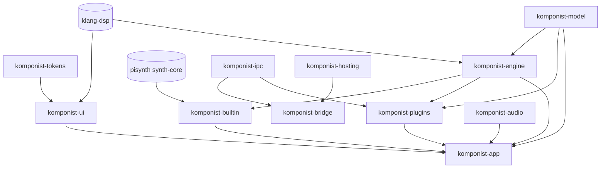

# komponist – Software Architecture v0.1

Status: **proposal, waiting for approval** (stack decision, gate G0 in `PLAN.md`).
Date: 2026-11-13. Inputs: `../klang-studio-handoff/` (design v0.1 "Graphit"),
`../daw-design-briefing.md`, `../klang-dsp`, `../pisynth`, `../klopfer`.

This document fixes the structure that the work packages in `PLAN.md` build on.
Anything marked **Decision** needs the owner's approval before code is written.

**Naming:** the DAW is called **komponist**. *klang-studio* is the umbrella name for all projects in
the workspace (`<workspace>/`: komponist, pisynth, klopfer, klang-dsp). The design
handoff still says "klang-studio" where it means the DAW. In the UI, read it as "komponist" (§13.6).

---

## 1. Requirements that shape the architecture

From `HANDOFF.md` §3 and the screens:

| # | Requirement | Consequence |
|---|---|---|
| R1 | Linux first; PipeWire, JACK and ALSA; buffer size changes without restarting the engine (S07) | Audio I/O layer separate from the engine. The engine survives a stream rebuild. |
| R2 | Host CLAP and VST3 plugins, including their GUIs in a native window with a komponist frame (S05) | Native windows with X11 window IDs. Plugin GUI embedding through a parent window. |
| R3 | A plugin crash must not stop the track (S05 "abgestürzt → Neu laden") | **Plugins run out of process.** In-process hosting cannot survive a segfault. |
| R4 | The realtime audio thread is separate from the UI | No locks, allocation or blocking syscalls on the audio thread. Lock-free queues. |
| R5 | Pixel-exact custom UI, 1×/2× scaling, 1 px lines, 60 fps with thousands of notes | GPU-drawn custom widgets, our own hit testing for canvases, culling and level of detail. |
| R6 | Built-in instruments pisynth (6-op FM) and klopfer (drum sampler) | pisynth's `synth-core` runs in process. klopfer is already a CLAP plugin. |
| R7 | Tokens are never hard-coded; `tokens.json` is the single source of truth | Code generation from `tokens.json` at build time. |
| R8 | Keyboard first; every frequent action has a shortcut | Central action and keymap layer, independent of widgets. |
| R9 | Later: audio tracks, automation, buses/sends, CC lanes | Extension points in the model, the engine events and the program, without building them now. |

---

## 2. Stack options

### 2.1 Option A – egui on wgpu, cpal, own plugin bridges (**recommended**)

| Layer | Choice | Why |
|---|---|---|
| UI | **egui + eframe 0.37** (wgpu renderer, features `inspection` and `accesskit`). X11 is forced through `NativeOptions::event_loop_builder` (`with_x11()`), so it runs under XWayland on Wayland desktops. | The briefing assumes egui, and klopfer already uses egui 0.36 (known patterns). An immediate-mode `Painter` suits timeline and piano roll. eframe brings for free: event loop, extra native windows as viewports (plugin frames), AccessKit, screenshots, clipboard/IME, file drops and live inspection for agents (`EGUI_INSPECTION=1`, §11.1). Native handles stay reachable (`Frame::winit_window()`, `HasWindowHandle`). Our own integration on `egui-winit` + `egui-wgpu` is only the fallback if spike WP-15 shows that eframe cannot give us the X11 ID of a plugin frame viewport. `egui_kittest` provides headless snapshot and interaction tests. |
| Audio I/O | **cpal 0.18** with the `pipewire`, `jack` and ALSA hosts. MIDI in through **midir 0.11** (ALSA seq, optionally JACK). | One API for all three drivers in S07. pisynth and klopfer already use cpal 0.18. A buffer change rebuilds only the stream. |
| Hosting core (inside the bridge) | **Own layer** on **clack-host 0.2** (CLAP) + **vst3 0.3** (VST3), behind the `HostedPlugin` trait. Decided after spike WP-15 (§2.4). | The spike embedded Klopfer, Surge XT, Dexed, Shortcircuit XT and DecentSampler through both crates from a bridge process. truce-rack failed on Linux. |
| Isolation | **One bridge process per plugin instance** (`komponist-bridge`). Audio via shared memory and futex, control via a Unix socket. | Meets R3. No Rust library provides this on Linux (§2.4). Gives parallelism across cores for free. klopfer's egui/baseview dependency stack never meets ours. |
| Test plugins | **nice-plug** 0.4 (crates.io; the klang-studio fork only if a fix is needed) | One source exports CLAP **and** VST3, so both hosting paths get the same fixtures without the C++ SDK. Known from klopfer. |
| RT plumbing | `rtrb` (SPSC), `rustix` (futex, memfd, pidfd), `assert_no_alloc` in tests and debug builds | Proven, small. |
| Serialization | `serde` + `serde_json` (project, settings), `postcard` (IPC control messages) | Readable project files, compact IPC. |
| WAV | `hound` | Already used in pisynth and klopfer. |

### 2.2 Option B – own wgpu renderer instead of egui

A rect and line batcher with a glyph atlas (cosmic-text/swash), plus our own immediate-mode layer.
**Pro:** full control over pixels and OpenType features (`tnum`). **Contra:** text input, IME, focus,
scrolling, menus and tests all become our own work. Roughly 2–3× the UI effort before the first screen.
Only worth it if egui fails gate G2 (gallery review).

### 2.3 Option C – iced (or Slint)

Retained or declarative, wgpu-based. **Contra:** the dense canvases (timeline, piano roll, step grid)
end up as custom canvas widgets anyway. Multi-window plus foreign X11 child windows is less direct than
with egui on winit, and there is no existing know-how in the projects. No advantage over A.

*Rejected:* a web UI (Tauri/WebKitGTK). WebKitGTK canvas performance on Linux is weak for 60 fps
note editing, and the briefing asks for a Rust GPU UI. GTK4 is rejected because the design wants no
system widgets and pixel-exact rendering.

### 2.4 Plugin hosting libraries evaluated (2026-11-13)

| Candidate | What it is | Verdict for komponist |
|---|---|---|
| **nice-plug** 0.4 (codeberg RustAudio, successor of NIH-plug) | Framework for **writing** plugins: exports CLAP, VST3 and standalone. klopfer is built with it. It has no code that loads foreign plugins. Its README still calls it experimental. | **Cannot host.** Used for the test plugins (WP-27). Its wrappers are good reading for what plugins expect from a host. Option for later: pisynth as a nice-plug plugin, so it works in other DAWs too. |
| **truce-rack** 1.1.5 (2026-06-19, MIT/Apache) | In-process host library for CLAP and VST3 (plus AU/LV2). Pure Rust on clap-sys and vst3. `Plugin` trait with sample-accurate `EventList`, `PluginEditor` with an `X11(u64)` parent handle, versioned state envelope, scanners. | **Out (spike WP-15, `docs/spikes/WP-15.md` §2):** CLAP loads 0 of 5 plugins (NULL `clap_host`), VST3 instruments stay silent, state restore fails for 4 of 5, 8–12 allocations per `process`, no IRunLoop, IPlugFrame, IComponentHandler, latency or render mode, unmaintained since June. Useful only as reference code. |
| **plughost** 0.2.5 (2026-11-13, 6 weeks old) | Host library with crash isolation: one helper process per chain, shared memory, one buffer of pipelining (the callback never waits). | **Out: no Linux support** ("Linux … not supported"). Its design confirms our approach. Its pipelining costs one buffer of latency per hop. komponist waits synchronously with a deadline instead, to keep monitoring latency low. |
| **Carla** 2.5.10 (C++, GPL) | Mature host with bridges. VST3 through JUCE. CLAP only in the unreleased main branch. | **Out:** C++ and GPL in the core, CLAP not released, little control over the realtime handshake. |
| **nexus** (GitHub poucet/nexus) | App and hosting engine on clack + vst3, not a published library. | **Reference code** for WP-26/32 if we write the core ourselves. |
| **clack-host** 0.2 + **vst3** 0.3 | Low-level, safe (CLAP) and raw COM (VST3) bindings. | **Baseline and fallback.** Always works, most effort. |

Conclusion: crash isolation, IPC, GUI frames and the format layer are our own. The format layer uses
clack-host and vst3 directly (D3, decided after spike WP-15).

### 2.5 Decisions to approve (G0)

| ID | Decision | Recommendation |
|---|---|---|
| D1 | UI toolkit | egui + eframe 0.37 (wgpu, `inspection`), X11 via `event_loop_builder`; fallback own egui-winit + egui-wgpu integration if spike WP-15 requires it |
| D2 | Audio/MIDI I/O | cpal 0.18 (pipewire/jack/alsa) + midir |
| D3 | Plugin format layer | **decided after WP-15:** own layer behind `HostedPlugin` on clack-host 0.2 (CLAP) + vst3 0.3 (VST3); CLAP first. Test plugins with nice-plug |
| D4 | Plugin isolation | out of process, one bridge per instance |
| D5 | klopfer integration | load the bundled `Klopfer.clap` through the normal bridge, shown as "INTERN" |
| D6 | pisynth integration | in process via `synth-core` (`alloc` + `serde` features), as a built-in `Processor` |
| D7 | Project format | one JSON file `*.komponist` with schema version; plugin states as base64 |
| D8 | Undo | immutable snapshots with `Arc` structural sharing (copy on write) |
| D9 | Musical time | `i64` ticks at 960 PPQ; display `Takt.Schlag.Tick` with 240 ticks/beat (= PPQ/4) |

---

## 3. System overview

```
┌────────────────────────── komponist (main process) ───────────────────────────┐
│                                                                                  │
│  Main/UI thread (eframe + egui)                Audio thread (cpal callback, RT)  │
│  ┌──────────────────────────┐   commands      ┌───────────────────────────────┐  │
│  │ App: Document (model +   │ ──rtrb──────▶   │ Engine                        │  │
│  │ undo), UiState, Keymap,  │                 │  transport · sequencer ·      │  │
│  │ panels, dialogs, plugin  │ ◀──rtrb──────── │  mixer · metronome · record   │  │
│  │ frame windows            │   events +      │  processors: pisynth (in-proc)│  │
│  │ EngineSync (compile)     │   garbage       │  ExternalProcessor ──┐        │  │
│  └────────────┬─────────────┘ ◀── atomics ─── │  telemetry (meters…) │        │  │
│               │                 (telemetry)   └──────────────────────┼────────┘  │
│  Worker threads: scan, load/save, export render, plugin manager      │ shm +     │
│  MIDI thread (midir) ──rtrb (timestamped)──▶ engine                  │ futex     │
└───────────────┬──────────────────────────────────────────────────────┼───────────┘
                │ Unix socket (control, postcard)                      │
        ┌───────▼──────────────────────────────────────────────────────▼────────┐
        │ komponist-bridge (one process per plugin instance)                 │
        │  RT thread: wait(futex) → plugin.process() → signal                   │
        │  main thread: poll loop (control socket, plugin fds, timers), GUI     │
        │  GUI: plugin window as X11 child of the app's frame window            │
        └───────────────────────────────────────────────────────────────────────┘
```

Threads and their rules:

| Thread | Owns | May | Must not |
|---|---|---|---|
| Main/UI | `App`, `Document`, windows | allocate, do IO, block briefly | touch engine internals except through queues and atomics |
| Audio (RT) | `Box<Engine>` | futex wait/wake on bridges (with deadline), atomics, rtrb | allocate, free, lock, log, do file or socket IO |
| MIDI | midir connection | push timestamped events into rtrb | block on the engine |
| Workers | jobs | anything non-RT | hold `Document` locks (there are none, they get snapshots) |
| Bridge RT | plugin `process` | call the plugin | anything beyond the plugin's own RT contract |
| Bridge main | plugin instance (main-thread side), GUI | poll fds and timers, socket IO | block the RT thread |

---

## 4. Workspace and crates

New repository `komponist/` (this folder), Cargo workspace, edition 2024, resolver 3 (as in pisynth).
Sibling repositories are referenced by **relative path** and must stay at their places:
`../klang-dsp`, `../pisynth/crates/synth-core`, `../klopfer` (bundle build only).

```
komponist/
  Cargo.toml                 workspace
  CLAUDE.md                  rules for agents (from PLAN.md §1)
  design/tokens.json         copy of the handoff tokens (single source of truth)
  design/reference/*.png     rendered reference screens and components (scripts/render-reference.sh)
  assets/fonts/              IBM Plex Sans / Mono (OFL)
  assets/icons/              Lucide subset (ISC), SVG
  crates/
    komponist-tokens/           build.rs: tokens.json → Rust consts; oklch → sRGB; fonts
    komponist-model/            project document, time, edits, undo, serde, formatting
    komponist-engine/           RT engine, Processor trait, program compiler, offline render, export
    komponist-audio/            cpal backends, midir inputs, stream lifecycle, CPU/xrun stats
    komponist-builtin/          pisynth adapter (Processor), metronome voice
    komponist-ipc/              shared memory, futex signalling, SPSC rings, control protocol
    komponist-hosting/          CLAP (clack-host) and VST3 (vst3) hosting, scanning
    komponist-bridge/           bin `komponist-bridge`: instance mode and scan mode
    komponist-plugins/          app side: catalog, scan cache, bridge lifecycle, ExternalProcessor
    komponist-ui/               design system on egui: theme, widgets, paint fns, bin `komponist-gallery`
    komponist-app/              bin `komponist`: shell, views, dialogs, actions, keymap
  test-plugins/              own Cargo workspace: nice-plug test plugins (CLAP + VST3 each): synth, fx, crash, slow
  scripts/                   check.sh, render-reference.sh, build-klopfer.sh
  spikes/                    throwaway risk spikes (not in the workspace)
```



Rules: `komponist-model` has no dependency on any other studio crate. `komponist-engine` knows no UI,
no IPC and no plugin format. Only `komponist-bridge` links plugin formats. Only `komponist-app` knows egui
*and* the engine.

---

## 5. Data model (`komponist-model`)

The prototype's semantics are kept, its short names are not (`HANDOFF.md` §8).

### 5.1 Time

- `Tick(i64)`, **960 PPQ**. One 4/4 bar = 3840 ticks. A 1/16 step = 240 ticks.
- Display `Takt.Schlag.Tick` uses 240 ticks per beat: `display_tick = tick_in_beat / 4`.
  Example: `10.2.120`. Before position 0 the display reads "Vorzähler".
- `Tempo { bpm: f64 }` and `Meter { num: u8, den: u8 }`, constant per project in v0.1.
  A `TempoMap` with one segment hides this, so tempo changes can come later.
- Sample position ↔ tick conversion lives in `time.rs` (f64 math, rounding rules documented and tested).

### 5.2 Document

```rust
pub struct Project {
    pub name: String,
    pub tempo: Tempo, pub meter: Meter,
    pub loop_range: TickRange, pub loop_on: bool,
    pub metronome: bool, pub count_in_bars: u8,           // "Vorzähler 1"
    pub tracks: Vec<Arc<Track>>,
    pub master: Arc<Channel>,                              // master strip + inserts
    pub next_id: u64,
}
pub struct Track {
    pub id: TrackId, pub name: String, pub hue: Hue,       // Hue = one of the 14 token hues
    pub kind: TrackKind,                                   // Midi only in v0.1 (Audio later)
    pub channel: Channel,                                  // volume_db, pan (-1..1), mute, solo, devices
    pub arm: bool, pub monitor: bool,                      // R, I
    pub input: MidiInputSel, pub midi_channel: MidiChannelSel, // "Alle MIDI-Eingänge", "Omni"
    pub height: u16,                                       // 32..=160, part of the project
    pub clips: Vec<Arc<Clip>>,
}
pub struct Channel { pub volume_db: f32, pub pan: f32, pub mute: bool, pub solo: bool,
                     pub devices: Vec<Arc<Device>> }       // [0] = instrument on MIDI tracks
pub struct Device {
    pub id: DeviceId, pub role: DeviceRole,                // Instrument | Effect
    pub plugin: PluginRef,                                 // format Builtin|Clap|Vst3, id, name, vendor, version
    pub bypass: bool,
    pub state: Option<Arc<[u8]>>,                          // opaque plugin state, kept when the plugin is missing
}
pub struct Clip {
    pub id: ClipId, pub name: String,
    pub start: Tick, pub length: Tick,                     // on the timeline
    pub loop_length: Option<Tick>,                         // "loopen": repetitions of the content
    pub mute: bool,
    pub content: ClipContent,                              // Midi(MidiClip) | Step(StepClip)
}
pub struct MidiClip { pub takes: Vec<Take>, pub active_take: usize }  // loop recording → takes
pub struct Take { pub name: String, pub notes: Arc<Vec<Note>> }       // sorted by start
pub struct Note { pub id: NoteId, pub start: Tick, pub length: Tick, pub pitch: u8, pub velocity: u8 }
pub struct StepClip {
    pub rows: Vec<StepRow>,                                // name + MIDI note; default 8 rows
    pub steps: Vec<[Step; 32]>,                            // per row
    pub length_steps: u8,                                  // 1..=32 ("Länge 16 Steps")
    pub resolution: StepResolution,                        // 1/8, 1/16, 1/32, triplets
    pub swing: f32,                                        // 0..=0.75
}
pub struct Step { pub on: bool, pub velocity: u8, pub probability: u8 /*0..=100*/, pub ratchet: u8 /*1..=4*/ }
```

Runtime status of a device (ok / lädt / abgestürzt / fehlt) is **not** part of the document. It lives
in `komponist-plugins` and is shown by the UI. The document only keeps what must survive a save.

IDs are `u64` from `Project::next_id`, so they stay stable across undo and redo.

### 5.3 Edits and undo (D8)

- The document is a tree of `Arc`s. An edit clones the path to the changed node (`Arc::make_mut`) and
  produces a new root `Arc<Project>`.
- `Document { current, undo: Vec<Arc<Project>>, redo, gesture }`. Undo swaps roots. A drag is one
  *gesture*: `begin_gesture` takes the snapshot, intermediate updates replace `current` without
  pushing, `end_gesture` pushes once.
- Every edit is a function `fn(&Project, args) -> Result<Project, EditError>` in `edits/`. Pure,
  unit-tested, also used by the acceptance tests.
- Change detection for the engine: `Arc::ptr_eq` per track, clip and device (see 6.3).
- Selection, focus, zoom and open panels are UI state (`komponist-app`) and are not undone.

### 5.4 Formatting (pure, tested)

`fmt_pos` (`10.2.120`, "Vorzähler"), `fmt_time` (`00:17.902`), `fmt_db` (`−∞`, `+1.5`, `−3.2`,
U+2212 minus), `fmt_pan` (`C`, `L 12`, `R 50`), `note_name` (`C4` = 60). Rules from `ks-engine.js`.

### 5.5 Persistence (D7)

- `*.komponist`: JSON `{ "format": "komponist", "version": 1, "project": … }`. Plugin states are base64.
  A missing plugin keeps its state unchanged (S06).
- Migrations: `version` → `migrate_vN_to_vN+1` functions, with a test per version.
- Settings: `~/.config/komponist/settings.json` (driver, device, rate, buffer, MIDI inputs, plugin
  folders, last export settings, UI scale). Recent projects: `~/.config/komponist/recent.json`.
  Plugin scan cache: `~/.cache/komponist/plugins.json`.

---

## 6. Engine (`komponist-engine`)

### 6.1 Realtime rules (enforced)

- `Engine::process` runs inside `assert_no_alloc` in debug builds and tests (this also catches frees).
- No `Arc` drop can be the last one on the RT thread. Everything the engine retires (old programs,
  removed processors) goes back through a **garbage queue** and is dropped on the UI thread.
- FTZ/DAZ is set on the audio thread (helper in `komponist-audio`).
- Fixed capacities: max block `MAX_BLOCK = 2048` frames, max events per block, max tracks per program
  (configurable, preallocated when the program is built off-thread).

### 6.2 Processor trait

```rust
pub trait Processor: Send {
    /// Non-RT. Called before the processor goes into the engine and again after a rate change.
    fn activate(&mut self, sample_rate: f32, max_block: usize) -> Result<(), ProcessorError>;
    /// RT. `events` are sorted by `offset` (< frames). Stereo in/out; instruments ignore input.
    fn process(&mut self, ctx: &ProcessContext, events: &[Event], io: &mut StereoIo) -> ProcessStatus;
    fn latency(&self) -> u32;
    /// RT. Silence all voices (stop, loop jump, bypass on).
    fn reset(&mut self);
}
pub struct Event { pub offset: u32, pub kind: EventKind }
pub enum EventKind {
    NoteOn { key: u8, velocity: u8, channel: u8, note_id: u32 },
    NoteOff { key: u8, channel: u8, note_id: u32 },
    Midi([u8; 3]),                   // CC, pitch bend, … (CC lanes later)
    Param { id: u32, value: f64 },   // automation later
    AllNotesOff,
}
pub struct ProcessContext { pub frames: u32, pub sample_rate: f32, pub transport: TransportInfo, pub offline: bool }
```

Implementations: `PisynthProcessor` (`komponist-builtin`), `ExternalProcessor` (`komponist-plugins`,
talks to a bridge), `TestSine` / `TestGain` (public module `komponist_engine::testing`, usable by other
crates' tests). The metronome is engine-internal (fixed level 0.3 in v0.1).

### 6.3 Program, commands, telemetry

- **Program** = an immutable, RT-ready snapshot of everything the sequencer needs:
  per track the sorted event list (notes from clips including loops and takes, step patterns
  expanded with swing and ratchets, probability kept as a per-event value), the processor slot order,
  gain, pan, mute and solo, plus loop range, tempo and meter. Built on the UI thread by
  `compile::build(&Project, &previous)`, which recompiles only tracks whose `Arc` changed. Sent as
  `Box<Program>` over rtrb. The old program goes back through the garbage queue.
- **Commands** (UI → engine, rtrb): `Play`, `Stop`, `Locate(Tick)`, `SetLoop`, `Record{…}`,
  `SetProgram(Box<Program>)`, `InsertProcessor{slot, Box<dyn Processor>}`, `RemoveProcessor{slot}`,
  `SetTrackGain/Pan/Mute/Solo` (fast path without recompiling), `LiveNote{track, …}`
  (computer keyboard, step row audition), `Detach` (export, see 6.7).
- **Events** (engine → UI, rtrb): `RecordedNoteOn/Off{track, tick, …}`, `LoopWrapped`,
  `CountInDone`, `ProcessorFailed{slot}`, `Retired(Garbage)`.
- **Telemetry** (atomics, read every UI frame): playhead tick, play/record state, CPU load (callback
  time / buffer period, smoothed), xrun count, per-track `TrackMeter` (`Arc` shared with the program:
  peak L/R since the last read, as `AtomicU32` f32 bits, taken with `swap(0)`), master meter,
  MIDI activity per input. Ballistics (peak hold 1.5 s, 20 dB/s, clip latch) run in the UI with
  `klang_dsp::meter`.

### 6.4 Block processing order

1. Drain commands (bounded per block).
2. Read MIDI input (timestamped) → monitored tracks (I on) get live events, and recording capture
   when recording.
3. Transport: tick range of this block, splitting at the loop end (wrap) and at the end of the
   count-in. Metronome clicks (accent on beat 1).
4. Per track: sequencer events from the program (`active_notes` table per track, so note-offs come
   from the table and survive program swaps, loop wraps and stop) + live events → processor chain
   (instrument → effects; bypass = passthrough plus `reset`) → `klang_dsp::buffer::gain_ramp` (fader)
   → `klang_dsp::pan::balance` → meter → master bus (with the latency compensation delay, 6.6).
5. Master: inserts → master fader → meter → output. The metronome is added after the master fader
   with its own level.
6. Telemetry, events.

Solo logic: audible = `!mute && (!any_solo || solo)`. "Stumm durch Solo" is a derived UI state.

Larger device buffers are cut into ≤ `MAX_BLOCK` chunks. Buffer size changes therefore never touch
processors. Only a sample rate change re-activates them.

### 6.5 Sequencer details

- Probability: `klang_dsp::rng::Rng` per track, seeded per playback start, so offline export is
  reproducible.
- Ratchets: expanded at compile time into evenly spaced notes within the step.
- Swing: delays every second step by `swing × step length / 2` (compile time).
- Clip loops: repetitions are expanded at compile time (thousands of notes are cheap). Notes that
  reach past the clip end are cut at the clip end.
- Recording (S02): the engine reports note-ons and note-offs with ticks. The UI builds the take
  live, so notes appear at once. At stop it writes **one** undo step "Take n". During loop
  recording each `LoopWrapped` starts a new take in the same clip. Esc discards the running take.
  Input timestamps are corrected by the output latency reported by the stream.

### 6.6 Latency compensation (PDC)

Each chain reports `Σ latency`. The program keeps per-track delay lines (allocated off-thread,
length = max chain latency − own chain latency) before the master bus. Small, but needed as soon as
a lookahead plugin is in use. It can move behind v0.1 if time is short (WP-23 marks it optional).

### 6.7 Offline render and export (S08)

- Export detaches the engine from the device (`Detach` → the audio callback hands the `Box<Engine>`
  back and outputs silence). A worker renders as fast as possible with `offline = true` (CLAP
  `render` extension, VST3 `kOffline`), then hands the engine back. The transport stops during
  export, which is acceptable for v0.1.
- The export sample rate comes from the dialog (default 48 kHz). If it differs from the device rate,
  processors are re-activated for the render and again afterwards.
- Render into an in-memory f32 buffer (≈ 23 MB per stereo minute at 48 kHz) → peak → optional
  normalisation to −1 dBFS → TPDF dither for 16/24 bit → `hound`. The progress dialog shows the
  peak level. Tail 2 s. Range: song (up to the end of the last clip), loop, selection.
- Dither and PCM quantisation stay in `komponist-engine::export` (only one user, see §10).

---

## 7. Audio and MIDI I/O (`komponist-audio`)

- `AudioSystem::hosts()` → PipeWire, JACK, ALSA (cpal features `pipewire`, `jack`), devices, rates,
  buffer sizes. A `NullBackend` drives the engine from a timer thread (tests, "Kein Audio-Gerät").
- **Engine handoff without restart (R1):** the callback closure owns an `EngineSlot<P>` holding
  `Box<P>`, where `P: AudioProcess` is a small callback trait defined in `komponist-audio`. The app
  implements it for the engine, so `komponist-audio` does not depend on `komponist-engine`. On stream teardown the slot's `Drop` (non-RT, cpal teardown) sends the engine back
  over a channel. The new stream takes it over. A buffer change is "short dropout, engine untouched"
  (S07).
- No device / device lost → state `NoDevice`. The UI disables play and record and shows the red notice
  in the transport bar, the status bar and S07.
- MIDI: midir inputs per device, switchable in S07, activity flag per device. Events carry
  `Instant` timestamps. In the callback they are mapped to frame offsets using the callback's
  timestamp. Accuracy is about 1 ms, enough for v0.1.
- Latency display in S07: `buffer / rate` plus the latency the stream reports.

---

## 8. Plugins

### 8.1 Bridge processes (D4)

Each external plugin instance runs in `komponist-bridge --instance`. The app starts it, passes a
memfd (shared memory) and a socket, and sends `Load`, `Activate{rate, max_block}` and `SetState`.
While loading, the device reads "Lädt" and the engine passes audio through (S05).

**Shared memory per instance** (fixed size): header with futex words `request_seq` and `done_seq`,
`frames`, transport info, status, latency; SPSC rings for input events (notes, params) and output
events (param changes from the plugin); audio in and out `[2][MAX_BLOCK]`.

**RT handshake per block:** the engine writes input and events → `request_seq += 1` → futex wake →
futex wait on `done_seq` with a deadline (about 60 % of the block period minus elapsed time).
The bridge RT thread waits on `request_seq`, calls `process`, writes the output, sets `done_seq` and
wakes. If the deadline passes, the engine uses passthrough (effect) or silence (instrument) for this
block, counts the device as "late", and ignores the stale result via the sequence number.

**RT priority is mandatory** for the bridge RT thread (SCHED_FIFO; the owner's machine allows it:
realtime group, rtprio 98). Spike WP-15 measured the futex roundtrip with 4 × 2 KiB copied: p99
7.6 µs and max 16 µs at RT priority, but max 3 ms under load without it (57 % of a 5.33 ms block).
If RT priority cannot be obtained, the bridge logs it and the UI shows a warning in the status bar.

**Watchdog:** the bridge main loop must answer a heartbeat on the control socket; a stalled main
loop (seen once with DecentSampler in the spike) is reported as "hängt" and can be restarted like a crash.

**Crash:** the plugin manager watches each bridge's `pidfd`. Death → state "abgestürzt": red edge,
the track keeps running (passthrough or silence), "Neu laden" starts a new bridge with the last known
state. State snapshots are taken on save, on GUI close, and debounced on "state dirty" (CLAP
`state.mark_dirty`, VST3 `restartComponent` / edits).

**Control protocol** (postcard over a Unix seqpacket socket), app → bridge:
`Load`, `Activate`, `Deactivate`, `GetState`, `SetState`, `ListParams`, `SetParam`, `OpenGui{parent_xid, scale}`,
`SetGuiSize`, `CloseGui`, `SetRenderMode`, `Shutdown`. Bridge → app: `Loaded{info, params, latency}`,
`State(bytes)`, `ParamValues(batch, ~30 Hz)`, `GuiSizeRequest`, `LatencyChanged`, `RestartRequested`,
`StateDirty`, `Log`, `Error`.

**Parallelism:** bridges are separate processes, so tracks in v0.1 are processed one after another
but each plugin runs on its own core. Later optimisation, only if measurements demand it: start all
first-in-chain bridges at the beginning of the block and collect them afterwards (fan-out).

### 8.2 Hosting core (`komponist-hosting`, used only by the bridge)

The bridge talks to plugins only through the `HostedPlugin` trait (load, activate, process, params,
state, latency, GUI, render mode) and offers them a `HostLoop` (fds and timers). Behind it sits our own
layer on clack-host and vst3 (D3). The spike code in `spikes/gui-embed/` (`clap_child.rs`,
`vst3_child.rs`) is a working prototype of both formats plus `HostLoop`; nexus (poucet/nexus) and
truce-rack serve as further reference code.

- **CLAP** via clack-host. Extensions: audio-ports, note-ports, params, state, latency, gui (x11,
  embedded), timer-support, posix-fd-support, thread-check, log, render, note-name (step sequencer
  rows, optional).
- **VST3** via the `vst3` crate: Linux bundle layout `X.vst3/Contents/x86_64-linux/X.so`,
  `GetPluginFactory`, IComponent/IAudioProcessor/IEditController (+ IConnectionPoint),
  IHostApplication, IComponentHandler (GUI edits), IParameterChanges/IEventList, IBStream (state:
  component + controller in one blob with a header), IPlugView with `kPlatformTypeX11EmbedWindowID`,
  IPlugFrame (resize), **Linux IRunLoop** (event handlers for fds and timers, in the bridge's poll
  loop), IPlugViewContentScaleSupport. Parameters are exposed normalized (0..1) because only the
  controller converts to plain values; the state blob is `KPV3` + class id + component and controller
  state (`vst3/stream.rs`). Plugin libraries stay mapped (`RTLD_NODELETE`) in both formats, because
  threads that called into a plugin crash at exit after `dlclose`. Host duties the spike found: call `ModuleEntry` before and
  `ModuleExit` after use, activate buses before processing (otherwise instruments stay silent), sync
  component state into the controller, keep the library loaded until every COM object is released.
- Bridge main loop = `poll()` over the control socket, the fds the plugin registered, and a timerfd.
  The bridge needs no X11 connection of its own. JUCE plugins register their X11 fd for writing too;
  honouring write readiness blindly makes the loop spin at 100 % CPU (Dexed in the spike). Poll for
  reading by default and handle write interest only with a rate limit (WP-26/31 decide the details).

### 8.3 Scanning

`komponist-bridge --scan <bundle>` prints JSON descriptors (format, id, name, vendor, version,
instrument/effect, features/subcategories). The app runs scans in parallel as separate processes with
a 10 s timeout and caches them by path + mtime. Default folders: CLAP `~/.clap`, `/usr/lib/clap`,
`/usr/local/lib/clap`, `$CLAP_PATH`; VST3 `~/.vst3`, `/usr/lib/vst3`, `/usr/local/lib/vst3`.
Browser categories ("EQ und Filter", "Dynamik", "Hall und Delay", "Modulation") come from a mapping
table of CLAP features / VST3 subcategories.

### 8.4 Plugin GUI windows (S05)

- Each open plugin gets a **frame window**, an eframe deferred viewport (X11): a 28 px header drawn
  with egui (bypass, presets, view, close) and below it an **X11 child window** created with `x11rb`
  inside the viewport's native window. eframe exposes native handles only for the root viewport, and
  egui-winit 0.37 sets WM_CLASS only on Wayland. So the app opens the viewport with a **unique title
  token**, finds its window with an x11rb tree walk (36–70 ms after opening in the spike), then sets the
  real title (spike WP-15 §1.3). The app sends the child's XID to the bridge, and the plugin attaches as
  a child (CLAP `set_parent`, VST3 `attached`).
- Size negotiation: the plugin requests a size → the bridge sends `GuiSizeRequest` → the app resizes
  the frame window and the child → `SetGuiSize`. Scale: the egui `pixels_per_point` of the frame is
  passed on (CLAP `set_scale`, VST3 content scale). egui reports a viewport's new size late, so the frame
  needs a small resize state machine; never call `set_size` on a fixed-size CLAP plugin after its own
  resize request.
- Focus: JUCE plugins grab the keyboard focus, so komponist's shortcuts do not arrive while the plugin
  window is focused. WP-50 defines the policy (which shortcuts the frame forwards, how focus returns).
- Requirement: the app runs on X11 or XWayland (`with_x11()` in eframe's `event_loop_builder`). Native
  Wayland embedding is not part of v0.1.

### 8.5 Built-in instruments

- **pisynth (D6):** `komponist-builtin::PisynthProcessor` wraps `synth_core::Synth<1>` (`Synth::boxed`,
  features `alloc` + `serde`). Events are applied sample-accurately by splitting `render` at event
  offsets. State = `Patch` (serde). The browser shows the factory presets (`synth_core::presets`)
  under "Presets · pisynth". The device card shows 8 macros (S05: Algorithmus, Ratio 2, Index,
  Feedback, Attack, Decay, Sustain, Release) mapped to patch fields. The mapping is documented in WP-25.
  pisynth has no own GUI in v0.1 (generic view only). An idea for later: the HEXA-6 display
  (`synth-ui`, LVGL) rendered into a texture in a frame window.
- **klopfer (D5):** `../klopfer` builds `Klopfer.clap` (`cargo xtask bundle klopfer --release`).
  The catalog contains it as a built-in entry ("INTERN") with a fixed path. It runs through the
  normal bridge, including crash isolation and its own egui GUI. Step rows: 8 rows. Notes and names
  come from CLAP note-name if klopfer provides it (nice-plug fork), otherwise pads 1–8 = notes 36–43.
  See the open question in §13.

### 8.6 Device states in the UI

`Ok`, `Loading` (passthrough), `Crashed` (red edge, "Neu laden"), `Missing` (placeholder, state
kept, S06 dialog on open), plus `Bypassed`. Held by `komponist-plugins::PluginManager`, keyed by `DeviceId`.

---

## 9. User interface

### 9.1 Rendering and design rules (`komponist-ui`)

- **Tokens:** `komponist-tokens` generates `color::SURFACE_0…5`, `TEXT_1…4`, `LINE_1/2`, `ACCENT_*`,
  `STATE_*`, `METER_*`, sizes, spacing, radii and type styles from `design/tokens.json`. Track colours
  are computed at runtime with the oklch → sRGB function from `ks-engine.js` (`hex()`, clamped per
  channel). A test checks the function against every precomputed value in `tokens.json`. A table of
  14 hues × 128 velocities is built at startup.
- **Pixels:** design px = egui points; `pixels_per_point` = scale factor (1×/2×, overridable in the
  settings). All axis-aligned rects and 1 px lines are snapped to physical pixels (helpers in
  `komponist-ui::px`). Only round shapes (knob arcs, fader thumb) use anti-aliasing. Animations are off
  (`animation_time = 0`) because the design wants "keine Animation".
- **Fonts:** IBM Plex Sans (400/500/600) and Plex Mono (400/500), embedded. Values use Mono (type
  tokens `value.*`), so they are tabular. egui applies no OpenType features. If Plex Sans digits are
  not tabular by default, WP-02 freezes `tnum` into a renamed copy of the font (fontTools
  `pyftfeatfreeze`, OFL-compliant renaming).
- **Icons:** Lucide subset as SVG through the egui_extras SVG loader, behind an `Icon` enum, so the
  final set can replace it. Play, Stop and Record are drawn as geometric shapes.
- **States:** hover (+1 surface, text 2→1), pressed (+2), keyboard focus ring (1 px accent, 1 px
  offset; only after keyboard input, tracked as "focus-visible" in `komponist-ui`), selection, disabled.
  One function per widget computes the colours from `(state) → style`, tested by snapshots.
- **Interaction helpers** (`komponist-ui::drag`): number field 1 px = 1 step, knob 200 px = full range,
  Shift × 0.1, Ctrl × 10, Alt-click = default, double-click = text entry. The fader is relative from
  the thumb, with the DBT taper. While dragging, the cursor is hidden and grabbed
  (`ViewportCommand::CursorGrab` + `CursorVisible(false)`), and raw mouse deltas drive the value.
  Value tooltip at once while dragging. Hover tooltips after 600 ms; neighbours appear without delay
  (egui `tooltip_delay` + grace time).
- **Gallery:** `komponist-gallery` shows every component in every state (matches
  `Designsystem.dc.html`). `egui_kittest` snapshot tests write PNGs for each state.

### 9.2 Canvases

The arrangement, piano roll, step grid and meters are **not** built from one egui widget per object.
Each canvas allocates one area, hit-tests itself (spatial index per visible range), and paints
with `Painter`:

- Culling to the visible range. Notes and clips are simple rects (R5).
- Clip previews in the arrangement: a cached `Mesh` per (clip `Arc` pointer, zoom bucket). At small
  zoom, notes are aggregated per pixel column.
- Piano roll level of detail per the note states in the design system (zoom levels).
- Target: 10 000 notes, 60 fps, UI frame ≤ 8 ms (checked in WP-61).
- Accessibility: each canvas registers AccessKit nodes for its **visible** objects (role, name, bounds,
  selected/toggled state). They make the canvases queryable for kittest and the egui MCP server and
  usable with screen readers. Only visible objects, so the cost follows the screen, not the project.

### 9.3 App structure (`komponist-app`)

- `App { doc: Document, ui: UiState, engine: EngineHandle, plugins: PluginManager, windows, settings }`.
- **Actions:** every interaction produces an `Action` (`Edit(…)`, `Transport(…)`, `Ui(…)`,
  `Plugin(…)`), dispatched centrally. Panels never mutate the document directly. This makes flows
  testable without pixels.
- **Keymap:** a table from (key, modifiers, focus area) → `Action`, filled from the shortcut lists in
  `HANDOFF.md` §7 and `Designsystem.dc.html` `ix`. Computer keyboard MIDI (A W S E D F T G Y/Z H U J K
  from C4, as in the prototype) is a keymap layer, see §13.
- **Layout 2a with dock:** transport 44 / browser 260 (200–420) / arrangement / inspector 280 (240–360) /
  dock 320 (200 … 70 %, collapsed 28, double-click 320) / status bar 22. Ctrl 1/2/3 toggles panels,
  Ctrl ↑ maximises the dock, Tab switches arrangement ↔ mixer (maximised dock on the mixer tab).
  The focused panel shows a 1 px accent line at the top of its header.
- **Headless:** `App` can be built with the `NullBackend` and without a window. Acceptance tests drive
  it with `egui_kittest`.
- **EngineSync:** after each document change: `compile::build` → `SetProgram`. Fader, pan, mute and
  solo use the fast-path commands during a gesture.

---

## 10. klang-dsp – inclusion and further development

### 10.1 Current state

`no_std`, no allocation, `f32`, math via `libm`. Modules: `biquad`, `crush`, `one_pole`, `phase`, `rng`,
`sine`, `svf`, `units`, `wave` (≈ 1 200 lines with tests). Users: pisynth (`synth-core`, `synth-ui`)
and klopfer (`klopfer_dsp`, plugin). Rule from the crate doc: *building blocks only, no parameter
mapping; something moves in once at least two projects need it.*
**klang-dsp is not under version control yet.** That must change before agents edit it (WP-00).

### 10.2 What komponist uses as is

`units::{db_to_gain, gain_to_db}` (faders, meters, export), `one_pole` (parameter smoothing),
`rng::Rng` (step probability, TPDF dither), `phase` + `sine` + `one_pole::t60_coeff` (metronome click).

### 10.3 New modules (each with ≥ 2 users, so the crate rule holds)

| Module | Content | Users today → after |
|---|---|---|
| `pan` | `balance(b) -> (l, r)`: far side down, nothing up, `((1-b).min(1), (1+b).min(1))` | pisynth `engine/render.rs::balance_gains`, klopfer `voice.rs` (same law, written twice) → plus the studio mixer |
| `meter` | `block_peak(&[f32])`; `PeakMeter { hold, fall_db_per_s }` with `update(peak, dt)`, `level_db`, `held_db`, `clipped` (latched), `reset`; `decay_coeff(db, seconds, rate)` | klopfer `lib.rs` + `recording.rs` (meter decay, written twice) → plus studio track/master meters, export peak display |
| `buffer` | `add`, `add_scaled`, `scale`, `gain_ramp(buf, from, to)`, `add_ramped`, `peak` – plain loops that vectorise | pisynth `synth::add` (public) → plus studio mixer and master bus |

Rules for these changes: additive only (no existing signature changes), tests in the existing style
(key points, edge cases), and the regression gate in `PLAN.md` WP-10 (klang-dsp, pisynth and klopfer
tests stay green; pisynth keeps bit-identical output).

Migration of pisynth and klopfer onto the new modules is a separate, optional package (WP-34) in their
own repositories. It must not change pisynth's output (bit-identity tests).

### 10.4 What deliberately stays out (one user, or not DSP)

TPDF dither / PCM quantisation and the PDC delay line (runtime length) stay in `komponist-engine` until
a second project needs them; then the delay line would be unified with pisynth's `DelayLines`.
Fader taper, dB formatting and meter colour zones are product decisions (UI). MIDI parsing is not DSP.
An FTZ/DAZ guard stays in `komponist-audio`.

---

## 11. Testing strategy

| Level | What | Tool |
|---|---|---|
| Unit | model edits, undo, time math, formatting, compiler (golden event lists), klang-dsp | `cargo test`, `proptest` for undo/redo invariants |
| Engine | offline renders: sample-exact note positions, loop wraps, count-in, solo/mute, meters, no allocation in `process` | `assert_no_alloc`, deterministic seeds |
| IPC/bridge | roundtrip, deadline/timeout, crash (test plugin crashes on a note), reload with state | `test-plugins/*` built with nice-plug, as CLAP and VST3 |
| Hosting | real plugins: Klopfer.clap; installed CLAP/VST3s if present (LSP, Surge XT, Dexed …) | integration tests marked `#[ignore]` when the plugin is missing |
| UI components | one snapshot per component state; interaction (drag math, Alt-click, double-click) | `egui_kittest` (wgpu renderer) |
| Visual | compare against `design/reference/*.png` (rendered from the handoff) | review WP-62, PNGs side by side |
| Acceptance | the five flows of `HANDOFF.md` §9, headless App + NullBackend + offline render (WAV not silent) | `egui_kittest`; flow 4 GUI part under Xvfb |
| Live (agents) | the running app or gallery: AccessKit tree, clicks, typing, screenshots | `egui_mcp` over `egui_inspection` (§11.1); `xdotool` + screenshots for foreign plugin GUIs |
| Performance | 10k notes ≤ 8 ms UI frame; engine with 16 tracks; IPC roundtrip p99 | bench binaries, WP-61 |

### 11.1 Agents see the UI

| Tool | What it does | Use |
|---|---|---|
| **egui_kittest** | Headless harness. Queries the AccessKit tree by label/role (`get_by_label`), clicks, types, steps frames, renders PNG snapshots (wgpu). | Unit, interaction and acceptance tests, deterministic, in CI. |
| **egui_mcp** (official, egui ≥ 0.35, 0.3 from 2026-10-19) + **egui_inspection** | MCP server that attaches to a **running** egui app over TCP (default 127.0.0.1:5719): AccessKit tree, input events, screenshots, resize. eframe's `inspection` feature registers the `InspectionPlugin`; it is switched on by `EGUI_INSPECTION=1`, and eframe answers the screenshot requests. | The Playwright equivalent: agents use the live app, reproduce bugs, check their changes. |
| **Generic Linux desktop MCPs** (e.g. agent-sh/computer-use-linux: AT-SPI + screenshots + xdotool on X11) or plain `xdotool` + `import` under Xvfb | Pixels and input on any X11 window. | Things egui cannot see: plugin GUIs from bridge processes inside the frame windows (WP-50, WP-60), file dialogs. |

All three rely on the AccessKit nodes from §9.2 and on accessible names for every widget
(PLAN rule 12). Newer kittest versions even fail when an input widget has no accessible name.

The design reference can be rendered: the `.dc.html` files need the dc runtime `support.js`, which lies
in `../pisynth/design_handoff/`. Copied next to them, headless Chromium renders them
(`scripts/render-reference.sh`, WP-00).

---

## 12. Risks

| Risk | Impact | Mitigation |
|---|---|---|
| Cross-process X11 embedding (eframe viewport + foreign child) behaves badly with some plugins / XWayland | S05 | Spike WP-15: works under Xvfb with and without a reparenting WM for 5 CLAP and 5 VST3 plugins. Open: checks on a real XWayland desktop (Vulkan, focus, fractional scaling, `docs/spikes/WP-15.md` §6) |
| IPC roundtrip too slow at small buffers | CPU, dropouts | Spike WP-15 measures p50/p99; fan-out optimisation prepared (§8.1) |
| clack-host 0.2 is new, the vst3 bindings are raw and unsafe | effort, bugs | spike prototypes for both formats exist; everything behind `HostedPlugin`; test plugins for CLAP and VST3; CLAP first; VST3 fallback: C++ SDK helpers (MIT) |
| egui: pixel crispness, tabular digits, text styling | look | pixel snapping helpers, Mono for values, `tnum` freeze; gate G2 on the gallery before the views; option B as fallback |
| Performance with thousands of notes | R5 | culling, cached meshes, LOD; measured in WP-61 |
| Changes to klang-dsp break pisynth/klopfer | other projects | additive only, git, regression gate |
| Plugins that misbehave on threads or timers | crashes | they can only crash their own bridge; thread-check extension |

---

## 13. Contradictions and open questions in the design

These need a decision (the handoff says: report contradictions; the design system wins):

1. **Tab.** In the design system, "Tab / Shift Tab" moves focus within a panel (button `ix`), and also
   "Tab (Taste): Arrangement ↔ Mixer" (tabs `ix`, global shortcuts). Proposal: Tab toggles
   arrangement ↔ mixer only while focus is on a canvas (arrangement, mixer, editor). In dialogs,
   the inspector, the browser and text fields it moves focus.
2. **Z.** The shortcut "Z: Auswahl einpassen" collides with computer keyboard MIDI: the prototype maps
   the physical keys `KeyY`/`KeyZ` to G#. On a German keyboard the key labelled Z is one of them.
   Proposal: computer keyboard MIDI is only active while at least one track is armed (R) or when
   toggled on explicitly; otherwise Z fits the selection.
3. **klopfer pads.** The handoff says "8 Pads". klopfer has 32 pads in two banks, with default notes
   36 + pad index. The prototype's step rows use GM notes (36, 38, 39, 42, 46, 45, 37, 47). Proposal:
   step rows follow the instrument (CLAP note-name). Without note names: 8 rows, pads 1–8 = notes
   36–43, names "Pad 1…8". For other instruments: the GM rows from the prototype.
4. **Hue 45 (vermilion)** is missing from `auto-assign-hue-order` (13 entries, 14 hues). The demo
   project gives it to "Drums" by hand. Assumption: on purpose, manual only.
5. **Export rate.** S08 shows 48 kHz. Assumption: a dropdown with 44.1/48/96 kHz, default 48 kHz,
   rendered by re-activating the processors (§6.7).
6. **Product name (decided 2026-11-13).** The screens show "klang-studio" as the wordmark in the
   transport bar, and S05 says "Rahmen von klang-studio". The DAW is called **komponist**, so the UI
   shows "komponist" wherever the screens mean the DAW (wordmark, window title, start screen, plugin
   frame). Everything else is taken verbatim. Open: does the wordmark keep the style of the design
   (lowercase, same type token)? Assumption: yes.

---

## 14. Extension points (not in v0.1)

| Later | Prepared by |
|---|---|
| Audio tracks, audio pool | `TrackKind`, `ClipContent` are enums; project file has a version; disk streaming would be a new worker type |
| Automation, CC lanes | `EventKind::Param` / `Midi` already reach every processor sample-accurately |
| Buses and sends | `Channel` is its own type; program order becomes a topological order over channels |
| Tempo changes | `TempoMap` behind the time conversions |
| Light theme | token names are theme-neutral; `komponist-tokens` can generate a second palette |
| Undocking dock tabs | windows are managed by the app (same mechanism as plugin frames) |
