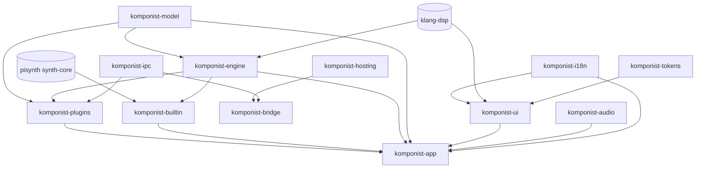

# komponist – Software Architecture v0.1

Status: **proposal, waiting for approval** (stack decision, gate G0 in `PLAN.md`).
Date: 2026-11-13. Inputs: `../klang-studio-handoff/` (design v0.1 "Graphit"),
`../daw-design-briefing.md`, `../klang-dsp`, `../pisynth`, `../klopfer`.

This document fixes the structure that the work packages in `PLAN.md` build on.
Anything marked **Decision** needs the owner's approval before code is written.

**Naming:** the DAW is called **komponist**. *klang-studio* is the umbrella name for all projects in
the workspace (the parent folder of this repo: komponist, pisynth, klopfer, klang-dsp). The design
handoff still says "klang-studio" where it means the DAW. In the UI, read it as "komponist" (§13.6).

---

## 1. Requirements that shape the architecture

From `HANDOFF.md` §3 and the screens:

| # | Requirement | Consequence |
|---|---|---|
| R1 | Linux first; PipeWire, JACK and ALSA; buffer size changes without restarting the engine (S07) | Audio I/O layer separate from the engine. The engine survives a stream rebuild. |
| R2 | Host CLAP and VST3 plugins, including their GUIs in a native window with a komponist frame (S05) | Native windows with X11 window IDs. Plugin GUI embedding through a parent window. |
| R3 | A plugin crash must not stop the track (S05 "abgestürzt → Neu laden") | **Plugins run out of process.** In-process hosting cannot survive a segfault. |
| R4 | The realtime audio thread is separate from the UI | No locks, allocation or blocking syscalls on the audio thread. Lock-free queues. |
| R5 | Pixel-exact custom UI, 1×/2× scaling, 1 px lines, 60 fps with thousands of notes | GPU-drawn custom widgets, our own hit testing for canvases, culling and level of detail. |
| R6 | Built-in instruments pisynth (6-op FM) and klopfer (drum sampler) | pisynth's `synth-core` runs in process. klopfer is already a CLAP plugin. |
| R7 | Tokens are never hard-coded; `tokens.json` is the single source of truth | Code generation from `tokens.json` at build time. |
| R8 | Keyboard first; every frequent action has a shortcut | Central action and keymap layer, independent of widgets. |
| R9 | Later: audio tracks, automation, buses/sends, CC lanes | Extension points in the model, the engine events and the program, without building them now. |

---

## 2. Stack options

### 2.1 Option A – egui on wgpu, cpal, own plugin bridges (**recommended**)

| Layer | Choice | Why |
|---|---|---|
| UI | **egui + eframe 0.37** (wgpu renderer, features `inspection` and `accesskit`). X11 is forced through `NativeOptions::event_loop_builder` (`with_x11()`), so it runs under XWayland on Wayland desktops. | The briefing assumes egui, and klopfer already uses egui 0.36 (known patterns). An immediate-mode `Painter` suits timeline and piano roll. eframe brings for free: event loop, extra native windows as viewports (plugin frames), AccessKit, screenshots, clipboard/IME, file drops and live inspection for agents (`EGUI_INSPECTION=1`, §11.1). Native handles stay reachable (`Frame::winit_window()`, `HasWindowHandle`). Our own integration on `egui-winit` + `egui-wgpu` is only the fallback if spike WP-15 shows that eframe cannot give us the X11 ID of a plugin frame viewport. `egui_kittest` provides headless snapshot and interaction tests. |
| Audio I/O | **cpal 0.18** with the `pipewire`, `jack` and ALSA hosts. MIDI in through **midir 0.11** (ALSA seq, optionally JACK). | One API for all three drivers in S07. pisynth and klopfer already use cpal 0.18. A buffer change rebuilds only the stream. |
| Hosting core (inside the bridge) | **Own layer** on **clack-host 0.2** (CLAP) + **vst3 0.3** (VST3), behind the `HostedPlugin` trait. Decided after spike WP-15 (§2.4). | The spike embedded Klopfer, Surge XT, Dexed, Shortcircuit XT and DecentSampler through both crates from a bridge process. truce-rack failed on Linux. |
| Isolation | **One bridge process per plugin instance** (`komponist-bridge`). Audio via shared memory and futex, control via a Unix socket. | Meets R3. No Rust library provides this on Linux (§2.4). Gives parallelism across cores for free. klopfer's egui/baseview dependency stack never meets ours. |
| Test plugins | **nice-plug** 0.4 (crates.io; the klang-studio fork only if a fix is needed) | One source exports CLAP **and** VST3, so both hosting paths get the same fixtures without the C++ SDK. Known from klopfer. |
| RT plumbing | `rtrb` (SPSC), `rustix` (futex, memfd, pidfd), `assert_no_alloc` in tests and debug builds | Proven, small. |
| Serialization | `serde` + `serde_json` (project, settings), `postcard` (IPC control messages) | Readable project files, compact IPC. |
| WAV | `hound` | Already used in pisynth and klopfer. |

### 2.2 Option B – own wgpu renderer instead of egui

A rect and line batcher with a glyph atlas (cosmic-text/swash), plus our own immediate-mode layer.
**Pro:** full control over pixels and OpenType features (`tnum`). **Contra:** text input, IME, focus,
scrolling, menus and tests all become our own work. Roughly 2–3× the UI effort before the first screen.
Only worth it if egui fails gate G2 (gallery review).

### 2.3 Option C – iced (or Slint)

Retained or declarative, wgpu-based. **Contra:** the dense canvases (timeline, piano roll, step grid)
end up as custom canvas widgets anyway. Multi-window plus foreign X11 child windows is less direct than
with egui on winit, and there is no existing know-how in the projects. No advantage over A.

*Rejected:* a web UI (Tauri/WebKitGTK). WebKitGTK canvas performance on Linux is weak for 60 fps
note editing, and the briefing asks for a Rust GPU UI. GTK4 is rejected because the design wants no
system widgets and pixel-exact rendering.

### 2.4 Plugin hosting libraries evaluated (2026-11-13)

| Candidate | What it is | Verdict for komponist |
|---|---|---|
| **nice-plug** 0.4 (codeberg RustAudio, successor of NIH-plug) | Framework for **writing** plugins: exports CLAP, VST3 and standalone. klopfer is built with it. It has no code that loads foreign plugins. Its README still calls it experimental. | **Cannot host.** Used for the test plugins (WP-27). Its wrappers are good reading for what plugins expect from a host. Option for later: pisynth as a nice-plug plugin, so it works in other DAWs too. |
| **truce-rack** 1.1.5 (2026-06-19, MIT/Apache) | In-process host library for CLAP and VST3 (plus AU/LV2). Pure Rust on clap-sys and vst3. `Plugin` trait with sample-accurate `EventList`, `PluginEditor` with an `X11(u64)` parent handle, versioned state envelope, scanners. | **Out (spike WP-15, spike notes `WP-15.md` (internal notes) §2):** CLAP loads 0 of 5 plugins (NULL `clap_host`), VST3 instruments stay silent, state restore fails for 4 of 5, 8–12 allocations per `process`, no IRunLoop, IPlugFrame, IComponentHandler, latency or render mode, unmaintained since June. Useful only as reference code. |
| **plughost** 0.2.5 (2026-11-13, 6 weeks old) | Host library with crash isolation: one helper process per chain, shared memory, one buffer of pipelining (the callback never waits). | **Out: no Linux support** ("Linux … not supported"). Its design confirms our approach. Its pipelining costs one buffer of latency per hop. komponist waits synchronously with a deadline instead, to keep monitoring latency low. |
| **Carla** 2.5.10 (C++, GPL) | Mature host with bridges. VST3 through JUCE. CLAP only in the unreleased main branch. | **Out:** C++ and GPL in the core, CLAP not released, little control over the realtime handshake. |
| **nexus** (GitHub poucet/nexus) | App and hosting engine on clack + vst3, not a published library. | **Reference code** for WP-26/32 if we write the core ourselves. |
| **clack-host** 0.2 + **vst3** 0.3 | Low-level, safe (CLAP) and raw COM (VST3) bindings. | **Baseline and fallback.** Always works, most effort. |

Conclusion: crash isolation, IPC, GUI frames and the format layer are our own. The format layer uses
clack-host and vst3 directly (D3, decided after spike WP-15).

### 2.5 Decisions to approve (G0)

| ID | Decision | Recommendation |
|---|---|---|
| D1 | UI toolkit | egui + eframe 0.37 (wgpu, `inspection`), X11 via `event_loop_builder`; fallback own egui-winit + egui-wgpu integration if spike WP-15 requires it |
| D2 | Audio/MIDI I/O | cpal 0.18 (pipewire/jack/alsa) + midir |
| D3 | Plugin format layer | **decided after WP-15:** own layer behind `HostedPlugin` on clack-host 0.2 (CLAP) + vst3 0.3 (VST3); CLAP first. Test plugins with nice-plug |
| D4 | Plugin isolation | out of process, one bridge per instance |
| D5 | klopfer integration | load the bundled `Klopfer.clap` through the normal bridge, shown as "INTERN". **Superseded by WP-87:** komponist has its own Sampler (internal device, `klopfer_dsp` engine); klopfer is an ordinary scanned CLAP plugin |
| D6 | pisynth integration | in process via `synth-core` (`alloc` + `serde` features), as a built-in `Processor` |
| D7 | Project format | one JSON file `*.komponist` with schema version; plugin states as base64 |
| D8 | Undo | immutable snapshots with `Arc` structural sharing (copy on write) |
| D9 | Musical time | `i64` ticks at 960 PPQ; display `Takt.Schlag.Tick` with 240 ticks/beat (= PPQ/4) |

---

## 3. System overview

```
┌────────────────────────── komponist (main process) ───────────────────────────┐
│                                                                                  │
│  Main/UI thread (eframe + egui)                Audio thread (cpal callback, RT)  │
│  ┌──────────────────────────┐   commands      ┌───────────────────────────────┐  │
│  │ App: Document (model +   │ ──rtrb──────▶   │ Engine                        │  │
│  │ undo), UiState, Keymap,  │                 │  transport · sequencer ·      │  │
│  │ panels, dialogs, plugin  │ ◀──rtrb──────── │  mixer · metronome · record   │  │
│  │ frame windows            │   events +      │  processors: pisynth (in-proc)│  │
│  │ EngineSync (compile)     │   garbage       │  ExternalProcessor ──┐        │  │
│  └────────────┬─────────────┘ ◀── atomics ─── │  telemetry (meters…) │        │  │
│               │                 (telemetry)   └──────────────────────┼────────┘  │
│  Worker threads: scan, load/save, export render, plugin manager      │ shm +     │
│  MIDI thread (midir) ──rtrb (timestamped)──▶ engine                  │ futex     │
└───────────────┬──────────────────────────────────────────────────────┼───────────┘
                │ Unix socket (control, postcard)                      │
        ┌───────▼──────────────────────────────────────────────────────▼────────┐
        │ komponist-bridge (one process per plugin instance)                 │
        │  RT thread: wait(futex) → plugin.process() → signal                   │
        │  main thread: poll loop (control socket, plugin fds, timers), GUI     │
        │  GUI: plugin window as X11 child of the app's frame window            │
        └───────────────────────────────────────────────────────────────────────┘
```

Threads and their rules:

| Thread | Owns | May | Must not |
|---|---|---|---|
| Main/UI | `App`, `Document`, windows | allocate, do IO, block briefly | touch engine internals except through queues and atomics |
| Audio (RT) | `Box<Engine>` | futex wait/wake on bridges (with deadline), atomics, rtrb | allocate, free, lock, log, do file or socket IO |
| MIDI | midir connection | push timestamped events into rtrb | block on the engine |
| Workers | jobs | anything non-RT | hold `Document` locks (there are none, they get snapshots) |
| Bridge RT | plugin `process` | call the plugin | anything beyond the plugin's own RT contract |
| Bridge main | plugin instance (main-thread side), GUI | poll fds and timers, socket IO | block the RT thread |

---

## 4. Workspace and crates

New repository `komponist/` (this folder), Cargo workspace, edition 2024, resolver 3 (as in pisynth).
Sibling repositories are referenced by **relative path** and must stay at their places:
`../klang-dsp`, `../pisynth/crates/synth-core`, `../klopfer` (bundle build only).

```
komponist/
  Cargo.toml                 workspace
  CLAUDE.md                  rules for agents (from PLAN.md §1)
  design/tokens.json         copy of the handoff tokens (single source of truth)
  assets/fonts/              IBM Plex Sans / Mono (OFL)
  assets/icons/              Lucide subset (ISC), SVG
  crates/
    komponist-tokens/           build.rs: tokens.json → Rust consts; oklch → sRGB; fonts
    komponist-i18n/             build.rs: locales/*/*.ftl → typed text catalog (`Lang`, one method per message); leaf crate
    komponist-model/            project document, time, edits, undo, serde, formatting
    komponist-engine/           RT engine, Processor trait, program compiler, offline render, export
    komponist-audio/            cpal backends, midir inputs, stream lifecycle, CPU/xrun stats
    komponist-builtin/          pisynth adapter (Processor), metronome voice
    komponist-ipc/              shared memory, futex signalling, SPSC rings, control protocol
    komponist-hosting/          CLAP (clack-host) and VST3 (vst3) hosting, scanning
    komponist-bridge/           lib `run()` (instance mode, scan mode) + bin `komponist-bridge`; `komponist --bridge` calls it
    komponist-plugins/          app side: catalog, scan cache, bridge lifecycle, ExternalProcessor
    komponist-ui/               design system on egui: theme, widgets, paint fns, bin `komponist-gallery`
    komponist-app/              bin `komponist`: shell, views, dialogs, actions, keymap
  test-plugins/              own Cargo workspace: nice-plug test plugins (CLAP + VST3 each): synth, fx, crash, slow
  scripts/                   check.sh, build-klopfer.sh
```



Rules: `komponist-model` has no dependency on any other studio crate. `komponist-engine` knows no UI,
no IPC and no plugin format. Only `komponist-bridge` links plugin formats. Only `komponist-app` knows egui
*and* the engine.

---

## 5. Data model (`komponist-model`)

The prototype's semantics are kept, its short names are not (`HANDOFF.md` §8).

### 5.1 Time

- `Tick(i64)`, **960 PPQ**. One 4/4 bar = 3840 ticks. A 1/16 step = 240 ticks.
- Display `Takt.Schlag.Tick` uses 240 ticks per beat: `display_tick = tick_in_beat / 4`.
  Example: `10.2.120`. Before position 0 the display reads "Vorzähler".
- `Tempo { bpm: f64 }` and `Meter { num: u8, den: u8 }`, constant per project in v0.1.
  A `TempoMap` with one segment hides this, so tempo changes can come later.
- Sample position ↔ tick conversion lives in `time.rs` (f64 math, rounding rules documented and tested).

### 5.2 Document

```rust
pub struct Project {
    pub name: String,
    pub tempo: Tempo, pub meter: Meter,
    pub loop_range: TickRange, pub loop_on: bool,
    pub metronome: bool, pub count_in_bars: u8,           // "Vorzähler 1"
    pub tracks: Vec<Arc<Track>>,
    pub master: Arc<Channel>,                              // master strip + inserts
    pub next_id: u64,
}
pub struct Track {
    pub id: TrackId, pub name: String, pub hue: Hue,       // Hue = one of the 14 token hues
    pub kind: TrackKind,                                   // Midi | Bus (wave 9); Audio in wave 10
    pub channel: Channel,                                  // volume_db, pan (-1..1), mute, solo, devices
    pub arm: bool, pub monitor: bool,                      // R, I
    pub input: MidiInputSel, pub midi_channel: MidiChannelSel, // "Alle MIDI-Eingänge", "Omni"
    pub height: u16,                                       // 32..=160, part of the project
    pub clips: Vec<Arc<Clip>>,                             // empty on a bus
    pub output: TrackOutput,                               // Master | Bus(id)       (routing, §6.8)
    pub sends: Vec<TrackSend>,                             // to buses, pre/post     (§6.8)
    pub folder: bool, pub folded: bool,                    // bus shown as a group   (§6.8.1)
}
pub struct Channel { pub volume_db: f32, pub pan: f32, pub mute: bool, pub solo: bool,
                     pub devices: Vec<Arc<Device>> }       // MIDI track: [MidiEffect…] Instrument? [Effect…]
pub struct Device {
    pub id: DeviceId, pub role: DeviceRole,                // MidiEffect | Instrument | Effect
    pub plugin: PluginRef,                                 // format Builtin|Clap|Vst3, id, name, vendor, version
    pub bypass: bool,
    pub state: Option<Arc<[u8]>>,                          // opaque plugin state, kept when the plugin is missing
    pub sidechain: Option<Sidechain>,                      // source track/bus + tap (§6.8)
}
pub struct Clip {
    pub id: ClipId, pub name: String,
    pub start: Tick, pub length: Tick,                     // on the timeline
    pub loop_length: Option<Tick>,                         // "loopen": repetitions of the content
    pub mute: bool,
    pub content: ClipContent,                              // Midi(MidiClip) | Step(StepClip)
}
pub struct MidiClip { pub takes: Vec<Take>, pub active_take: usize }  // loop recording → takes
pub struct Take { pub name: String, pub notes: Arc<Vec<Note>> }       // sorted by start
pub struct Note { pub id: NoteId, pub start: Tick, pub length: Tick, pub pitch: u8, pub velocity: u8 }
pub struct StepClip {
    pub rows: Vec<StepRow>,                                // name + MIDI note; default 8 rows
    pub steps: Vec<[Step; 32]>,                            // per row
    pub length_steps: u8,                                  // 1..=32 ("Länge 16 Steps")
    pub resolution: StepResolution,                        // 1/8, 1/16, 1/32, triplets
    pub swing: f32,                                        // 0..=0.75
}
pub struct Step { pub on: bool, pub velocity: u8, pub probability: u8 /*0..=100*/, pub ratchet: u8 /*1..=4*/ }
```

**Chain order (WP-88).** A MIDI track's chain is `[MIDI effects…] → instrument → [audio effects…]`, in one
`devices` list, in signal order. `DeviceRole::MidiEffect` (serialised `"midieffect"`) devices come first,
the instrument (at most one) right behind them, audio effects last; the master holds audio effects only.
`Channel::midi_effect_count()`, `Channel::instrument()` and `Channel::first_effect_index()` read that
order; the edits keep it (`insert_device` puts a device into its part whatever the index, `move_device`
reorders only inside the part, `replace_instrument` replaces in place or inserts behind the MIDI
effects). Nothing was added to the file format: a project saved before WP-88 has no MIDI effects and
loads and saves unchanged (`FORMAT_VERSION` stays 1). A project **with** MIDI effects is rejected by a
build from before WP-88 (unknown role), which is the intended direction of compatibility.

Runtime status of a device (ok / lädt / abgestürzt / fehlt) is **not** part of the document. It lives
in `komponist-plugins` and is shown by the UI. The document only keeps what must survive a save.

IDs are `u64` from `Project::next_id`, so they stay stable across undo and redo (sends have ids too, `SendId`).

**Routing (wave 9).** Buses, outputs, sends and sidechains, their invariants, edits and file format: §6.8. A project
without buses has every track's output on the master and no sends, which is the pre-wave-9 behaviour.

### 5.3 Edits and undo (D8)

- The document is a tree of `Arc`s. An edit clones the path to the changed node (`Arc::make_mut`) and
  produces a new root `Arc<Project>`.
- `Document { current, undo: Vec<Arc<Project>>, redo, gesture }`. Undo swaps roots. A drag is one
  *gesture*: `begin_gesture` takes the snapshot, intermediate updates replace `current` without
  pushing, `end_gesture` pushes once.
- Every edit is a function `fn(&Project, args) -> Result<Project, EditError>` in `edits/`. Pure,
  unit-tested, also used by the acceptance tests. Routing edits (`edits/routes.rs`, §6.8.3) reject a cycle;
  deleting a track or bus repairs every routing reference to it in the same undo step.
- Change detection for the engine: `Arc::ptr_eq` per track, clip and device (see 6.3).
- Selection, focus, zoom and open panels are UI state (`komponist-app`) and are not undone.
- **Device parameters and plugin states are tracked** (owner decision 2026-11-15). A knob, fader,
  XY or graph-handle drag is one gesture, a wheel burst is one gesture, a click, key step, text
  entry, reset or dropdown choice is one step; a sample load, replace or clear is one step. The
  value goes into the device state (`edits::set_device_state`) and, for pisynth and the internal
  devices, to the running processor as `SetParam` on the engine's fast path: the app does **not**
  run `EngineSync::sync_device_states` for it (that hands pisynth a fresh processor), so a drag
  neither clicks nor recompiles per frame. Undo, redo, a cancelled gesture, presets and pastes do
  follow the document that way. A bridged plugin's own edits and card parameters arrive as state
  snapshots; they are tracked too, **coalesced** per device (snapshots within 1 s amend one step,
  `Document::amend`), named „<Parameter> ändern“ or „<Plugin>: Zustand ändern“, and a snapshot
  equal to the stored state is skipped. Only transport settings, sample paths rewritten on save
  and the echo of an undo (a plugin answering `SetState` with other bytes) stay outside the
  history (`Document::apply_untracked`). Details: `komponist-app/src/param_undo.rs`.

### 5.4 Formatting (pure, tested)

`fmt_pos` (`10.2.120`, "Vorzähler"), `fmt_time` (`00:17.902`), `fmt_db` (`−∞`, `+1.5`, `−3.2`,
U+2212 minus), `fmt_pan` (`C`, `L 12`, `R 50`), `note_name` (`C4` = 60). Rules from `ks-engine.js`.

### 5.5 Persistence (D7)

- `*.komponist`: JSON `{ "format": "komponist", "version": 2, "project": … }`. Plugin states are base64.
  A missing plugin keeps its state unchanged (S06).
- Migrations: `version` → `migrate_vN_to_vN+1` functions, with a test per version. Version 2 (WP-101) adds the
  routing (§6.8.3); `migrate_v1_to_v2` routes every track of an older file to the master.
- Settings: `~/.config/komponist/settings.json` (driver, device, rate, buffer, MIDI inputs, plugin
  folders, last export settings, UI scale). Recent projects: `~/.config/komponist/recent.json`.
  Plugin scan cache: `~/.cache/komponist/plugins.json`.

---

## 6. Engine (`komponist-engine`)

### 6.1 Realtime rules (enforced)

- `Engine::process` runs inside `assert_no_alloc` in debug builds and tests (this also catches frees).
- No `Arc` drop can be the last one on the RT thread. Everything the engine retires (old programs,
  removed processors) goes back through a **garbage queue** and is dropped on the UI thread.
- FTZ/DAZ is set on the audio thread (helper in `komponist-audio`). Worker threads (§6.4) copy the
  dispatching thread's floating-point mode before every batch.
- Fixed capacities: max block `MAX_BLOCK = 2048` frames, max events per block, max tracks per program
  (configurable, preallocated when the program is built off-thread).

### 6.2 Processor trait

```rust
pub trait Processor: Send {
    /// Non-RT. Called before the processor goes into the engine and again after a rate change.
    fn activate(&mut self, sample_rate: f32, max_block: usize) -> Result<(), ProcessorError>;
    /// RT. `events` are sorted by `offset` (< frames). Stereo in/out; instruments ignore input.
    fn process(&mut self, ctx: &ProcessContext, events: &[Event], io: &mut StereoIo) -> ProcessStatus;
    /// RT, optional (WP-102). `process` with the device's sidechain input (§6.8.2), aligned with
    /// `io.input`; called instead of `process` for a device whose sidechain is set. Default:
    /// ignore the sidechain, call `process`.
    fn process_sidechain(&mut self, ctx: &ProcessContext, events: &[Event], io: &mut StereoIo,
                         sidechain: [&[f32]; 2]) -> ProcessStatus { self.process(ctx, events, io) }
    /// RT, optional (WP-65). Start the next `process` early (bridges); default: no-op, `false`.
    fn begin(&mut self, ctx: &ProcessContext, events: &[Event], input: [&[f32]; 2]) -> bool { false }
    fn latency(&self) -> u32;
    /// RT. Silence all voices (stop, loop jump, bypass on).
    fn reset(&mut self);
    /// RT-safe, cheap (WP-88). `Some` for a MIDI effect: the engine runs its event stage (6.4.2)
    /// in front of the instrument and never calls `process`. Default: `None`.
    fn event_processor(&mut self) -> Option<&mut dyn EventProcessor> { None }
}
/// WP-88: events in, events out, in front of the instrument (6.4.2).
pub trait EventProcessor {
    fn set_param(&mut self, id: u32, value: f64);
    fn process_events(&mut self, ctx: &ProcessContext, input: &[Event], out: &mut EventSink<'_>);
    fn reset(&mut self);                                  // forget held notes and phases, emit nothing
}
pub struct Event { pub offset: u32, pub kind: EventKind }
pub enum EventKind {
    NoteOn { key: u8, velocity: u8, channel: u8, note_id: u32 },
    NoteOff { key: u8, channel: u8, note_id: u32 },
    Midi([u8; 3]),                   // CC, pitch bend, … (CC lanes later)
    Param { id: u32, value: f64 },   // automation later
    AllNotesOff,
}
pub struct ProcessContext { pub frames: u32, pub sample_rate: f32, pub transport: TransportInfo, pub offline: bool }
```

Implementations: `PisynthProcessor` (`komponist-builtin`), `InternalProcessor` (`komponist-builtin`, the
internal audio effects and, with an event stage, the MIDI effects Arpeggiator and Tonleiter),
`ExternalProcessor` (`komponist-plugins`, talks to a bridge), `TestSine` / `TestGain` / `TestMidiFx` /
`TestSidechain` (public module `komponist_engine::testing`, usable by other crates' tests). The metronome is engine-internal (fixed level 0.3 in v0.1).

### 6.3 Program, commands, telemetry

- **Program** = an immutable, RT-ready snapshot of everything the sequencer needs:
  per track the sorted event list (notes from clips including loops and takes, step patterns
  expanded with swing and ratchets, probability kept as a per-event value), the processor slot order,
  gain, pan, mute and solo, plus loop range, tempo and meter. Built on the UI thread by
  `compile::build(&Project, &previous)`, which recompiles only tracks whose `Arc` changed. Sent as
  `Box<Program>` over rtrb. The old program goes back through the garbage queue.
- **Commands** (UI → engine, rtrb): `Play`, `Stop`, `Locate(Tick)`, `SetLoop`, `Record{…}`,
  `SetProgram(Box<Program>)`, `InsertProcessor{slot, Box<dyn Processor>}`, `RemoveProcessor{slot}`,
  `SetTrackGain/Pan/Mute/Solo` (fast path without recompiling), `SetGates(GateTable)` (mute and solo
  of every output and send along the routing graph, §6.8.6), `LiveNote{track, …}`
  (computer keyboard, step row audition), `Detach` (export, see 6.7).
- **Events** (engine → UI, rtrb): `RecordedNoteOn/Off{track, tick, …}`, `LoopWrapped`,
  `CountInDone`, `ProcessorFailed{slot}`, `Retired(Garbage)`.
- **Telemetry** (atomics, read every UI frame): playhead tick, play/record state, CPU load (callback
  time / buffer period, smoothed), xrun count, per-track `TrackMeter` (`Arc` shared with the program:
  peak L/R since the last read, as `AtomicU32` f32 bits, taken with `swap(0)`), master meter,
  MIDI activity per input, keys held on the MIDI inputs (`Telemetry::held_input_keys`, a 128-bit
  map in two atomics; the piano roll's keyboard lights them, WP-61). Ballistics (peak hold 1.5 s, 20 dB/s, clip latch) run in the UI with
  `klang_dsp::meter`.

### 6.4 Block processing order

1. Drain commands (bounded per block).
2. Read MIDI input (timestamped) → monitored tracks (I on, or armed: §13 item 11) get live events,
   and recording capture when recording.
3. Transport: tick range of this block, splitting at the loop end (wrap) and at the end of the
   count-in. Metronome clicks (accent on beat 1).
4. Per track, in three phases (WP-65):
   1. **Events**, on the audio thread in track order: sequencer events from the program
      (`active_notes` table per track, so note-offs come from the table and survive program swaps,
      loop wraps and stop) + live events, into the track's own event list. On a track without MIDI
      effects, an instrument at the head of a chain is started at once if it can be
      (`Processor::begin`: a bridge writes its block and wakes the plugin, which then works while the
      engine runs the other tracks); with MIDI effects it starts in its job, because its events
      exist only after the stage (6.4.2).
   2. **Chains**, one job per track: the MIDI effect stage (6.4.2) → processor chain (instrument →
      effects; bypass = passthrough plus `reset`) → `klang_dsp::buffer::gain_ramp` (fader) → `klang_dsp::pan::balance` → meter →
      latency compensation delay (6.6) → the track's output buffer. The jobs run on the worker pool
      (6.4.1) and the audio thread together, or all on the audio thread. Started (bridge) tracks are
      claimed last.
   3. **Sum**, on the audio thread: the track outputs into the master bus in track order.
   With routing (§6.8.4, WP-102) phases 2 and 3 become one job graph in topological order: buses are jobs that sum
   their inputs first, and the master sums what outputs to it.
5. Master: inserts → master fader → meter → output. The metronome is added after the master fader
   with its own level.
6. Telemetry, events.

Solo logic: audible = `!mute && (!any_solo || solo)`. "Stumm durch Solo" is a derived UI state. With buses, solo
follows the signal path (`routing::gates`, §6.8.6); without buses that rule reduces to this one.

#### 6.4.1 Worker pool (WP-65)

`komponist_engine::workers`. A fixed pool of worker threads per engine, started outside the audio
callback by `Engine::set_workers(threads, priority)`; the app calls it from
`AudioProcess::prepare`, i.e. when a stream starts (and after export re-attach), and keeps the pool
while the count does not change. Count: settings file `worker_threads` (`null` = automatic: one
per core minus two, at most 8, 4 on the owner's 6-core machine; `0` = off; S07 has no control yet).
Workers run at `SCHED_FIFO` 80 (the bridges' priority) when the system allows it; otherwise they run
normally and `EngineSync::worker_status` / a startup line say so. If no thread starts, the engine
stays single-threaded.

- **Dispatch, per segment:** the audio thread writes a batch descriptor, publishes it with one
  release store of a claim word (`epoch << 32 | count << 16 | next`) and wakes as many workers as
  there are jobs beyond the first (one `FUTEX_WAKE`). Every thread claims jobs by compare-and-swap
  on that word. No allocation, no lock, no syscall besides the futex wake and wait.
- **Deadline fallback:** the audio thread claims jobs too, so a worker that wakes late (or not at
  all) leaves its jobs to the audio thread, which never waits for a worker to *start*. It waits
  (`FUTEX_WAIT` with a deadline of one segment period, repeated) only for jobs a worker is already
  running: such a job owns its track's processors and state, so it can be neither redone nor
  abandoned. Waits past the deadline are counted (`WorkerStats::late`).
- **Determinism:** a job touches only its own track (state, processors, output buffer) and its
  thread's scratch lane; note ids, probability rolls and captured input stay in phase 1 on the audio
  thread; the sum is in track order. The output is bit-exact with the single-threaded engine,
  realtime and offline (tests: `komponist-engine` `tests/engine/parallel.rs`, the 1 000-sequence
  random test's parallel variant, `komponist-plugins` `bridged_instruments_with_workers_…`).
- **Serial fallback per segment:** no pool, fewer than two tracks, segments under 32 frames (wake-up
  costs more than the work), or a program in which one slot appears in two track chains (checked
  when the program is installed; the compiler never builds one).
- **Same path offline:** the export's render thread dispatches to the same pool (`Engine::render`).
- **RT checks:** workers run their loop inside `assert_no_alloc`; a panicking job is reported to
  the audio thread, which re-raises it (never a silent hang).
- **Dependencies (WP-102, §6.8.4):** the claim word became a **ready set** (one bit per job, at most
  128 = `MAX_TRACKS`): dispatch publishes the jobs without inputs, threads claim the lowest ready
  bit by an atomic `fetch_and`, and a finishing job decrements the missing-input counters of the
  jobs that read it and publishes those that reach zero (also when it unwinds). A project without
  buses publishes every job at dispatch and schedules exactly as before.

#### 6.4.2 MIDI effect stage (WP-88)

`komponist_engine::stage`. A track chain is `[MIDI effects…] → instrument → [audio effects…]`
(`TrackProgram::stage_count()`, at most `MAX_STAGES` = 8; the compiler drops MIDI effects anywhere but
the head of a track chain, and on the master). Per segment, in the track's job (so on a worker thread
with the pool, never on two threads at once), before the instrument runs:

1. The track's events (phase 1: sequenced notes including chased ones, probability applied, plus live
   input of monitored inputs) are the **input** of the first active stage. Each active stage
   (`Processor::event_processor()`, not bypassed, processor present) rewrites them into a
   preallocated `EventSink` (`MAX_EVENTS_PER_BLOCK`, sorted afterwards: note-offs before note-ons at
   one offset); the next stage reads that. Queued `SetParam`s of a stage go to
   `EventProcessor::set_param` before its call, `all_off` (stop, locate, panic) to `reset`.
   A stage sees the call's `ProcessContext` (tempo, meter, position in ticks at frame 0, playing,
   loop); a call is one segment, which ends at the loop end and has constant tempo.
2. The **guard** turns the last stage's output into the instrument's events. It is the track's table of
   notes the instrument received through the stage (`StageState`, 256 notes): the engine assigns note
   ids (a per-track counter, so threads cannot change them), a note-off passes only for a note in the
   table, a note-on for a sounding key first ends the old note, and every note ends with a note-off at
   offset 0 of the next call on stop, locate and panic (the instrument slot's `all_off`), on bypass
   or removal or replacement of a stage or the instrument, and when the stage chain changes (see
   below). A stage can therefore not hang a note, whatever it does; it only has to be musically right.
3. The instrument's pending parameters and `AllNotesOff` join the guard's output; the instrument and
   the audio effects run as before.

The sequencer's own `active_notes` table keeps meaning "notes that entered the chain": on a track
with MIDI effects its notes are tagged with the slot of the first MIDI effect, so their note-offs
reach the stages. When a program swap changes how a track's events reach its instrument (a stage
added, removed, bypassed, reordered, or the instrument replaced: the track's `StageSig`), the
instrument's sounding notes end at once (the guard owns them: notes the sequencer table held for the
instrument when the first stage appears move to the guard), the stages are reset, and notes held at
that moment do not start again (program swaps never chase).

**What a MIDI effect sees, recording and chasing.** Live input (when the track monitors it) and
sequenced notes both go through the stages. **Recording captures the input, not the output**: the
capture sits in phase 1, in front of the stage, so a take holds the keys the player pressed and an
arpeggio or a scale does not get baked into the clip (the effect plays again on the take; the
compiled program also holds the clip's notes, not the stage's output). Note chasing after a start,
locate or loop wrap puts the chased notes into the stage's input at offset 0, so a held pad restarts
an arpeggio at the new position; a stage is reset by stop and by locate while playing, but not on a
loop wrap (the sounding arpeggio note ends where the stage sees the position jump). A bypassed MIDI
effect passes its input through unchanged; its card stays operable.

Costs: the stage runs on the track's job, adds events × stages of work (microseconds) and allocates
nothing; stage output is bounded per call and counted in `Telemetry::dropped_events` when it
overflows. Determinism: a job touches only its own track's state, slots and scratch lists, so the
output is bit-exact with and without workers (`tests/engine/midi_fx.rs`, including the real devices).

Larger device buffers are cut into ≤ `MAX_BLOCK` chunks. Buffer size changes therefore never touch
processors. Only a sample rate change re-activates them.

### 6.5 Sequencer details

- Probability: `klang_dsp::rng::Rng` per track, seeded per playback start, so offline export is
  reproducible.
- Ratchets: expanded at compile time into evenly spaced notes within the step.
- Swing: delays every second step by `swing × step length / 2` (compile time).
- Clip loops: repetitions are expanded at compile time (thousands of notes are cheap). Notes that
  reach past the clip end are cut at the clip end.
- Note chasing (WP-61, like Ableton Live): after a playback start, a locate while playing and a loop
  wrap, notes that started earlier and still sound at the new position start at once with their
  remaining length (probability rolls for them too). Program swaps do not chase. Export starts
  with `Play`, so a range that begins inside a pad renders it.
- MIDI effects (WP-88): chased notes go through the track's MIDI effect stage like any other note
  (6.4.2).
- Recording (S02): the engine reports note-ons and note-offs with ticks, captured from the **input**
  before the MIDI effect stage (6.4.2). The UI builds the take
  live, so notes appear at once. At stop it writes **one** undo step "Take n". During loop
  recording each `LoopWrapped` starts a new take in the same clip. Esc discards the running take.
  Input timestamps are corrected by the output latency reported by the stream.

### 6.6 Latency compensation (PDC)

Each chain reports `Σ latency`. The program keeps per-track delay lines (allocated off-thread,
length = max chain latency − own chain latency) before the master bus. Small, but needed as soon as
a lookahead plugin is in use. It can move behind v0.1 if time is short (WP-23 marks it optional).
With buses, sends and sidechains the alignment runs over the whole graph (§6.8.5); this per-track delay is its
special case.

### 6.7 Offline render and export (S08)

- Export detaches the engine from the device (`Detach` → the audio callback hands the `Box<Engine>`
  back and outputs silence). A worker renders as fast as possible with `offline = true` (CLAP
  `render` extension, VST3 `kOffline`), then hands the engine back. The transport stops during
  export, which is acceptable for v0.1.
- The export sample rate comes from the dialog (default 48 kHz). If it differs from the device rate,
  processors are re-activated for the render and again afterwards.
- Render into an in-memory f32 buffer (≈ 23 MB per stereo minute at 48 kHz) → peak → optional
  normalisation to −1 dBFS → TPDF dither for 16/24 bit → `hound`. The progress dialog shows the
  peak level. Tail 2 s. Range: song (up to the end of the last clip), loop, selection.
- **The file is aligned with the song timeline.** Lookahead devices (presse, Limiter) and plugin latency delay
  the whole mix by the project latency `out(master)` (6.8.5). The export renders that many frames more and drops
  the first ones, so the sound of song frame `f` is file frame `f − range.start` and the tail is complete
  (`Engine::project_latency`: `Routing::latency()` with a routing graph, else the longest track chain, plus the
  master's active effects). Projects without latency export exactly as before. The export rate must equal the
  rate the program was compiled at for a routing graph's latency to be exact (see 6.8.10 item 8).
- Dither and PCM quantisation stay in `komponist-engine::export` (only one user, see §10).

### 6.8 Routing: buses, sends, sidechains (wave 9)

Designed by WP-101 (model, this section), built in the engine by WP-102, shown by WP-103 to WP-105. Owner
decisions on WP-100 (2026-11-15, the routing/README.md proposal (internal notes), numbered there): one bus kind with two ways to
make one (1 C), sends post-fader at −6 dB (8 B, 9 A), sidechains tapped pre-fader (10 A), no sends on buses in v1
(11 A), solo follows the signal path without a solo-safe flag (12 A), deleting a group dissolves it (13 A), bus
colours from the palette (14 A). Model code: `komponist_model::routing` (pure queries) and
`komponist_model::edits` (`add_bus`, `set_output`, `add_send`, `set_send`, `remove_send`, `set_sidechain`,
`duplicate_tracks`, and `remove_tracks` for deleting).

#### 6.8.1 The graph, track kinds and the UI

One graph for everything. **Nodes:** every track (`TrackKind::Midi`, `TrackKind::Bus`, later `Audio`) and the
master. **Edges:**

| Edge | From → to | Model | Carries |
|---|---|---|---|
| Output | track or bus → master or bus | `Track::output: TrackOutput` (`Master` \| `Bus(TrackId)`) | the node's signal after fader, pan and mute |
| Send | MIDI track → bus | `Track::sends: Vec<TrackSend>` (`id: SendId`, `target`, `level_db`, `tap: Pre \| Post`, `enabled`) | a copy at the tap, scaled by the send level |
| Sidechain | track or bus → the node holding the device | `Device::sidechain: Option<Sidechain>` (`source: TrackId`, `tap`) | the source's signal at the tap into the device's sidechain input; nothing into the mix |

```rust
pub enum TrackKind { #[default] Midi, Bus }            // Audio reserved for wave 10 (WP-111)
pub struct Track { /* … as in 5.2 … */
    pub output: TrackOutput,                            // required from file version 2
    pub sends: Vec<TrackSend>,                          // empty on buses (11 A)
    pub folder: bool,                                   // bus shown as a group (Strg G)
    pub folded: bool,                                   // group folded in the arrangement
}
pub enum TrackOutput { #[default] Master, Bus(TrackId) }
pub struct TrackSend { pub id: SendId, pub target: TrackId, pub level_db: f32, pub tap: Tap, pub enabled: bool }
pub struct Sidechain { pub source: TrackId, pub tap: Tap }   // on Device; Sidechain::new → Tap::Pre
pub enum Tap { Pre, Post }
```

A **bus** sums everything that outputs or sends to it, runs audio effects, and has fader, pan, mute, solo, meter and
an output. It holds no clips, no instrument and no MIDI effects, is never armed, and in v1 has no sends. Kinds are
separate; there are no hybrid tracks (owner).

**UI mapping (variant C, chosen).** Both ways of making a bus give the same `TrackKind::Bus`; only `Track::folder`
differs, and it changes nothing in the routing:

- **Group** (Strg G „In Gruppe zusammenfassen“, `NewBus::group(members)`): a bus with `folder = true`, placed where
  the topmost selected track was; the selected tracks output to it. Its **members are the tracks that output to
  it**: membership is the routing, there is no second tree. The arrangement shows a group as a foldable folder
  (`folded`) and the members indented below it; the model keeps every group's members directly behind it in display
  order as one block (`routing::normalized_order`, applied by every edit), so routing a track to a group moves it
  into the block (WP-100: dragging a track onto a group sets its output) and routing it elsewhere moves it right
  behind the block. A group inside a group is a group bus that outputs to the outer group.
- **Effect bus** („Send zu neuem Bus“, `NewBus::effect(senders)`): a bus with `folder = false`, fed by a send from
  each selected track (−6 dB, post-fader), listed in the arrangement's „Busse“ section. Tracks may also output to
  an effect bus; it does not become a folder then.
- The mixer shows all buses right before the master (3 A); that is a view order, not the model's track order.

For the record, the two rejected variants would have mapped onto the same model without changes: **A** (return
and group as two kinds) = a group is a `folder` bus, a return is a non-folder bus that only sends feed (the UI hides
it from output menus); **B** (generic bus, no folders) = every bus has `folder = false`.

#### 6.8.2 Signal flow of a node and the tap points

```
MIDI track:  events → MIDI effects → instrument → audio effects ─┬─▶ [Pre tap] ─▶ pre sends, pre sidechains
Bus:         Σ inputs (outputs + sends, PDC-aligned) → effects ──┘
             ─▶ fader → pan → mute ─┬─▶ meter
                                    ├─▶ [Post tap] ─▶ post sends, post sidechains
                                    └─▶ output (master or bus)
```

- **Pre** („Vor Fader“): behind the device chain, before fader, pan and mute. **Post** („Nach Fader“): behind fader,
  pan and mute, the same signal the output carries.
- Sends are gated as audible signal (6.8.6): a muted or solo-muted track's sends are silent, pre or post.
- Sidechain taps are control signals: a **pre** tap ignores the source's fader, mute and solo (ducking keeps
  working with a muted ghost kick, 10 A); a **post** tap follows fader and mute but never solo.
- A disabled send (`enabled = false`) keeps its level and feeds nothing.

#### 6.8.3 Invariants, edits and the file

Invariants (`routing::check`, asserted after every edit in the property tests):

1. The graph over outputs, sends **and sidechains** is acyclic, and no node outputs, sends or taps into itself.
   Sidechain edges count because they impose processing order: the source must be done before the holder runs.
   Consequence: a device cannot take its own track (pre or post), nor a bus its track feeds.
2. The master is the only sink: it has no outgoing edge and is never a sidechain source. Every node reaches it.
3. Output and send targets are buses; a track sends at most once to a bus; buses have no sends (edits, 11 A).
4. Groups: `folder` only on buses, `folded` only on groups, members directly behind their group (6.8.1).
5. A bus holds no clips, no instrument, no MIDI effects, is not armed and not monitoring.

**Queries for the UI** (grey out what would close a cycle, WP-100 §7): `routing::output_targets(track)` (master
first, then every bus that is not upstream of the track), `send_targets(track)` (the same buses minus those it
already sends to), `sidechain_sources(device)` (every track and bus not downstream of the holder; a device on the
master takes all), `would_create_cycle(from, to)`, `group_of`, `group_members`, `group_ancestors`.

**Edits** (each one undo step; each validates, normalises the group blocks and rejects a cycle with
`EditError::RoutingCycle`, a non-bus target with `NotABus`):

- `add_bus(NewBus)`: name „Gruppe n“ / „Bus n“ (first free n from 1), hue from the palette; a group of members
  outputs where all its members did (so a group made inside a group nests), else to the master.
- `set_output(tracks, output)` (also joins and leaves groups), `add_send(track, bus)`, `set_send(id, SendProp)`
  (level, tap, enabled, target), `remove_send(id)`, `set_sidechain(device, Option<Sidechain>)`,
  `TrackProp::Folded`.
- `remove_tracks` (Entf on tracks or buses) repairs every reference in the same step: outputs to a removed bus go
  where that bus went (transitively; for a group this is „Gruppe auflösen“, its members join the enclosing group
  or the top level), sends to it are removed, sidechains from a removed track or bus are cleared (master chain
  too). „Mit Spuren löschen“ is the UI passing the members as well. Untouched tracks keep their `Arc`.
- `duplicate_tracks` (new, Ctrl D on tracks): copies keep output, sends (new `SendId`s) and sidechains; references
  between the listed tracks point at the copies (a duplicated group with its members gets member copies, a
  duplicated kick feeds the duplicated compressor).
- Existing edits: `add_track` before a group member joins that group; `move_tracks` keeps membership (a group
  moves with its block); clips cannot be added, moved or copied onto a bus; a bus takes audio effects only; arm and
  monitor are ignored on buses. Device copy and paste (`NewDevice`) start without a sidechain.

**File (format version 2, 5.5).** Every track writes `"output": "master"` or `{"bus": id}`; `sends`, `folder`,
`folded` and a device's `sidechain` are written only when set; kind `"bus"`. `migrate_v1_to_v2` gives every track
of a version-1 file `"output": "master"`, so an old project loads unchanged (no sends, no buses). Loading repairs
dangling or invalid references (output to the master, sends and sidechains dropped, flags cleared, group order) and
rejects a cycle or a bus with clips or an instrument as malformed. A build from before wave 9 refuses version 2
(„newer“), which is the intended direction.

#### 6.8.4 Engine: compiling and scheduling the graph (WP-102)

`compile::build` turns the project into a **job graph**, `Program::routing: Arc<route::Routing>` (module
`komponist_engine::route`; the compiler part is `compile/graph.rs`, the run-time part `graph.rs` and the jobs in
`engine.rs`). A project without buses, sends and sidechains compiles to the **flat** routing
(`Routing::default()`): every track into the master in display order, the old mute and solo rule with the per-track
fast paths, and the same output bit for bit (golden test against a render of the base commit,
`tests/engine/routing.rs`).

- **Order:** `routing::topo_order` (Kahn's algorithm; among ready nodes the higher track first, the master last).
  Without buses it is the display order, so today's programs compile to the same order and the same output.
- **Jobs:** one per node except the master. A MIDI track job is today's chain job (6.4 phase 2: MIDI effect stage,
  instrument, effects) plus fader, pan, mute, meter, taps and its input delays. A **bus job** first sums its inputs
  (a join node), then runs its effects and strip the same way. The master stays on the audio thread after all jobs.
- **Buffers** (as built): every buffer is preallocated, none in the program. Per node, in the engine's per-track
  state (preallocated for `MAX_TRACKS` nodes when the engine is created, kept by track id across swaps): the output
  buffer (behind fader, pan, mute, solo and the output's delay), a pre-tap buffer and a post-tap buffer, written
  only when the routing marks the node's `pre` / `post` as read. The post tap has its **own fader** (gain, pan,
  mute, no solo) because the output also closes for solo while a send from it may stay open (a soloed effect bus).
  A bus sums its inputs into its job's lane scratch (no per-bus sum buffer). Sends and outputs are not buffers of
  their own: the consuming bus job reads the source's output (already delayed for this target) or its pre / post
  tap, applies the send's delay and gain ramp, and adds. Sidechain inputs are read from the source's tap buffer by
  the holder's job into a lane buffer and passed to `Processor::process_sidechain` (internal devices consume it since
  WP-104: `Spec::sidechain` marks the device, `Dsp::process_sidechain` gets the buffer slice of each piece between
  parameter events, presse feeds its detector with it instead of the input; plugins through the bridge's extra channels in WP-105). The program carries only indices: per node
  `NodeRoute` (bus, output, input / sidechain / dependent spans, number of inputs, taps, head delay, latencies),
  the input list (`RouteInput`: source, optional `SendRoute` with gate index, linear level, tap and delay), the
  sidechain list (`SidechainRoute`: chain position, source, tap, delay), the dependents, the master's inputs and
  sidechains, the send ids by gate index, the compiled gates and the line map.
- **Edge states:** every send, sidechain and MIDI-track head delay has an edge state (delay line and send gain)
  in an engine-owned table of `route::MAX_LINES` (512), addressed by `LineId`. The compiler assigns lines per
  `LineKey` (send id, device id, track id) and keeps an edge's line from one program to the next (`LineMap`, like
  the slot map); installing a program resets a line whose key changed. A recompile therefore keeps the delayed
  audio and the gains: swapping in a recompiled program is bit-identical to not swapping (tested). Send gains ramp
  over a segment (`add_ramped`); a new send fades in from 0. The output edge's delay stays on the source
  (`TrackProgram::pdc_delay`, today's line), since every node has exactly one output.
- **Determinism:** a job writes only its own buffers and state; a bus sums its inputs in topological order of the
  sources (fixed per program), so the output stays bit-exact with and without workers, like 6.4.1.
- **Worker pool as a DAG scheduler** (6.4.1): each job has a counter of missing inputs (distinct sources over
  output, send and sidechain edges into it), set from the program at dispatch. A finishing job decrements the
  counters of its targets (release) and publishes those that reach zero to the ready set (a bit per job); threads
  claim the lowest ready bit atomically. The thread that publishes goes on claiming (so it usually runs the bus
  itself) and wakes the dispatcher, which claims what is left. Among ready jobs the earlier in topological order
  goes first, bridge-started tracks last. The serial path runs the same ready set on one thread. Independent branches (all MIDI tracks into the master, the normal case) are all ready at once,
  so a project without buses schedules exactly like WP-65. The audio thread keeps the deadline fallback: it claims
  every ready job no worker has started and waits (futex with deadline) only for jobs a worker is running, now also
  when a job it needs next depends on them. Bridged instruments still start early (`Processor::begin`) in phase 1.
- **Serial fallback** stays per segment (no pool, fewer than two jobs, segments under 32 frames).
- **Solo and mute fast path:** solo now depends on the graph (6.8.6), so `SetTrackSolo` can no longer be decided per
  track on the audio thread. The UI thread computes `routing::gates` and sends a gate table through
  `Command::SetGates(route::GateTable)` (`compile::gates(project, program)`; bits per program track: muted, output
  open; per send: open; 48 bytes, fixed capacity `MAX_TRACKS` tracks and `route::MAX_SENDS` = 256 sends); the
  faders keep ramping as today. The app sends it with every mute or solo change on the fast path
  (`EngineSync::gates`). The program carries the compiled table; `SetTrackMute` / `SetTrackSolo` still work for flat
  programs while no table is active.
- **Bridges:** an instrument whose own sidechain is set is not started early (`Processor::begin`): its input exists
  only once its source is done.

#### 6.8.5 Latency compensation across the graph

Generalises 6.6 (today: one delay per track before the master, `max chain latency − own chain latency`). With
`chain(v)` = Σ latency of v's active devices, computed in topological order:

- `in(v)` = latency at which v's inputs are aligned = max over its incoming outputs and sends `e: u → v` of
  `out(u)`, and over the sidechain edges into v (see below); 0 for a MIDI track (live input latency is handled
  apart, 6.5).
- `out(v) = in(v) + chain(v)`; pre and post taps both have latency `out(v)` (fader, pan and mute add none).
- **Every input edge gets its own delay line** of `in(v) − out(u)` frames (outputs and sends alike; a send's delay
  sits on the send). The master is one more join node; the project latency is `out(master)`, the maximum over all
  paths.
- **Sidechains** are aligned with the signal they act on: a device at chain position k of holder h sees the main
  signal at `in(h) + chain(h)[..k]`. A tap from s arrives at `out(s)`. If it arrives early it is delayed by the
  difference; if it would arrive late, `in(h)` is raised so that it is not (a sidechain may delay its holder, never
  the reverse). This is the extra term in `in(v)` above.
- Delay lines are preallocated when the engine is created (`MAX_PDC_FRAMES` each, 6.1: one per node for its output,
  one per edge state) and delays are clamped there (a warning in the UI when a path exceeds it is still to come).
  Path latencies are recomputed on every compile; `EngineSync` already recompiles when a plugin reports a new
  latency, and the lines keep their contents, so a latency change moves a read position like today's PDC.
- **As built:** a MIDI track's raised `in(h)` is a **head delay** in front of its first audio effect (behind the
  instrument; MIDI tracks have no audio inputs to delay). A sidechain into the instrument itself (a vocoder) cannot
  be aligned that way and arrives as it is; on buses and the master the raise delays their inputs. `route::NodeRoute`
  carries `latency_in` / `latency_out`, `Routing::latency()` is `in(master)`.

#### 6.8.6 Mute, solo, meters

`routing::gates(&Project)` decides which outputs and sends carry signal (unit and property tests pin it):

- **Mute** closes the node's output and all its sends. Muting a bus silences its output only; the sends and
  outputs of its sources stay as they are (WP-100 §7), and its effects keep running (tails stay consistent).
- **Solo** follows the signal path (12 A, „Mitsolo“). Let S be the soloed tracks and buses (solo on the master is
  ignored) and S* = S plus everything that reaches S through outputs only (soloing a group solos its members). An
  output or send u → v stays open when u lies on or behind S* (the soloed track's bus path, the buses it sends to,
  the master) or when v leads into S* (sends into a soloed effect bus keep feeding it, so you hear only its wet
  signal). Everything else is solo-muted. Without buses this is exactly the old rule
  `audible = !mute && (!any_solo || solo)`. The UI shows a bus kept audible this way with a dashed „S“
  (WP-100 §7); `Gate::solo_muted` is the „stumm durch Solo“ state.
- No solo-safe flag: buses behind a soloed track stay audible by the rule above (12 A).
- **Meters:** every node meters after fader, pan and mute, as tracks do today (`TrackMeter` per job; buses get one
  too). As built the meter sits behind the output's gate, so a solo-muted node shows silence, as tracks did before.
  The master meter is unchanged. Send levels have no meters in v1.

#### 6.8.7 Export

Offline render runs the same program and job graph through `Engine::render` (6.7, same worker pool), so buses,
sends, sidechains and PDC render exactly as they play (tested bit-exact against realtime processing). As built, the
export compensates the project latency (6.7): it drops the first `out(master)` frames and renders as many more at
the end, so the file is aligned with the song and the tail is complete. Projects without latency export bit-identically
to before.
Per-bus stems later are one more output: copy a node's post buffer into a second render target.

#### 6.8.8 Realtime constraints

- The program carries the job graph (topological order, per-job input lists, edge delays, gain targets) in boxed
  slices built on the UI thread. Capacities are fixed: `MAX_TRACKS` nodes (buses count), `route::MAX_SENDS` (256)
  sends per program and `route::MAX_LINES` (512) edge states; the compiler drops what does not fit, like devices
  beyond `MAX_SLOTS` today. Input lists per job are not capped (they are slices of the program).
- **No allocation on program swap:** `SetProgram` swaps one pointer; the old program returns through the garbage
  queue. State that must survive a swap (PDC delay lines, bus sum history for tails, meters, fader ramps) lives in
  engine-owned tables indexed by node, preallocated when the engine is created (like processor slots), and the
  program refers to it by index; a recompile that keeps a node keeps its delay line contents, so no click.
- Nothing in the audio thread walks the `Project` or computes the graph: order, counters, gates and delays all come
  precomputed.

#### 6.8.9 Audio tracks (wave 10)

An audio track (`TrackKind::Audio`, WP-111) is one more source node: clip playback (and live input) replaces
sequencer and instrument at the head of the chain; output, sends, sidechain taps, groups, mute, solo and PDC are
the same, so nothing in this section changes. „Bus aufnehmen“ (16 A) creates an audio track whose **input** is a
bus: that adds an input edge bus → audio track, which counts for the cycle check like a sidechain (the audio track
must not output back into that bus).

#### 6.8.10 Open questions

1. **Bus sends later (11 A says not in v1).** The graph and file allow them; only the edits refuse. Enabling them is
   a one-line change plus UI.
2. **Send pan.** Not modelled (Ableton has none, Reaper has). A field with a serde default can come later without a
   migration.
3. **Sidechain tap „Pre FX“** (Ableton: before the source's effects). Not offered; would be a third `Tap` variant.
4. **Pre send and mute.** Here mute silences pre sends too (as Ableton's track activator does); some consoles keep
   pre-fader sends alive. Confirm with the owner when WP-103 shows it.
5. **Device copy and paste with a sidechain** start without one today (`NewDevice` has no field). WP-104 can carry
   it with `set_sidechain` after the insert in the same undo step.
6. **Export and the project latency** (WP-102): resolved (owner, 2026-11-15). The export drops the first
   `out(master)` frames and renders as many more (6.7), so the file starts on time.
7. **Send level fast path** (WP-102): a send level drag recompiles every frame (cheap, and the gain ramps, so no
   click). A `SetSendGain` fast path like `SetTrackGain` can come with WP-103 if it is needed.
8. **Export at another rate and the routing latency.** With a routing graph `Routing::latency()` (and the delay
   compensation itself) holds frames of the rate the program was compiled at; an export at another rate re-activates
   the processors but does not recompile, so the skipped latency is off by the rate ratio there. Flat programs read
   the live processor latencies and are exact. A recompile after `set_sample_rate` in the export worker would fix both.

---

## 7. Audio and MIDI I/O (`komponist-audio`)

- `AudioSystem::hosts()` → PipeWire, JACK, ALSA (cpal features `pipewire`, `jack`), devices, rates,
  buffer sizes. A `NullBackend` drives the engine from a timer thread (tests, "Kein Audio-Gerät").
- **Engine handoff without restart (R1):** the callback closure owns an `EngineSlot<P>` holding
  `Box<P>`, where `P: AudioProcess` is a small callback trait defined in `komponist-audio`. The app
  implements it for the engine, so `komponist-audio` does not depend on `komponist-engine`. On stream teardown the slot's `Drop` (non-RT, cpal teardown) sends the engine back
  over a channel. The new stream takes it over. A buffer change is "short dropout, engine untouched"
  (S07).
- No device / device lost → state `NoDevice`. The UI disables play and record and shows the red notice
  in the transport bar, the status bar and S07.
- MIDI: midir inputs per device, switchable in S07, activity flag per device. Events carry
  `Instant` timestamps. In the callback they are mapped to frame offsets using the callback's
  timestamp. Accuracy is about 1 ms, enough for v0.1.
- Latency display in S07: `buffer / rate` plus the latency the stream reports.

---

## 8. Plugins

### 8.1 Bridge processes (D4)

Each external plugin instance runs in `komponist --bridge --instance`. The app starts it, passes a
memfd (shared memory) and a socket, and sends `Load`, `Activate{rate, max_block}` and `SetState`.
While loading, the device reads "Lädt" and the engine passes audio through (S05).

*As built (WP-94):* there is one executable. `komponist-bridge` is a library (`run(args) -> ExitCode`);
`komponist` calls it first thing in `main()` when `argv[1] == "--bridge"` (before settings, eframe,
audio) and the app spawns `current_exe()` with `--bridge` (`PluginManagerConfig::bridge_exe` +
`bridge_args`, also used by scans). The bridge stays a process of its own per plugin instance, with
unchanged settings (non-dumpable, RT priority, signals, exit codes); it sets its process name to
`komponist-bridge` (`prctl(PR_SET_NAME)`, shown as `komponist-bridg` in `comm`). A small
`komponist-bridge` binary remains for the bridge's own tests and tools; the app does not need it.

**Shared memory per instance** (fixed size): header with futex words `request_seq` and `done_seq`,
`frames`, transport info, status, latency; SPSC rings for input events (notes, params) and output
events (param changes from the plugin); audio in and out `[2][MAX_BLOCK]`.

**RT handshake per block:** the engine writes input and events → `request_seq += 1` → futex wake →
futex wait on `done_seq` with a deadline (about 60 % of the block period minus elapsed time).
The bridge RT thread waits on `request_seq`, calls `process`, writes the output, sets `done_seq` and
wakes. If the deadline passes, the engine uses passthrough (effect) or silence (instrument) for this
block, counts the device as "late", and ignores the stale result via the sequence number.

**RT priority is mandatory** for the bridge RT thread (SCHED_FIFO; the owner's machine allows it:
realtime group, rtprio 98). Spike WP-15 measured the futex roundtrip with 4 × 2 KiB copied: p99
7.6 µs and max 16 µs at RT priority, but max 3 ms under load without it (57 % of a 5.33 ms block).
If RT priority cannot be obtained, the bridge logs it and the UI shows a warning in the status bar.

**Watchdog:** the bridge main loop must answer a heartbeat on the control socket; a stalled main
loop (seen once with DecentSampler in the spike) is reported as "hängt" and can be restarted like a crash.

**Crash:** the plugin manager watches each bridge's `pidfd`. Death → state "abgestürzt": red edge,
the track keeps running (passthrough or silence), "Neu laden" starts a new bridge with the last known
state. State snapshots are taken on save, on GUI close, and debounced on "state dirty" (CLAP
`state.mark_dirty`, VST3 `restartComponent` / edits).

**Control protocol** (postcard over a Unix seqpacket socket), app → bridge:
`Load`, `Activate`, `Deactivate`, `GetState`, `SetState`, `ListParams`, `SetParam`, `OpenGui{parent_xid, scale}`,
`SetGuiSize`, `CloseGui`, `SetRenderMode`, `Shutdown`. Bridge → app: `Loaded{info, params, latency}`,
`State(bytes)`, `ParamValues(batch, ~30 Hz)`, `GuiSizeRequest`, `LatencyChanged`, `RestartRequested`,
`StateDirty`, `Log`, `Error`.

**Parallelism:** bridges are separate processes, so each plugin runs on its own core. Since WP-65 an
instrument bridge at the head of a chain is started before the engine runs any chain
(`Processor::begin`: build the wire events, `begin_block`, wake) and collected by whichever thread
runs its track (`process` then only waits). Its track is claimed last, so the bridge works while the
in-process tracks run. Bridges later in a chain (effects) start when their input is ready, on the
thread that runs the track; with workers, several of them wait at once.

### 8.2 Hosting core (`komponist-hosting`, used only by the bridge)

The bridge talks to plugins only through the `HostedPlugin` trait (load, activate, process, params,
state, latency, GUI, render mode) and offers them a `HostLoop` (fds and timers). Behind it sits our own
layer on clack-host and vst3 (D3). The spike code (gui-embed, kept with the internal notes) (`clap_child.rs`,
`vst3_child.rs`) is a working prototype of both formats plus `HostLoop`; nexus (poucet/nexus) and
truce-rack serve as further reference code.

- **CLAP** via clack-host. Extensions: audio-ports, note-ports, params, state, latency, gui (x11,
  embedded), timer-support, posix-fd-support, thread-check, log, render, note-name (step sequencer
  rows, optional).
- **VST3** via the `vst3` crate: Linux bundle layout `X.vst3/Contents/x86_64-linux/X.so`,
  `GetPluginFactory`, IComponent/IAudioProcessor/IEditController (+ IConnectionPoint),
  IHostApplication, IComponentHandler (GUI edits), IParameterChanges/IEventList, IBStream (state:
  component + controller in one blob with a header), IPlugView with `kPlatformTypeX11EmbedWindowID`,
  IPlugFrame (resize), **Linux IRunLoop** (event handlers for fds and timers, in the bridge's poll
  loop), IPlugViewContentScaleSupport. Parameters are exposed normalized (0..1) because only the
  controller converts to plain values; the state blob is `KPV3` + class id + component and controller
  state (`vst3/stream.rs`). Plugin libraries stay mapped (`RTLD_NODELETE`) in both formats, because
  threads that called into a plugin crash at exit after `dlclose`. Host duties the spike found: call `ModuleEntry` before and
  `ModuleExit` after use, activate buses before processing (otherwise instruments stay silent), sync
  component state into the controller, keep the library loaded until every COM object is released.
- Bridge main loop = `poll()` over the control socket, the fds the plugin registered, and a timerfd.
  The bridge needs no X11 connection of its own. JUCE plugins register their X11 fd for writing too;
  honouring write readiness blindly makes the loop spin at 100 % CPU (Dexed in the spike). Poll for
  reading by default and handle write interest only with a rate limit (WP-26/31 decide the details).

### 8.3 Scanning

`komponist --bridge --scan <bundle>` prints JSON descriptors (format, id, name, vendor, version,
instrument/effect, features/subcategories). The app runs scans in parallel as separate processes with
a 10 s timeout and caches them by path + mtime. Default folders: CLAP `~/.clap`, `/usr/lib/clap`,
`/usr/local/lib/clap`, `$CLAP_PATH`; VST3 `~/.vst3`, `/usr/lib/vst3`, `/usr/local/lib/vst3`.
Browser categories ("EQ und Filter", "Dynamik", "Hall und Delay", "Modulation") come from a mapping
table of CLAP features / VST3 subcategories.

### 8.4 Plugin GUI windows (S05)

- Each open plugin gets a **frame window**, an eframe deferred viewport (X11): a 28 px header drawn
  with egui (bypass, presets, view, close) and below it an **X11 child window** created with `x11rb`
  inside the viewport's native window. eframe exposes native handles only for the root viewport, and
  egui-winit 0.37 sets WM_CLASS only on Wayland. So the app opens the viewport with a **unique title
  token**, finds its window with an x11rb tree walk (36–70 ms after opening in the spike), then sets the
  real title (spike WP-15 §1.3). The app sends the child's XID to the bridge, and the plugin attaches as
  a child (CLAP `set_parent`, VST3 `attached`).
- Size negotiation: the plugin requests a size → the bridge sends `GuiSizeRequest` → the app resizes
  the frame window and the child → `SetGuiSize`. Scale: the egui `pixels_per_point` of the frame is
  passed on (CLAP `set_scale`, VST3 content scale). egui reports a viewport's new size late, so the frame
  needs a small resize state machine; never call `set_size` on a fixed-size CLAP plugin after its own
  resize request.
- Focus: JUCE plugins grab the keyboard focus, so komponist's shortcuts do not arrive while the plugin
  window is focused. WP-50 defines the policy (which shortcuts the frame forwards, how focus returns).
- Requirement: the app runs on X11 or XWayland (`with_x11()` in eframe's `event_loop_builder`). Native
  Wayland embedding is not part of v0.1.
- As built (WP-50): header 28 px (S05's markup draws 36; the design-system height wins), controls are the
  24 px design-system ones. Fixed-size plugins get a non-resizable frame; user resizes of resizable plugins move
  the child at once and tell the plugin 100 ms after the drag rests, following its own adjustment without
  answering again. On close the child is parked (moved out and hidden) until `GuiClosed`, so the frame disappears
  at once. Key policy while the plugin has the focus: a synchronous X11 key grab per frame decides each press on a
  dedicated thread — Strg S always goes to komponist; Leertaste, Esc, Strg Z, Strg Shift Z go to komponist unless
  the user is typing in the plugin (heuristic: text keys start a typing session, Enter/Tab/Esc or 5 s idle end it);
  everything else goes to the plugin. `KOMPONIST_LOG_KEYS=1` logs keys, grab decisions and focus changes.
  `komponist --open-plugin NAME` opens a frame directly (for checks). Presets work for pisynth only until a
  CLAP/VST3 preset API exists (post v0.1).

### 8.5 Built-in instruments

- **pisynth (D6):** `komponist-builtin::PisynthProcessor` wraps `synth_core::Synth<1>` (`Synth::boxed`,
  features `alloc` + `serde`). Events are applied sample-accurately by splitting `render` at event
  offsets. State = `Patch` (serde). The browser shows the factory presets (`synth_core::presets`)
  under "Presets · pisynth". The device card shows 8 macros (S05: Algorithmus, Ratio 2, Index,
  Feedback, Attack, Decay, Sustain, Release) mapped to patch fields. The mapping is documented in WP-25.
  pisynth has no own GUI in v0.1 (generic view only). An idea for later: the HEXA-6 display
  (`synth-ui`, LVGL) rendered into a texture in a frame window.
- **klopfer (D5):** `../klopfer` builds `Klopfer.clap` (`cargo xtask bundle klopfer --release`).
  The catalog contains it as a built-in entry ("INTERN") with a fixed path. It runs through the
  normal bridge, including crash isolation and its own egui GUI. Step rows: 8 rows. Notes and names
  come from CLAP note-name if klopfer provides it (nice-plug fork), otherwise pads 1–8 = notes 36–43.
  See the open question in §13.

- **Internal devices (WP-85, WP-88):** `komponist-builtin::Internal` is one enum with a `Spec` per device
  (catalog name, parameters, layout, DSP). The audio effects EQ, Delay, Hall and Limiter have a `Dsp`;
  the MIDI effects **Arpeggiator** and **Tonleiter** (role `MidiEffect`, catalog kind
  `PluginKind::MidiEffect`, browser section „MIDI-Effekte“) have an `EventProcessor` stage instead
  (`internal/arpeggiator.rs`, `internal/tonleiter.rs`; a placeholder pass-through `Dsp` fills the
  spec). Dropping a MIDI effect into a chain inserts it into the MIDI part, in front of the instrument.

### 8.6 Device states in the UI

`Ok`, `Loading` (passthrough), `Crashed` (red edge, "Neu laden"), `Missing` (placeholder, state
kept, S06 dialog on open), plus `Bypassed`. Held by `komponist-plugins::PluginManager`, keyed by `DeviceId`.
`Loading` also covers a running bridge that re-activates (another sample rate, the render-mode
switch around an export) and a warm-up of `komponist_plugins::WARM_UP` (250 ms) after every
activation, so `Ok` means "renders real audio now"; the export waits for it (WP-61).

---

## 9. User interface

### 9.1 Rendering and design rules (`komponist-ui`)

- **Tokens:** `komponist-tokens` generates `color::SURFACE_0…5`, `TEXT_1…4`, `LINE_1/2`, `ACCENT_*`,
  `STATE_*`, `METER_*`, sizes, spacing, radii and type styles from `design/tokens.json`. Track colours
  are computed at runtime with the oklch → sRGB function from `ks-engine.js` (`hex()`, clamped per
  channel). A test checks the function against every precomputed value in `tokens.json`. A table of
  14 hues × 128 velocities is built at startup.
- **Pixels:** design px = egui points; `pixels_per_point` = scale factor (1×/2×, overridable in the
  settings). All axis-aligned rects and 1 px lines are snapped to physical pixels (helpers in
  `komponist-ui::px`). Only round shapes (knob arcs, fader thumb) use anti-aliasing. Animations are off
  (`animation_time = 0`) because the design wants "keine Animation".
- **Fonts:** IBM Plex Sans (400/500/600) and Plex Mono (400/500/600), embedded. Values use Mono (type
  tokens `value.*`), so they are tabular. egui applies no OpenType features. If Plex Sans digits are
  not tabular by default, WP-02 freezes `tnum` into a renamed copy of the font (fontTools
  `pyftfeatfreeze`, OFL-compliant renaming).
- **Icons:** Lucide subset as SVG through the egui_extras SVG loader, behind an `Icon` enum, so the
  final set can replace it. Play, Stop and Record are drawn as geometric shapes.
- **States:** hover (+1 surface, text 2→1), pressed (+2), keyboard focus ring (1 px accent, 1 px
  offset; only after keyboard input, tracked as "focus-visible" in `komponist-ui`), selection, disabled.
  One function per widget computes the colours from `(state) → style`, tested by snapshots.
- **Interaction helpers** (`komponist-ui::drag`): number field 1 px = 1 step, knob 200 px = full range,
  Shift × 0.1, Ctrl × 10, Alt-click = default; number fields: double-click = text entry; knobs and
  faders: double-click = default, text entry by Enter or the right-click menu, wheel = one step
  (§13 item 10). The fader is relative from the thumb, with the DBT taper. While dragging, the cursor is hidden and grabbed
  (`ViewportCommand::CursorGrab` + `CursorVisible(false)`), and raw mouse deltas drive the value.
  Value tooltip at once while dragging. Hover tooltips after 600 ms; neighbours appear without delay
  (egui `tooltip_delay` + grace time).
- **Gallery:** `komponist-gallery` shows every component in every state (matches
  `Designsystem.dc.html`). `egui_kittest` snapshot tests write PNGs for each state.

### 9.2 Canvases

The arrangement, piano roll, step grid and meters are **not** built from one egui widget per object.
Each canvas allocates one area, hit-tests itself (spatial index per visible range), and paints
with `Painter`:

- Culling to the visible range. Notes and clips are simple rects (R5).
- Clip previews in the arrangement: a cached `Mesh` per (clip `Arc` pointer, zoom bucket). At small
  zoom, notes are aggregated per pixel column.
- Piano roll level of detail per the note states in the design system (zoom levels).
- Target: 10 000 notes, 60 fps, UI frame ≤ 8 ms (checked in WP-61).
- Accessibility: each canvas registers AccessKit nodes for its **visible** objects (role, name, bounds,
  selected/toggled state). They make the canvases queryable for kittest and the egui MCP server and
  usable with screen readers. Only visible objects, so the cost follows the screen, not the project.

### 9.3 App structure (`komponist-app`)

- `App { doc: Document, ui: UiState, engine: EngineHandle, plugins: PluginManager, windows, settings }`.
- **Actions:** every interaction produces an `Action` (`Edit(…)`, `Transport(…)`, `Ui(…)`,
  `Plugin(…)`), dispatched centrally. Panels never mutate the document directly. This makes flows
  testable without pixels.
- **Keymap:** a table from (key, modifiers, focus area) → `Action`, filled from the shortcut lists in
  `HANDOFF.md` §7 and `Designsystem.dc.html` `ix`. Computer keyboard MIDI (A W S E D F T G Y/Z H U J K
  from C4, as in the prototype) is a keymap layer, see §13.
- **Layout 2a with dock:** transport 44 / browser 260 (200–420) / arrangement / inspector 280 (240–360) /
  dock 320 (200 … 70 %, collapsed 28, double-click 320) / status bar 22. Ctrl 1/2/3 toggles panels,
  Ctrl ↑ maximises the dock, Tab switches arrangement ↔ mixer (maximised dock on the mixer tab).
  The focused panel shows a 1 px accent line at the top of its header.
- **Headless:** `App` can be built with the `NullBackend` and without a window. Acceptance tests drive
  it with `egui_kittest`.
- **EngineSync:** after each document change: `compile::build` → `SetProgram`. Fader, pan, mute and
  solo use the fast-path commands during a gesture.

---

## 10. klang-dsp – inclusion and further development

### 10.1 Current state

`no_std`, no allocation, `f32`, math via `libm`. Modules: `biquad`, `crush`, `one_pole`, `phase`, `rng`,
`sine`, `svf`, `units`, `wave` (≈ 1 200 lines with tests). Users: pisynth (`synth-core`, `synth-ui`)
and klopfer (`klopfer_dsp`, plugin). Rule from the crate doc: *building blocks only, no parameter
mapping; something moves in once at least two projects need it.*
**klang-dsp is not under version control yet.** That must change before agents edit it (WP-00).

### 10.2 What komponist uses as is

`units::{db_to_gain, gain_to_db}` (faders, meters, export), `one_pole` (parameter smoothing),
`rng::Rng` (step probability, TPDF dither), `phase` + `sine` + `one_pole::t60_coeff` (metronome click).

### 10.3 New modules (each with ≥ 2 users, so the crate rule holds)

| Module | Content | Users today → after |
|---|---|---|
| `pan` | `balance(b) -> (l, r)`: far side down, nothing up, `((1-b).min(1), (1+b).min(1))` | pisynth `engine/render.rs::balance_gains`, klopfer `voice.rs` (same law, written twice) → plus the studio mixer |
| `meter` | `block_peak(&[f32])`; `PeakMeter { hold, fall_db_per_s }` with `update(peak, dt)`, `level_db`, `held_db`, `clipped` (latched), `reset`; `decay_coeff(db, seconds, rate)` | klopfer `lib.rs` + `recording.rs` (meter decay, written twice) → plus studio track/master meters, export peak display |
| `buffer` | `add`, `add_scaled`, `scale`, `gain_ramp(buf, from, to)`, `add_ramped`, `peak` – plain loops that vectorise | pisynth `synth::add` (public) → plus studio mixer and master bus |

Rules for these changes: additive only (no existing signature changes), tests in the existing style
(key points, edge cases), and the regression gate in `PLAN.md` WP-10 (klang-dsp, pisynth and klopfer
tests stay green; pisynth keeps bit-identical output).

Migration of pisynth and klopfer onto the new modules is a separate, optional package (WP-34) in their
own repositories. It must not change pisynth's output (bit-identity tests).

### 10.4 What deliberately stays out (one user, or not DSP)

TPDF dither / PCM quantisation and the PDC delay line (runtime length) stay in `komponist-engine` until
a second project needs them; then the delay line would be unified with pisynth's `DelayLines`.
Fader taper, dB formatting and meter colour zones are product decisions (UI). MIDI parsing is not DSP.
An FTZ/DAZ guard stays in `komponist-audio`.

---

## 11. Testing strategy

| Level | What | Tool |
|---|---|---|
| Unit | model edits, undo, time math, formatting, compiler (golden event lists), klang-dsp | `cargo test`, `proptest` for undo/redo invariants |
| Engine | offline renders: sample-exact note positions, loop wraps, count-in, solo/mute, meters, no allocation in `process` | `assert_no_alloc`, deterministic seeds |
| IPC/bridge | roundtrip, deadline/timeout, crash (test plugin crashes on a note), reload with state | `test-plugins/*` built with nice-plug, as CLAP and VST3 |
| Hosting | real plugins: Klopfer.clap; installed CLAP/VST3s if present (LSP, Surge XT, Dexed …) | integration tests marked `#[ignore]` when the plugin is missing |
| UI components | one snapshot per component state; interaction (drag math, Alt-click, double-click) | `egui_kittest` (wgpu renderer) |
| Visual | compare against the reference screens rendered from the design handoff (internal notes) | review WP-62, PNGs side by side |
| Acceptance | the five flows of `HANDOFF.md` §9, headless App + NullBackend + offline render (WAV not silent) | `egui_kittest`; flow 4 GUI part under Xvfb |
| Live (agents) | the running app or gallery: AccessKit tree, clicks, typing, screenshots | `egui_mcp` over `egui_inspection` (§11.1); `xdotool` + screenshots for foreign plugin GUIs |
| Performance | 10k notes ≤ 8 ms UI frame; engine with 16 tracks; IPC roundtrip p99 | bench binaries, WP-61 |

### 11.1 Agents see the UI

| Tool | What it does | Use |
|---|---|---|
| **egui_kittest** | Headless harness. Queries the AccessKit tree by label/role (`get_by_label`), clicks, types, steps frames, renders PNG snapshots (wgpu). | Unit, interaction and acceptance tests, deterministic, in CI. |
| **egui_mcp** (official, egui ≥ 0.35, 0.3 from 2026-10-19) + **egui_inspection** | MCP server that attaches to a **running** egui app over TCP (default 127.0.0.1:5719): AccessKit tree, input events, screenshots, resize. eframe's `inspection` feature registers the `InspectionPlugin`; it is switched on by `EGUI_INSPECTION=1`, and eframe answers the screenshot requests. | The Playwright equivalent: agents use the live app, reproduce bugs, check their changes. |
| **Generic Linux desktop MCPs** (e.g. agent-sh/computer-use-linux: AT-SPI + screenshots + xdotool on X11) or plain `xdotool` + `import` under Xvfb | Pixels and input on any X11 window. | Things egui cannot see: plugin GUIs from bridge processes inside the frame windows (WP-50, WP-60), file dialogs. |

All three rely on the AccessKit nodes from §9.2 and on accessible names for every widget
(PLAN rule 12). Newer kittest versions even fail when an input widget has no accessible name.

The design reference can be rendered: the `.dc.html` files need the dc runtime `support.js`, which lies
in `../pisynth/design_handoff/`. Copied next to them, headless Chromium renders them
(a maintainer script kept with the internal notes, WP-00).

---

## 12. Risks

| Risk | Impact | Mitigation |
|---|---|---|
| Cross-process X11 embedding (eframe viewport + foreign child) behaves badly with some plugins / XWayland | S05 | Spike WP-15: works under Xvfb with and without a reparenting WM for 5 CLAP and 5 VST3 plugins. Open: checks on a real XWayland desktop (Vulkan, focus, fractional scaling, spike notes `WP-15.md` (internal notes) §6) |
| IPC roundtrip too slow at small buffers | CPU, dropouts | Spike WP-15 measures p50/p99; fan-out optimisation prepared (§8.1) |
| clack-host 0.2 is new, the vst3 bindings are raw and unsafe | effort, bugs | spike prototypes for both formats exist; everything behind `HostedPlugin`; test plugins for CLAP and VST3; CLAP first; VST3 fallback: C++ SDK helpers (MIT) |
| egui: pixel crispness, tabular digits, text styling | look | pixel snapping helpers, Mono for values, `tnum` freeze; gate G2 on the gallery before the views; option B as fallback |
| Performance with thousands of notes | R5 | culling, cached meshes, LOD; measured in WP-61 |
| Changes to klang-dsp break pisynth/klopfer | other projects | additive only, git, regression gate |
| Plugins that misbehave on threads or timers | crashes | they can only crash their own bridge; thread-check extension |

---

## 13. Contradictions and open questions in the design

These need a decision (the handoff says: report contradictions; the design system wins):

1. **Tab.** In the design system, "Tab / Shift Tab" moves focus within a panel (button `ix`), and also
   "Tab (Taste): Arrangement ↔ Mixer" (tabs `ix`, global shortcuts). Proposal: Tab toggles
   arrangement ↔ mixer only while focus is on a canvas (arrangement, mixer, editor). In dialogs,
   the inspector, the browser and text fields it moves focus.
2. **Z.** The shortcut "Z: Auswahl einpassen" collides with computer keyboard MIDI: the prototype maps
   the physical keys `KeyY`/`KeyZ` to G#. On a German keyboard the key labelled Z is one of them.
   Proposal: computer keyboard MIDI is only active while at least one track is armed (R) or when
   toggled on explicitly; otherwise Z fits the selection.
3. **klopfer pads.** The handoff says "8 Pads". klopfer has 32 pads in two banks, with default notes
   36 + pad index. The prototype's step rows use GM notes (36, 38, 39, 42, 46, 45, 37, 47). Proposal:
   step rows follow the instrument (CLAP note-name). Without note names: 8 rows, pads 1–8 = notes
   36–43, names "Pad 1…8". For other instruments: the GM rows from the prototype.
4. **Hue 45 (vermilion)** is missing from `auto-assign-hue-order` (13 entries, 14 hues). The demo
   project gives it to "Drums" by hand. Assumption: on purpose, manual only.
5. **Export rate.** S08 shows 48 kHz. Assumption: a dropdown with 44.1/48/96 kHz, default 48 kHz,
   rendered by re-activating the processors (§6.7).
6. **Product name (decided 2026-11-13).** The screens show "klang-studio" as the wordmark in the
   transport bar, and S05 says "Rahmen von klang-studio". The DAW is called **komponist**, so the UI
   shows "komponist" wherever the screens mean the DAW (wordmark, window title, start screen, plugin
   frame). Everything else is taken verbatim. Open: does the wordmark keep the style of the design
   (lowercase, same type token)? Assumption: yes.
7. **Mixer strip: tall faders (decided 2026-11-14).** S04 stacks name, instrument, inserts, sends, pan
   and M S R above the fader, which leaves 121 px in the normal dock. Deviation, owner decision: the
   strip's paddings are tighter (4 px) and the pan value stands right of the knob; the empty reserved
   sends are hidden until busses exist; the normal dock shows a lean strip (name, M S R, fader,
   values; no instrument line or inserts). The instrument is the name's tooltip and AccessKit
   description; pan is a small knob in the lean strip's values row (item 9, Q8). Fader area:
   maximised 641 → 753 px, normal dock 121 → 215 px (`views/mixer/metrics.rs`).
8. **Track toggles R and I: symbols, own group (decided 2026-11-14).** Wherever the M S R I buttons
   appear (arrangement track header; the mixer strip has M S R, the master only M; the inspector and
   the step sequencer show M S only), R (record arm) and I (input monitoring) stand apart from M and S
   by one extra 4 px gap (`widgets::metrics::TOGGLE_GROUP_GAP`) and show a symbol instead of the
   letter, like Reaper: R a filled record circle (8 px), I the Lucide `volume-2` speaker (12 px). M and S
   keep their letters. Armed R is `state.record`; monitoring on is `state.play` (green) instead of the
   design system's accent blue. Size, hit area, tooltips and German AccessKit names ("Record-Arm",
   "Monitoring") are unchanged.

9. **Owner UI decisions 2026-11-14** (WP-62 questions Q1–Q10, owner questions, internal notes):
   Q1 every bar line stays `line.2`. Q2 no „Falten“ button. Q3 dialogs stay vertically centred.
   Q4 the missing-plugins list (S06) shows the module file name („Vital.vst3“) under a plugin;
   `PluginRef.module` stores it (filled from the scan, `#[serde(default)]`, not written when
   empty, so no format version bump: old files load, new files still load in older builds); old
   projects show nothing there (a CLAP keeps its readable id). Q5 the inspector row tag for a load
   failure is „lädt nicht“ (card and frame keep „Lässt sich nicht laden“). Q6 transport toggles
   keep the design system (Sans 12 / padding 10). Q7 monitoring on stays `state.play` (green);
   `design/README.md` documents it (C3). Q8 the lean dock strips get a small pan knob (Ø 20) at
   the right end of the values row, right of the dB level where the peak value stood (the lean
   strip shows no peak value; the meter LED carries peak and clip), so the fader keeps its
   height and the name its full width (item 7). Q9 Tab leaves the
   maximised mixer always, even over a focus ring (Shift Tab and arrows still move between
   widgets; dialogs and text fields are unchanged, item 1). Q10 the plugin-frame position is saved
   on close only.

10. **Double-click and wheel on knobs and faders (owner decision 2026-11-15).** The design system
    and the devices handoff (§4) say Alt-click = default, double-click = text entry. Changed for
    **knobs and faders** (flat knob, pan knobs, fader, device knob cells, large knob, mini fader):
    **double-click resets to the default**, like Alt-click, as one undo step and without starting a
    drag or a text entry. **Text entry** moves to Enter on the focused control and to the
    right-click menu „Auf Standard“ / „Wert eingeben“ (device cards since WP-89; mixer and
    inspector faders and pan knobs and the plugin frame's generic knobs through
    `komponist_ui::widgets::value_menu`). **Unchanged:** number fields (double-click = text entry),
    the dB value under a fader (`DbValue`, a text readout: double-click = text entry), segments,
    toggles, dropdowns, graph handles (Alt-click default; the double-click on the graph area keeps
    its configured meaning). Also **the wheel over a knob or fader changes its value**: one notch =
    1 % of the range (fader: 1 dB; stepped number cells: one step), Shift × 0.1, Ctrl × 10, touchpads
    accumulate to whole lines. A burst of notches is one undo step (`send_gesture` opens a gesture on
    the first notch and closes it after 0.4 s without one or when the pointer leaves). While the
    pointer is over such a control it takes the wheel (the device chain does not scroll then, also
    not with Shift; it still scrolls over its head and outside controls). Hints and gallery texts
    follow; the status-bar hint while dragging a device parameter reads „Alt-Klick: Standard ·
    Rechtsklick: Wert eingeben“, true for every control.

11. **Auto-monitoring (owner decision 2026-11-15).** An armed track (R) monitors live MIDI input
    automatically, so you hear what you play (like Ableton's "Auto"); I stays an explicit switch
    that monitors without arming. The engine plays live input when `track.monitor || track.arm`;
    capture while recording is unchanged. When a track is armed but I is off, the I toggle shows
    the implied look (the one of "stumm durch Solo") and its tooltip and AccessKit value say
    "durch Record-Arm".

---

## 14. Extension points (not in v0.1)

| Later | Prepared by |
|---|---|
| Audio tracks, audio pool | `TrackKind`, `ClipContent` are enums; project file has a version; disk streaming would be a new worker type |
| Automation, CC lanes | `EventKind::Param` / `Midi` already reach every processor sample-accurately |
| Buses and sends | Designed in §6.8 (wave 9): model in WP-101, engine WP-102 |
| Tempo changes | `TempoMap` behind the time conversions |
| Light theme | token names are theme-neutral; `komponist-tokens` can generate a second palette |
| Undocking dock tabs | windows are managed by the app (same mechanism as plugin frames) |
| Native Wayland | Main window: eframe/winit/wgpu support Wayland; drop the forced `with_x11()` behind a setting and test HiDPI, IME and AccessKit (small). Plugin GUIs stay X11/XWayland: VST3 on Linux and almost all CLAP plugins only embed into X11, and Wayland forbids cross-process embedding. A native main window therefore needs the plugin frame (header + plugin) to move into the bridge as its own XWayland toplevel, with bypass/presets over IPC and no guaranteed stacking above the main window (medium to large). Only worth it once XWayland causes a concrete problem; the owner's KDE desktop at 125 % works fine via XWayland (WP-15 §6.1). |
